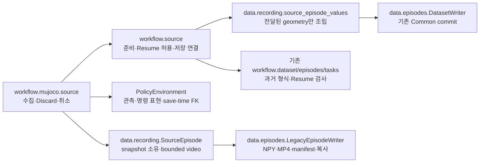
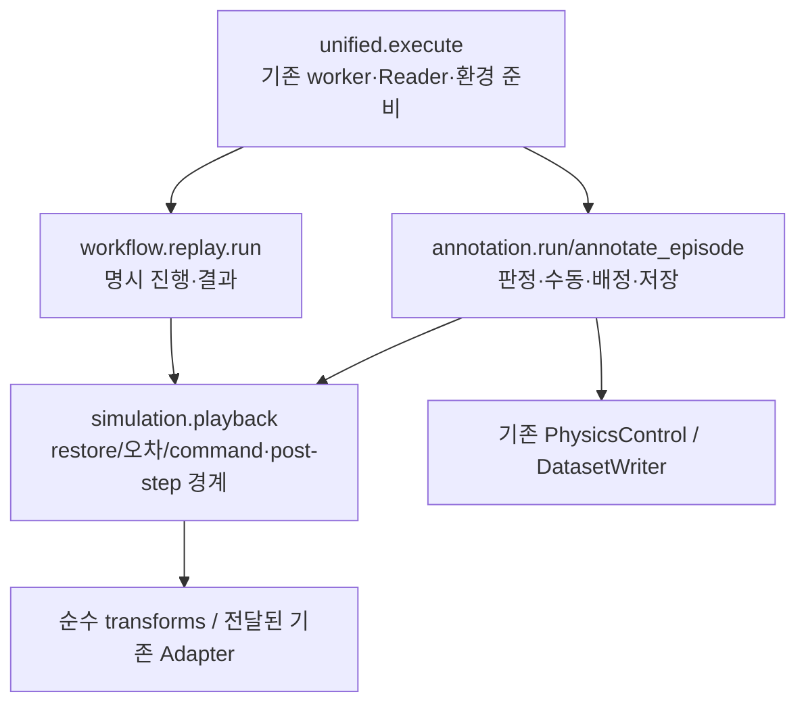
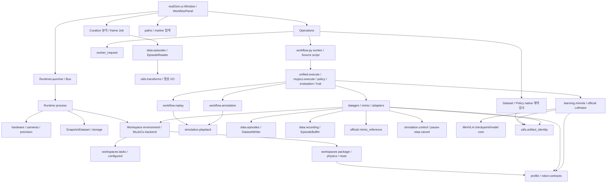

# 의존 관계와 상태 소유권

## 2026-10-21 — Curation 자유 선별·분할 완료

`workflow.curation.split_dataset/export_splits/export_subset`가 Episode 단위 선택·선택적 Train/Val 배정·재선별을 소유한다. 기존 `episodes.source_split/export_source_splits` 강제 Group 연결 성분 분할은 삭제했다. 과거 Partition/Lineage는 변경 없이 검증·보존하며 새 배정은 `curation_split.json`/`curation.role`로 분리한다. UI에 전체 제외·출력 폴더 선택·저장 취소를 연결했다. 지원 편집 형식은 기존 HDF5와 Legacy NPY/MP4이며 LeRobot 직접 편집·평가 묶음 전체 편집은 지원하지 않는다. 기존 Training/LeRobot Merge 정책은 후속이다. [검증/지원 범위](../../outputs/workflow_validation/functional_refactor/curation_independent/REPORT.md). 아래 이전 완료 기록은 당시 상태다.


## 2026-10-21 — Registry 제거 / 전체 Stage Path 실행

현재 모든 Workflow Stage의 공개 입력은 Path다. `workflow/artifacts.py`와 Registry 등록·조회·promote·ID CLI는 삭제했다. 기존 `artifacts/*.json`은 사용자 과거 자료로 그대로 남지만 실행에서 읽지 않는다. 아래 이전 단계 기록은 당시 상태이며 현재 경계는 이 절을 따른다.

- `workflow/paths.py`: native marker 탐색·저장 이름·출력 경계. 목록에서 payload/모델을 읽지 않는다.
- `worker_request.stage_input/episode_context`: Path에서 Dataset/Checkpoint/Workspace 계약을 읽고 기존 Stage 실행에 전달한다. `dataset.inspect_dataset`와 `policy.inspect_checkpoint`가 형식별 검사를 소유한다.
- `Operations`: Path 요청·출력 예약/Lock·process/Cancel·runs 로그·완료 결과 Path. UI의 선택/상세/READY는 기존 executor에서 처리한다.
- Curation은 원본 Path를 직접 열어 새 결과를 저장한다. 과거 Group/Partition 정책과 MiniVLA 학습/Val 정책은 이번에 바꾸지 않았다. 공식 ACT/SmolVLA Trainer/Resume도 유지한다.
- 필수 provenance/좌표가 없는 Checkpoint는 발견되더라도 평가 불가 오류를 낸다. Registry·다른 Checkpoint로부터 정보를 복원하거나 원본을 고치지 않는다.

상세 결과와 검증 한계: [Registry 제거 보고서](../../outputs/workflow_validation/functional_refactor/registry_removal/REPORT.md).


## 7b-1 — 두 Stage의 ID 의존 제거

Replay/Annotation UI/CLI → workflow.operations.episode_plan → worker_request.episode_context/EpisodeDataset → unified의 기존 실행/정리 → Replay/Annotation → Playback·기존 Adapter/Writer. ID 입력·Registry verify/register/promote는 이 실행 경로에서 제거했다. Context는 native Reader/Workspace/Scene/Task이며 가상 Artifact/Registry가 아니다.

Simulation/Playback/Recording/I/O/Policy의 기존 본문은 그대로다. Window의 Workspace 신호는 Path Stage에서 Registry를 재조회하거나 GUI에서 asset을 다시 읽지 않고 기존 선택/준비된 Workspace를 사용한다. 다른 Stage·Curation 창 자체의 Registry 의존은 남는다. [실제 경계와 후속](../../outputs/workflow_validation/functional_refactor/path_execution/CALLERS.md).

## 7a — 탐색 의존성과 실행 의존성 구분 (2026-10-21)

Resume UI → 기존 executor → workflow.paths.discover_inputs → stdlib scandir/stat. 선택 config → workflow.policy.checkpoint_metadata. CLI discover는 Operations/Registry import 이전에 분기하며 --details만 형식별 header를 읽는다. Paths는 Registry·Qt·h5py·모델/엔진을 import하지 않는다. 기존 I/O/Policy의 기존 정의는 동일하다.

제거한 의존은 Resume 목록의 Registry.all/get과 dialog 시작 위치의 Registry.latest/쓰기, Curation Picker.accept의 evaluation_inputs/HDF5 열기다. 일반 Stage 선택/실행·Curation.loaded/open_latest/저장·결과 등록의 Registry 의존은 남아 있다. 삭제: Registry.input_directory와 artifacts.browse_directory. 재노출/새 Catalog 없음. [책임과 남은 caller](../../outputs/workflow_validation/functional_refactor/path_discovery/REGISTRY_RESPONSIBILITIES.md).

[구조 지도](PROJECT_STRUCTURE.md)·[실제 흐름](SYSTEM_FLOW.md)·[수정 시작점](WHERE_TO_EDIT.md)을 연결하는 기술 문서다.
2026-10-19 첫 구현 묶음: 공통 제어·Guard·MiniVLA 추론 core·순수 Workspace Task를 이동했다. Registry/분할 정책/전용 학습은 아직 남아 있다. [구현 현황](FUNCTIONAL_REFACTOR_PLAN.md#10-실제-구현-현황--첫-검증-경계)을 함께 본다.

아래 화살표는 호출 또는 코드 의존이며 “왼쪽이 오른쪽을 사용한다”는 뜻이다. 실제 자원은 별도 process/file에서 만날 수 있다.

## 공통 Reader(6a)의 실제 경계

`curation.analyze/load_episode`와 CurationDialog의 frame 작업 → `data.episodes.EpisodeReader` → `utils.transforms` / 기존 영상 utils. 공통 Reader는 Stage·Registry·UI·Workspace·엔진을 import하지 않는다. `pose_matrix` 이동으로 Adapter/Annotation/Curation→robot_preview 3개 edge를 제거했다. 기존 Dataset의 legacy FK→RobotPreview와 Curation/Partition/Registry 결합은 아직 남아 있다.

리소스는 Reader가 소유하고 호출자가 수명을 정한다. 배치 분석은 context, UI는 기존 Qt Job 종료 신호 뒤 close. 타입/예외·전후 읽기/성능은 [6a 보고서](../../outputs/workflow_validation/functional_refactor/dataset_reader/REPORT.md)에 있다. 같은 AST resolver의 이번 단위 전후는 모듈128→131·edge423→428·최대SCC47→47이며, 감소한 edge 수 자체를 목표로 하지 않는다.

## Writer/Buffer(6b-1/2)의 실제 경계

- Stage/Isaac recorder → `data.episodes.DatasetWriter`; `SimulationAdapter.record_frame` → `data.recording.EpisodeBuffer` → 순수 transforms/기존 영상 I/O.
- 공통 I/O는 Stage·Registry·UI·env/adapter callback을 import/호출하지 않는다. Adapter→workflow.dataset·Annotation→workflow.dataset edge를 제거했다. Renderer/정책/성공 판정은 기존 소유자가 계속 담당한다.
- 이6b-1/2 당시 Source Legacy 결합은 남아 있었다. 후속6b-3은 아래와 같이 완료했다. Isaac native normalization·legacy Dataset reader/policy는 계속 Workflow에 남아 있다. 이전 Registry의 수정은 SCHEMA 소유자 import 교체 한 곳뿐이었다.
- 전체 AST graph는 모듈131→132, edge428→439·최대SCC47→48이다. 공통 I/O가 기존 수치/좌표 계약을 import하면서 `so101_joint_mapping`의 지연 Precision/Simulation 연결을 포함한 기존 정적 SCC에 들어갔다. 이를 순환 제거 성과로 주장하지 않는다. fresh process의 실제 공통 I/O import에는 Workflow/Qt/Torch/엔진이 없다. root 수치/보정 계약을 이 단위에서 재설계하지 않았다.

실제 edge·resource 계약·회귀와 미검증 범위: [6b 보고서](../../outputs/workflow_validation/functional_refactor/dataset_writer/REPORT.md), `dataset_writer/unit_dependencies.json`.

## Source Writer(6b-3)의 실제 경계



옛 `EpisodeWriter`와 `recorded_mujoco_episode` 본문/노출은 삭제했다. `recording_args`는 기존 수치/필드 그대로 공통 I/O가 소유하며 Evaluation도 새 위치를 직접 import한다. I/O에는 env/Adapter·FK·Stage callback/import가 없다. SourceEpisode는 반환 전 numeric leaf 복사, initial은 episode당1회 복사, RGB는 기존 encoder의1회 복사를 사용한다. pick pose는 이미 소유한 object matrix를 재사용한다.

동일 resolver 기준132→133모듈·439→445edge·최대SCC48→49다. 기존 Source Catalog/Scene/Reader의 정적 순환에 새 Source Stage가 들어간 결과이며 SCC 개선을 주장하지 않는다. `episodes→dataset/tasks/workspaces.tasks/data.episodes`와 `evaluation→dataset` edge는 제거했고 Source 정책 의존은 Source Stage로 옮겼다. `simulation.mujoco_backend→workspaces.tasks`는 Scene 정보 생성의 허용 방향이다. `data.episodes→real2sim.storage.atomic`은 기존 순수 파일 게시 기능을 재사용한다.

Source Resume의 Catalog/recorded_scene, Isaac native normalization, LegacyReader의 RobotPreview FK는 아직 남아 있다. Registry/Path·Curation 정책·학습은 변경하지 않았다. 실제 메서드/배열 동등성·실패 정리·그래프 근거는 [6b-3 보고서](../../outputs/workflow_validation/functional_refactor/source_writer/REPORT.md)와 source_writer/{audit,dependency_comparison}.json이다.

## Replay/Annotation Playback(6c-1)의 실제 경계



Replay→Annotation 함수 호출은 삭제했다. `unified→annotation` import는 Worker의 명시 dispatch에 필요하므로 남는다. 공통 Playback에는 Stage/Reader/Writer/UI/Mimic import가 없고, 성공·Grasp/Place·Mark/Skip는 Stage hook이 담당한다. `step_targets`의 engine 차이/활성 slot 적용은 원래 본문이며 forwarding Wrapper가 아니다. 벡터 전체 physics tick의 배치 시점은 기존 Annotation coordinator가 계속 결정한다.

`replay_cache_identity/cached_replay`는 production/CLI caller0개로 확인해 전용 cache 검사9개와 함께 삭제했다. 캐시 fallback·자동 Source Replay는 추가하지 않았다. 동명의 `scripts/mimic/annotate_demos.py:replay_episode`는 fixed-scene native EpisodeData CLI 계약으로, 이번 Common Workspace 재생과 구별해 보존했다.

AST는133→135모듈·445→449edge·최대SCC49→49다. module 단위로는 unified의 정상 dispatch가 남아 있기 때문에 함수 단위의 Replay→Annotation 제거를 edge 감소로 표현하지 않는다. 실제 caller·수치/스케줄러 AST·native trace/출력 근거는 [6c-1 보고서](../../outputs/workflow_validation/functional_refactor/playback/REPORT.md), playback/{audit,dependency_comparison}.json이다. Registry/Path·Dataset 형식 Reader/Adapter 전체 이전·Curation/Training은 후속이다.

## 주요 의존 방향



이는 주요 길이며 완벽한 단방향 계층을 주장하는 그림은 아니다. 실제 역참조는 아래에 명시한다.

- **입력 계약:** 루트 joint mapping/robot spec/dataset contract는 rad·명령 의미를 공통화한다.
- **외부 의존 seam:** Hardware/CameraReader는 SDK/장치, SimBackend·Mimic Adapter는 engine, Policy adapter는 모델 구현,
  Bus/Presentation은 file IPC, DatasetWriter는 HDF5+MP4 commit을 담당한다.
- **취소:** UI worker→Operations.cancel→process-group SIGINT. Runtime 명령 큐와 Workflow presentation 큐는
  수명/형식이 다른 별도 통신이다. 같은 “command JSON”이라는 이유로 하나로 합치지 않는다.
- **규칙:** UI가 engine을 직접 import하지 않는다. MuJoCo process는 Isaac/Omni/USD import를 거절한다.
  shared request/identity는 Qt/Torch/engine/Operations 없이 import할 수 있도록 검사한다.

## 실제 상태 소유자

| 상태/자원 | 소유자 | 전달되는 표현 / 수명 |
|---|---|---|
| 선택된 Scene·Stage별 Dataset/Model Path·모델 옵션 | Window/WorkflowPanel | ui.json, stage별 dict; 실행 때 options/request snapshot |
| Run process·취소·reservation·완료 상태 | Operations 인스턴스 | request/state/process.log, SIGINT/exit→native 검증→결과 Path; finally 상태 저장 |
| 입력 Path·내용 Hash | 실제 native 파일 / 실행 Worker | 필요 시 실행 시점에 검사; 전역 등록/목록 JSON 없음 |
| 장치/camera/engine·제어/측정 history | Runtime | 연결 세션과 Bus session; command Start/Stop/Disconnect |
| frozen snapshot·save/finish future | Runtime single writer + SnapshotDataset | 요청 시 image/state copy→원자 저장→reply; finish는 save 뒤 |
| calibration reference/active 승인 | Calibration/ProfileStore | raw/degree reference와 identity/hash, 승인된 pointer |
| MuJoCo model/data | parent backend / worker별 MjData | model 공유, data 독립·thread 수명; parent close는 worker 종료 뒤 |
| Isaac vector scene | native env / batch loop | 한 physics tick, 환경별 adapter/mailbox; 독립 reset/고정 대기 목표 |
| 시도 번호·성공 예약·실패·stop | GenerationScheduler | 상태 lock와 writer lock 분리; 저장 실패 시 예약 rollback |
| Source pool / seed / generator trace | worker / 시도별 Generator | pool read-only 1회, RNG/경계는 시도 소유 |
| Source numeric/initial·video staging | SourceEpisode / LegacyEpisodeWriter 또는 DatasetWriter | Source가 수명 제어, snapshot 복사·완성 영상 게시 뒤 manifest, 실패/Discard/취소에서 abort |
| 성공 episode·video private staging | EpisodeBuffer / DatasetWriter | private 영상 검사→이동/원자 group 확정; 원본/Resume은 복사 |
| dataset/statistics/model/optimizer | trainer | Train-only stats, 같은 bytes/조건 Resume, atomic checkpoint |

## 정적 import graph의 범위와 전후 결과

아래 과거 표는 이전 감사(7d02 기준)의 기록이다. 현재 작업의 기준/결과는 d60a7c2 → 첫 구현 묶음이며 package import409→423, 최대 SCC48→47이다. edge 증가를 개선 지표로 해석하지 않는다. MiniVLA 추론→Trainer/준비, Annotation→Mimic 제어, compiler→workflow Task의 실제 역참조를 제거한 것이 변경 내용이다. 현재 근거는 `outputs/workflow_validation/functional_refactor/{dependencies_before,dependencies_after,dependency_comparison}.json`이다.

AST는 `Import/ImportFrom`을 함수 내부까지 수집한다. before는 기준 commit 추적 파일, after는 변경/신규 Python도 포함한다.
전체 inventory/각 edge의 파일·line·scope와 SCC는 다음 파일에 있다.

- `outputs/workflow_validation/codebase_architecture/dependencies_before.json`
- `outputs/workflow_validation/codebase_architecture/dependencies_after.json`
- 같은 폴더의 `analyze.py`가 읽기 전용 재현 도구다(새 production 진입점 아님).

| 비교 | 변경 전 | 변경 후 | 의미 |
|---|---:|---:|---|
| 고유 package→package import pair | 382 | 388 | 공유 구현에 대한 정상 import가 늘어남; edge 총수 감소가 목적 아님 |
| 양방향 module pair | 14 | 11 | dataset/curation/episodes↔Registry의 직접 왕복 제거 |
| 큰 strongly connected group | 52 | 49 | 전체 cycle 제거 아님. 4개 기존 모듈이 빠지고 새 request 모듈1개가 포함됨 |
| Isaac action class/cfg group | 2 | 2 | 기존 cfg class_type 연결, 보존 |

규칙을 이동하며 직접 `mujoco→operations`와 Learning의 `→artifacts` bytes 의존을 제거했다.
`operations→mujoco` worker dispatch는 남는다. `artifacts.fingerprint`, `operations.mujoco_request/MUJOCO_STAGES`는
기존 호출자 호환을 위해 동일 객체를 다시 제공하며 전달 함수는 없다.

SCC는 함수가 실행될 수 있는 모든 조건부 edge를 합친 결과다. 모든 모듈이 동시에 import된다는 뜻이 아니다.
부모 package 초기화·외부 lib 내부·임의 문자열 import를 완전한 정적 그래프로 표현하지 못한다.
CLI/subprocess 연결도 Python import edge가 아니므로 [SYSTEM_FLOW](SYSTEM_FLOW.md)로 보완한다.

## 남아 있는 중요한 왕복과 근거

```text
simulation.mjcf → workspaces.tasks.configured → workspaces.physics/package
workspaces.environment/mimic → workspaces.tasks
workspaces.reset/demo → workflow.tasks (recorded_scene/from_artifact는 후속 이동 대상)
workflow.annotation → simulation.control (기존 mimic 제어 의존 삭제)
learning.minivla.policy → checkpoint/head/config (train/data 의존 삭제)
workflow.evaluation → workflow.policy.ActionGuard (MiniVLA Guard 의존 삭제)
learning.minivla.data → workflow.episodes.split_episodes → learning.minivla.data (준비/통계 경로)
so101_joint_mapping → real2sim.precision (기록된 mapping 복원) → so101_joint_mapping
real2sim.ui → workflow.view.CameraView   (Qt-only 공유 widget, 역방향 state 사용 없음)
```

- Workspace Task의 순수 구성7개는 실제로 이동했다. recorded_scene·파일 stamping·Stage/평가 규칙은 아직 workflow.tasks에 있으며 후속 단위로 교체한다.
- `split_episodes`의 Source Partition 역할 강제는 현재 남아 있지만 승인된 후속 제거 대상이다. 역사적 기록과 사용자가 지정한 현재 역할을 분리하며 실제 데이터 형식/좌표 검사는 보존한다.
- Precision mapper 복원은 raw/모델/SDK 의미와 과거 metadata 호환을 포함한다. 단순 import 방향을 위해 수학을 옮기지 않았다.
- `CameraView`는 별도 공통 UI package로 이동할 근거가 작다. 기존 위젯 재사용과 UX를 보존한다.

## 구조 회귀 방지

`tests/real2sim/test_architecture_contracts.py`는 기존 경로와 새 경로가 같은 함수 객체인지,
request/identity를 fresh process에서 import해 Qt/Torch/engine/Operations가 로드되지 않는지,
worker가 다시 Operations를 import하거나 hash-only caller가 Registry로 되돌아가지 않는지 검사한다.
추가로 fresh process에서 공통 Control/Policy/Workspace Task가 엔진·MiniVLA·Mimic을 끌어오지 않고, MiniVLA 추론이 Trainer/Dataset 준비/Workflow를 import하지 않는지 검사한다. 이전 request/identity의 재노출은 이 묶음에서 새로 만든 것이 아니며 Path/호출자 전환 시 삭제 대상이다.

전역적인 “모든 cycle 금지”는 현재 정당한 cfg/호환 edge까지 금지하므로 도입하지 않았다.
실제 계약은 payload/error/bytes/영상 tamper 검사 및 기존 영역 회귀로 검증한다.

## 6c-2a 진행 상태 — 2026-10-20

기록 Scene의 Isaac 생성만 `simulation/environment.py:create_isaac`로 이동하고 unified._native_isaac를 삭제했다. Worker가 identity 검사에 사용한 Workspace를 재사용한다. 105개 계약 회귀 통과, 설정/reset/close 본문은 입력 치환 외 AST 동일. 실제 Isaac baseline부터 GPU OOM으로 실패하여 native A/B 및 성능은 미검증이다. MuJoCo 생성, Source/평가의 별도 Isaac 경로, make_config의 기존 Presentation 간접 참조는 남아 있다. **6c-2 전체 완료 아님.** 근거: `outputs/workflow_validation/functional_refactor/environment/REPORT.md`.

## 6c-2b 실제 소유권 — 2026-10-21

`real2sim.workspaces.environment.make_config(..., overview_camera=False, grasp_observations=False)`는 전달된 요구만 사용한다. Workspace/Simulation의 Presentation.current/INSPECTION_STAGES 참조는 삭제했다. `workflow.unified.execute`는 연결된 DataGen의 Overview, `workflow.evaluation.evaluate_sim`은 연결된 평가의 Overview/Grasp 관측을 결정한다. 독립 Script/Source/Runtime은 false/false다. 정책 카메라 목록은 기존 Task가 소유한다. framing은 `simulation.workspace_scene.framing` 한 곳에 있고 이전 `workflow.presentation.framing`은 없다. MuJoCo는 같은 순수 구도 함수를 쓴다.

삭제 edge: workspaces.environment→workflow.presentation/stages, simulation.workspace_scene→workflow.presentation. 새 edge: workspaces.environment→simulation.workspace_scene. 다른 Stage/I/O 역참조나 전체 SCC 해소를 뜻하지 않는다. 실제8종 설정/32회 UI독립 구성·Isaac2환경 Annotation/평가·MuJoCo 모델/물리/RGB 비교 근거는 `outputs/workflow_validation/functional_refactor/presentation_config/REPORT.md`다. 이전6c-2a의 간접 UI 결합 문구는 당시 상태다. 전체6c-2는 미완료다.

## 6c-2c 실제 소유권 — 2026-10-21

- Request/파일/Source Resume/보정/Physics Profile 선택: `workflow.worker_request.prepare_mujoco(request, coordinates=..., hz=..., workspace=...) → kwargs`. 이미 검증한 원본 Workspace를 재사용하며 compiler에 구성 copy 대신 원본을 전달한다. Task/Active Objects/Simulation.reset은 명시 kwargs다.
- 실제 생성: `simulation.environment.create_mujoco(**kwargs) → 기존 PolicyEnvironment`. Stage/Dataset/Registry/Resume를 해석하지 않는다. Worker가 정상 close, PolicyEnvironment가 Backend 획득 후 초기화 실패 close를 소유한다.
- 기존 `workflow.mujoco._environment`와 output 인수·export는 없다. Unified/DataGen/Evaluation의 생성용 mujoco import를 삭제했다. Source/옛 rollout/환경검사 caller도 새 경계를 직접 사용한다.
- 계속 쓰는 Legacy/Common provenance 읽기는 `workflow.dataset.recording_provenance`로 이동했다. 새 형식·새 Writer·Wrapper는 없다. DataGen의 제공 Parent는 소유권을 이전받아 닫고 Parent가 없으면 직접 생성한다. 공유 MjModel/독립 MjData·ThreadPool·RNG·수치 알고리즘은 그대로다.
- `workspaces.reset.source_workspace → workflow.tasks/artifacts` 및 Legacy reader 위치는 남은 결합이다. Registry/Path/Training/Isaac 생성 통합을 완료했다는 뜻이 아니다.

실제 전후 결과·load/compile/close·DataGen 첫 환경 배정 차이와 검증용 배정 고정의 한계는 `outputs/workflow_validation/functional_refactor/mujoco_environment/REPORT.md`를 따른다. 숫자/MP4 일치에서 실측 timing·새 Source UUID·private 경로는 구분했다. 기존 6c-2a/b의 MuJoCo factory 미완료 문구는 당시 상태다.


## 2026-10-21 — 6c-2d 완료 / 6c-2 환경 생성 경계 완료

Isaac 설정/생성 호출35곳과 Gym 경로를 점검했다. Recorded Scene의 create_isaac, Source/Teleop, Sim 평가, Live Runtime, 독립 검사/고정 Scene CLI는 센서·Reset·수명이 달라 별도 진입을 유지한다. 공통 cfg는 기존 make_config이며 새 Factory/Manager/Wrapper를 추가하지 않았다. Source/평가/Runtime/물리 CLI는 이미 준비한 Workspace dict를 재사용한다. Runtime.build_environment(p, *, workspace=None)는 connect의 검증 snapshot을 빌리며 standalone 호출은 필요 시 현재 파일을1회 읽는다. Runtime profile 적용에는 파생 Task copy가 아닌 원본 Workspace를 사용한다. Source는 장치 연결 뒤 실제 mapping Hash 검사를 유지했다.

실제 Isaac A/B: 평가2환경×6step의 설정·3trace/72numeric·24frame/PTS·Preview3파일, Runtime/Source 생성 경계6step과 물리CLI120step의 설정·초기/명령/관절·물체속도 trace가 같다. Source는 가상 Leader이며 Recorder 전 경계만 검증했다. load는 평가생성1→0(상위1회 별도), Runtime connect3→1/standalone build2→1, Source2→1, 물리CLI3→1이다. 평가 baseline 반복과 전후 RGB 차이는 따로 기록했으며 pixel/통계적 동등성·보편적 속도향상은 주장하지 않는다. GUI/Runtime137PASS·인접57PASS·입력6PASS, core 완료 로그는 보고서 참조(중복합산 금지). 설정32회 UI독립 비교도 통과했다.

환경 생성·실제 reset event·Camera/framing에는 Workflow/UI/Registry import가 없다. 기존 workspaces.reset.source_workspace/demo.verify_dataset의 상위 입력 정책 역참조와 Task 생략 시 요청 파일 fallback은 남으며 전체 Workspace/Registry 정리 완료가 아니다. 사용자자료/설정·UI·의존성·Commit/Push 변경 없음. 실제 Source 전체 수집·실물·장시간·새 Annotation/DataGen actual·4/8환경 actual은 이번에 재검증하지 않았다. **6c-2a/b/c/d 경계는 완료, 전체 기능 단위 리팩터링은 미완료**다. 상세 호출자/검증/한계는 [6c-2d 보고서](../../outputs/workflow_validation/functional_refactor/isaac_boundaries/REPORT.md)와 해당 CALLERS.md를 따른다.
