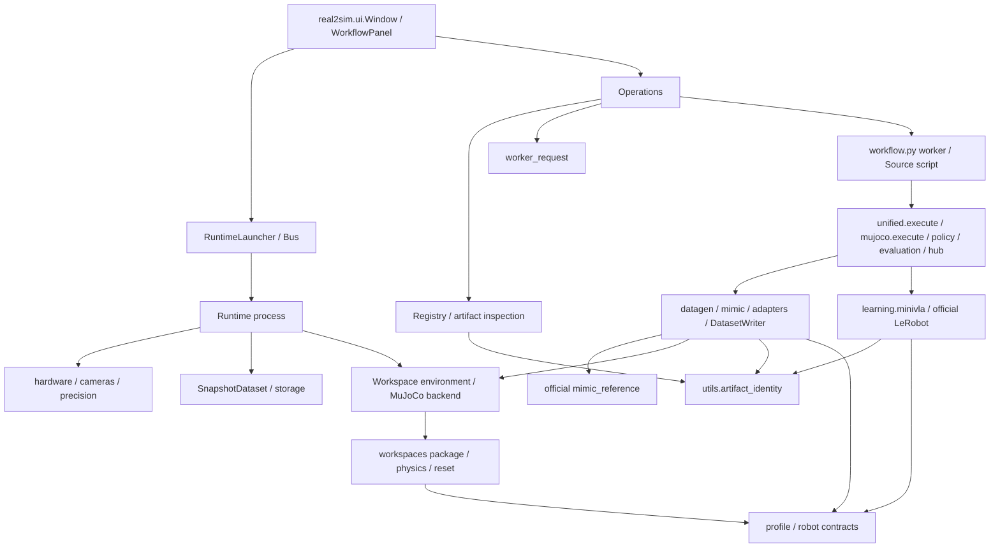

# 의존 관계와 상태 소유권

[구조 지도](PROJECT_STRUCTURE.md)·[실제 흐름](SYSTEM_FLOW.md)·[수정 시작점](WHERE_TO_EDIT.md)을 연결하는 기술 문서다.
아래 화살표는 호출 또는 코드 의존이며 “왼쪽이 오른쪽을 사용한다”는 뜻이다. 실제 자원은 별도 process/file에서 만날 수 있다.

## 주요 의존 방향



이는 주요 길이며 완벽한 단방향 계층을 주장하는 그림은 아니다. 실제 역참조는 아래에 명시한다.

- **입력 계약:** 루트 joint mapping/robot spec/dataset contract는 rad·명령 의미를 공통화한다.
- **외부 의존 seam:** Hardware/CameraReader는 SDK/장치, SimBackend·Mimic Adapter는 engine, Policy adapter는 모델 구현,
  Bus/Presentation은 file IPC, DatasetWriter는 HDF5+MP4 commit을 담당한다.
- **취소:** UI worker→Operations.cancel→process-group SIGINT. Runtime 명령 큐와 Workflow presentation 큐는
  수명/형식이 다른 별도 통신이다. 같은 “command JSON”이라는 이유로 하나로 합치지 않는다.
- **규칙:** UI가 engine을 직접 import하지 않는다. MuJoCo process는 Isaac/Omni/USD import를 거절한다.
  shared request/identity는 Qt/Torch/engine/Operations 없이 import할 수 있도록 검사한다.

## 실제 상태 소유자

| 상태/자원 | 소유자 | 전달되는 표현 / 수명 |
|---|---|---|
| 선택된 Scene·Stage별 폴더/Artifact·모델 옵션 | Window/WorkflowPanel | ui.json, stage별 dict; 실행 때 options/request snapshot |
| Run process·취소·reservation·등록 상태 | Operations 인스턴스 | request/state/process.log, SIGINT/exit→검증→Registry; finally 상태 저장 |
| Registry ID/부모/내용 SHA·path | Registry/실제 결과 파일 | JSON record; copy/분할의 Source 증거와 저장 묶음은 다른 의미 |
| 장치/camera/engine·제어/측정 history | Runtime | 연결 세션과 Bus session; command Start/Stop/Disconnect |
| frozen snapshot·save/finish future | Runtime single writer + SnapshotDataset | 요청 시 image/state copy→원자 저장→reply; finish는 save 뒤 |
| calibration reference/active 승인 | Calibration/ProfileStore | raw/degree reference와 identity/hash, 승인된 pointer |
| MuJoCo model/data | parent backend / worker별 MjData | model 공유, data 독립·thread 수명; parent close는 worker 종료 뒤 |
| Isaac vector scene | native env / batch loop | 한 physics tick, 환경별 adapter/mailbox; 독립 reset/고정 대기 목표 |
| 시도 번호·성공 예약·실패·stop | GenerationScheduler | 상태 lock와 writer lock 분리; 저장 실패 시 예약 rollback |
| Source pool / seed / generator trace | worker / 시도별 Generator | pool read-only 1회, RNG/경계는 시도 소유 |
| 성공 episode·video private staging | EpisodeBuffer / DatasetWriter | private 영상 검사→이동/원자 group 확정; 원본/Resume은 복사 |
| dataset/statistics/model/optimizer | trainer | Train-only stats, 같은 bytes/조건 Resume, atomic checkpoint |

## 정적 import graph의 범위와 전후 결과

AST는 `Import/ImportFrom`을 함수 내부까지 수집한다. before는 기준 commit 추적 파일, after는 변경/신규 Python도 포함한다.
전체 inventory/각 edge의 파일·line·scope와 SCC는 다음 파일에 있다.

- `outputs/workflow_validation/codebase_architecture/dependencies_before.json`
- `outputs/workflow_validation/codebase_architecture/dependencies_after.json`
- 같은 폴더의 `analyze.py`가 읽기 전용 재현 도구다(새 production 진입점 아님).

| 비교 | 변경 전 | 변경 후 | 의미 |
|---|---:|---:|---|
| 고유 package→package import pair | 382 | 388 | 공유 구현에 대한 정상 import가 늘어남; edge 총수 감소가 목적 아님 |
| 양방향 module pair | 14 | 11 | dataset/curation/episodes↔Registry의 직접 왕복 제거 |
| 큰 strongly connected group | 52 | 49 | 전체 cycle 제거 아님. 4개 기존 모듈이 빠지고 새 request 모듈1개가 포함됨 |
| Isaac action class/cfg group | 2 | 2 | 기존 cfg class_type 연결, 보존 |

규칙을 이동하며 직접 `mujoco→operations`와 Learning의 `→artifacts` bytes 의존을 제거했다.
`operations→mujoco` worker dispatch는 남는다. `artifacts.fingerprint`, `operations.mujoco_request/MUJOCO_STAGES`는
기존 호출자 호환을 위해 동일 객체를 다시 제공하며 전달 함수는 없다.

SCC는 함수가 실행될 수 있는 모든 조건부 edge를 합친 결과다. 모든 모듈이 동시에 import된다는 뜻이 아니다.
부모 package 초기화·외부 lib 내부·임의 문자열 import를 완전한 정적 그래프로 표현하지 못한다.
CLI/subprocess 연결도 Python import edge가 아니므로 [SYSTEM_FLOW](SYSTEM_FLOW.md)로 보완한다.

## 남아 있는 중요한 왕복과 근거

```text
simulation.mjcf → workflow.tasks.configured → workspaces.physics/package
workspaces.reset/demo/environment → workflow.tasks → workspaces.package/physics
learning.minivla.data → workflow.episodes.split_episodes → learning.minivla.data (준비/통계 경로)
so101_joint_mapping → real2sim.precision (기록된 mapping 복원) → so101_joint_mapping
real2sim.ui → workflow.view.CameraView   (Qt-only 공유 widget, 역방향 state 사용 없음)
```

- Workspace task 구성은 active object/reset·hash·기록된 Scene 상속을 포함한다. 전체 소유권 이동은
  두 engine의 recorded replay/실제 실행 검증을 더 확보한 뒤 검토한다.
- `split_episodes`는 Source Partition 누수/UNKNOWN 규칙이다. 일반 ML dataset split로 대체하지 않는다.
- Precision mapper 복원은 raw/모델/SDK 의미와 과거 metadata 호환을 포함한다. 단순 import 방향을 위해 수학을 옮기지 않았다.
- `CameraView`는 별도 공통 UI package로 이동할 근거가 작다. 기존 위젯 재사용과 UX를 보존한다.

## 구조 회귀 방지

`tests/real2sim/test_architecture_contracts.py`는 기존 경로와 새 경로가 같은 함수 객체인지,
request/identity를 fresh process에서 import해 Qt/Torch/engine/Operations가 로드되지 않는지,
worker가 다시 Operations를 import하거나 hash-only caller가 Registry로 되돌아가지 않는지 검사한다.
전역적인 “모든 cycle 금지”는 현재 정당한 cfg/호환 edge까지 금지하므로 도입하지 않았다.
실제 계약은 payload/error/bytes/영상 tamper 검사 및 기존 영역 회귀로 검증한다.
