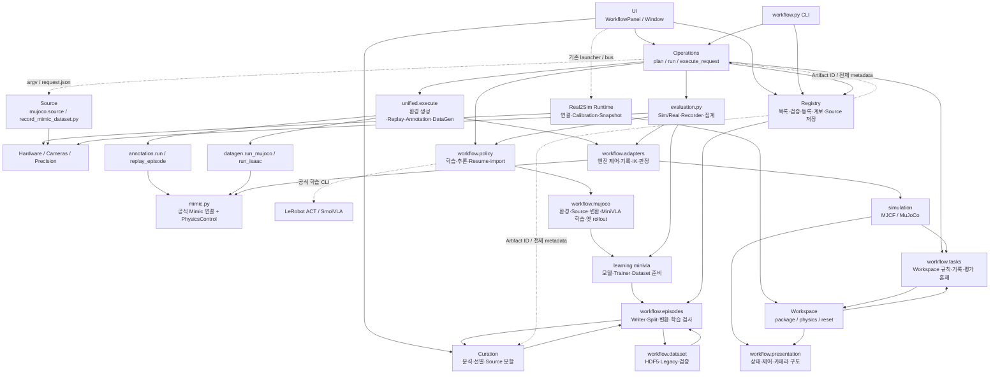
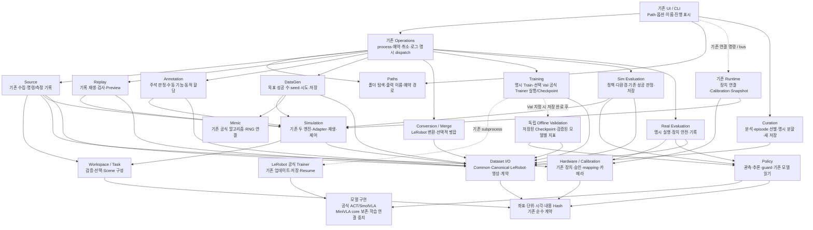
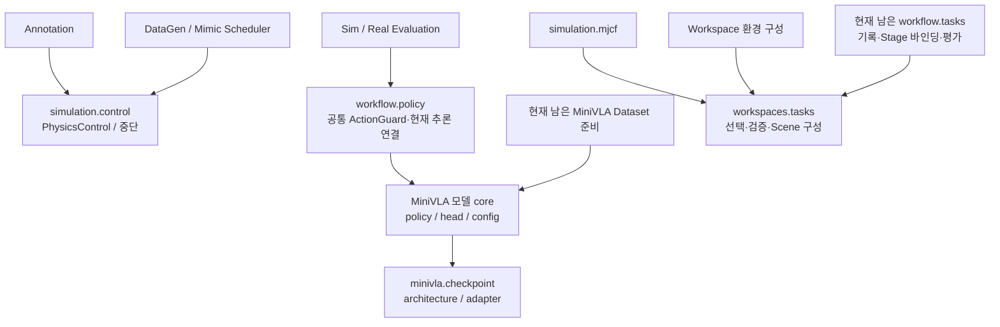
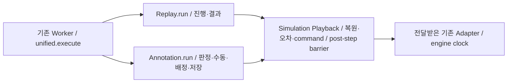

# SO-101 기능 단위 아키텍처 재설계안

## 2026-10-21 — Curation 자유 선별·분할 완료

`workflow.curation.split_dataset/export_splits/export_subset`가 Episode 단위 선택·선택적 Train/Val 배정·재선별을 소유한다. 기존 `episodes.source_split/export_source_splits` 강제 Group 연결 성분 분할은 삭제했다. 과거 Partition/Lineage는 변경 없이 검증·보존하며 새 배정은 `curation_split.json`/`curation.role`로 분리한다. UI에 전체 제외·출력 폴더 선택·저장 취소를 연결했다. 지원 편집 형식은 기존 HDF5와 Legacy NPY/MP4이며 LeRobot 직접 편집·평가 묶음 전체 편집은 지원하지 않는다. 기존 Training/LeRobot Merge 정책은 후속이다. [검증/지원 범위](../../outputs/workflow_validation/functional_refactor/curation_independent/REPORT.md). 아래 이전 완료 기록은 당시 상태다.


## 2026-10-21 — Registry 제거 / 전체 Stage Path 실행

현재 모든 Workflow Stage의 공개 입력은 Path다. `workflow/artifacts.py`와 Registry 등록·조회·promote·ID CLI는 삭제했다. 기존 `artifacts/*.json`은 사용자 과거 자료로 그대로 남지만 실행에서 읽지 않는다. 아래 이전 단계 기록은 당시 상태이며 현재 경계는 이 절을 따른다.

- `workflow/paths.py`: native marker 탐색·저장 이름·출력 경계. 목록에서 payload/모델을 읽지 않는다.
- `worker_request.stage_input/episode_context`: Path에서 Dataset/Checkpoint/Workspace 계약을 읽고 기존 Stage 실행에 전달한다. `dataset.inspect_dataset`와 `policy.inspect_checkpoint`가 형식별 검사를 소유한다.
- `Operations`: Path 요청·출력 예약/Lock·process/Cancel·runs 로그·완료 결과 Path. UI의 선택/상세/READY는 기존 executor에서 처리한다.
- Curation은 원본 Path를 직접 열어 새 결과를 저장한다. 과거 Group/Partition 정책과 MiniVLA 학습/Val 정책은 이번에 바꾸지 않았다. 공식 ACT/SmolVLA Trainer/Resume도 유지한다.
- 필수 provenance/좌표가 없는 Checkpoint는 발견되더라도 평가 불가 오류를 낸다. Registry·다른 Checkpoint로부터 정보를 복원하거나 원본을 고치지 않는다.

상세 결과와 검증 한계: [Registry 제거 보고서](../../outputs/workflow_validation/functional_refactor/registry_removal/REPORT.md).


작성: 2026-10-19. **사용자 승인 후 작은 단위로 구현 중이다. 목표 구조와 실제 완료 범위를 구분한다.**

수정 지침: 공식 ACT/SmolVLA Trainer 유지, 독립 Offline Validation 우선, 과거 Metadata의 역할 강제 제거, 작은 단위별 교체·검증. **현재는 1~5단위·6a(Curation 공통 Reader)·6b-1/2(Common Writer와 명시적 Buffer)·6b-3(Source EpisodeWriter 책임 분리)·6c-1(공통 Playback/독립 Replay)을 완료했다. Isaac native normalization·나머지 Dataset I/O/환경·Registry·과거 Group 정책·MiniVLA 학습 연결은 아직 남아 있다.** 완료 근거와 남은 작업은 마지막 구현 현황 및 `outputs/workflow_validation/functional_refactor/REPORT.md`에 기록한다.

### 추가 구현 품질 기준 — 다음 검증 단위부터 적용

파일 이동 자체를 완료 근거로 삼지 않는다. 각 단위에서 실제 공개 진입점·입력/반환 타입·예외·Reader/Writer/엔진/장치/worker의 생성·소유·종료 시점을 먼저 명시한다. 단순 함수면 충분한 책임에 새로운 클래스·Manager·Wrapper를 만들지 않는다. Stage는 Dataset Path와 필요한 설정을 받고, 다른 Stage 내부를 호출하지 않는 방향으로 교체한다.

기존 Qt 작업 큐/Thread·process, h5py, LeRobot/PyTorch, 두 엔진 및 영상 라이브러리를 우선 사용한다. 새 기술·알고리즘은 기존 구현의 실제 한계와 필요성이 확인될 때만 검토한다. 공식 모델의 네트워크·전처리·Loss와 Trainer는 모델/LeRobot이 계속 소유한다.

목록은 폴더와 작은 metadata로 탐색하고, HDF5·영상·모델·전체 Hash는 필요한 시점의 background 작업에서 읽는다. Lazy Loading은 무제한 캐시나 살아 있는 리소스를 방치하는 근거가 아니다. 같은 파일의 반복 open/read, Dataset 전체 복사와 반복 초기화를 먼저 측정하고 줄인다. 병렬화는 실제 병목과 엔진 제약을 근거로 결정한다.

각 단위 보고에는 (1) 바뀐 공개 API와 리소스 수명, (2) 제거한 의존성과 옛 본문, (3) 실제 회귀/수치·데이터 비교, (4) 측정한 읽기 횟수·byte·지연과 환경/한계, (5) 교체 시 영향을 받는 호출자와 미완료 경계를 남긴다. Atomic Save·Resume·Cancel·Lock과 부분 결과 비노출, 물리/좌표/관절/영상 계약은 보존한다. 사용자 데이터와 실제 장치를 사용하는 검증은 자동 실행하지 않는다.

## 1. 기준과 제안의 범위

- GitHub `HYEONHEE5739/so101-isaaclab`의 `main`과 로컬 HEAD가 모두 `d60a7c23679efc24d485d36024823920df758cd7`임을 `git ls-remote`로 확인했다.
- 추적 중인 Python 198개, 패키지 모듈125개의 AST import·함수·호출 위치를 조사했다. 로컬 패키지를 향하는 고유 import edge는834개이며 tests/scripts 호출자를 포함한 값이다. 패키지 사이 edge는409개다. 조건부·함수 내부 import도 포함한다.
- 아래 Current Graph는 최초 기준 commit에서 확인한 기능 간 경로다. 모든 함수의 동적 실행을 관측했다는 뜻은 아니다. 전체 정적 목록은 `outputs/workflow_validation/architecture_design/import_call_inventory.json`에 있다.
- 최초 작업은 설계 조사였다. 현재는 승인된 코드 교체를 작은 단위로 진행한다. 사용자 데이터·모델·설정·Workspace를 변경하지 않고 실제 장치를 시작하지 않는다. 의존성 변경·Commit/Push는 하지 않는다.
- sibling `real2sim-builder`는 이번 저장소 리팩터링 대상이 아니다. Builder export를 소비하는 계약과 published Workspace를 보호한다.

**핵심 제안:** Stage는 Path를 입력받아 자기 작업을 수행한다. UI는 경로·설정·이름을 수집하고 결과를 표시한다. Operations는 process·취소·출력 예약·로그를 담당한다. Dataset I/O·Workspace·Simulation·Hardware·Policy는 Stage의 내부를 import하지 않는다. Registry를 새 관리 시스템으로 대체하지 않는다.

## 2. Current Graph — 최초 기준 구조 (d60a7c2)

실선은 확인한 import/호출, 점선은 subprocess 실행 또는 Artifact dict/파일을 통한 결합이다. 노드별 세부 함수와 계약은 이어지는 표에 적었다.



### 2.1 현재 노드의 책임·계약·의존

경로의 `패키지/`는 `source/soarm101_lab/soarm101_lab/`다.

| 현재 노드 | 실제 소유 파일·핵심 함수 | 입력 → 출력 | 현재 의존 관계와 문제 |
|---|---|---|---|
| UI | `real2sim/ui.py:Window`; `workflow/ui.py:WorkflowPanel.refresh/select_data/_start_ready_check/execute` | 폴더·Artifact ID·Widget 값 → Artifact dict·options·명령 | Registry/Operations/Task/Policy/Curation을 직접 앎. 위젯 구성은 유지할 대상 |
| 실행 | `workflow/operations.py:Operations.plan/run/readiness/execute_request`, `mujoco_plan/unified_plan` | Artifact dict·Workspace·options → argv·Run·등록 Artifact | Process 제어 외에 모델별 데이터 준비·Partition 검사·결과 종류 판정·등록도 소유 |
| Source | `workflow/mujoco.py:source`; `scripts/teleoperation/record_mimic_dataset.py`; native recorders | Workspace·Leader·기록 설정 → Common HDF5/MP4 | 두 엔진 진입점은 다르며 수집 시점·명령/측정의 순서 보존 필요 |
| Replay | `workflow/unified.py:replay/cached_replay` → `annotation.replay_episode` | 기록된 초기 상태·joint_targets → 재생 검사·Preview | Replay가 Annotation 구현 내부를 호출함 |
| Annotation | `workflow/annotation.py:run/replay_episode` | Source → 통과한 주석 Dataset·보고서 | replay state machine과 동적 슬롯 조정이 함께 있음. pause 제어를 Mimic에서 import |
| DataGen | `workflow/datagen.py:run_mujoco/run_isaac`; `mimic.py` | Annotated Dataset·seed·IK → 성공 Dataset·attempts | 공식 생성 알고리즘과 실제 엔진 Adapter는 필요한 경계. 공통 제어의 Mimic 소유는 부적절 |
| Curation | `workflow/curation.py:EpisodeReader/analyze/export_subset`; `curation_ui.py` | Dataset → 분석·선별·분할본 | Dataset Reader가 Curation 안에 있고, Source 저장·계보·Group 기준 분할을 Registry/episodes에 의존 |
| Conversion/병합 | `episodes.py:convert_dataset/convert_hdf5`; `lerobot_merge.py:validate_inputs/merged_provenance/merge`; 변환 script | HDF5/Canonical 또는 LeRobot 목록 → LeRobot | 변환은 MiniVLA 준비와 같은 파일. 병합은 ID·Source Partition·완전한 계보를 필수 검사하고 입력 provenance 전체를 중첩 복사 |
| Training | `policy.py:train` → ACT/SmolVLA 공식 CLI 또는 `mujoco.train_from_lerobot` → MiniVLA Trainer | LeRobot/Canonical → 학습 결과 | MiniVLA만 별도 manifest·통계·Train/Val 강제 검사. 학습을 바꾸면 MuJoCo 파일도 수정해야 함 |
| Sim Evaluation | `evaluation.py:evaluate_sim`; MuJoCo는 `mujoco.execute('rollout')`에서 진입 | Policy·Workspace → 평가 보고서·성공/실패 HDF5/MP4 | 공통 ActionGuard까지 `learning.minivla.policy`에서 import. 옛 독립 rollout 함수도 남아 있음 |
| Real Evaluation | `evaluation.py:evaluate/real_start_pose` | Policy·Workspace·장치 설정 → 실제 제어·결과 기록 | Sim과 같은 큰 함수에서 분기. 장치 안전 제어는 유지해야 함 |
| 공통 I/O | `workflow/dataset.py:EpisodeDataset/DatasetWriter/validate_dataset`; `episodes.py:EpisodeWriter` | 배열·시간·영상·메타데이터 ↔ 파일 | Reader·Writer·Curation·학습 준비가 서로 참조 |
| Workspace/Simulation | `workspaces/package.py:load`, `environment.py:make_config`, `simulation/mjcf.py:build_scene` | 검증된 모델/Scene 설정 → 엔진 | 하위 엔진이 `workflow.tasks`, `workflow.presentation`, Stage 목록을 역참조 |
| Policy | `workflow/policy.py:load_policy/batch_actions/MiniVLAJointPolicy`; MiniVLA core | RGB·명령문·측정 state → 모델rad target | 추론이 학습 실행과 같은 모듈. MiniVLA 추론이 `train.restore_adapter/require_architecture`에 의존 |

### 2.2 실제로 확인한 결합·중복

| 근거 위치 | 현재 사실 | 목표에서의 처리 |
|---|---|---|
| [artifacts.py:323](../../source/soarm101_lab/soarm101_lab/workflow/artifacts.py:323) | `register`가 전체 inspection 결과와 `execution`을 별도 UUID JSON에 저장. `verify`는 Hash 후 다시 inspection | Registry 삭제. 결과 본체의 계약은 I/O에서 검사하고 Run에는 Path/options만 기록 |
| [operations.py:109](../../source/soarm101_lab/soarm101_lab/workflow/operations.py:109) | dry readiness의 inspection, 실행의 verify/inspection, planner의 load, worker의 재검증이 겹침 | GUI는 가벼운 준비 확인, worker는 full 입력 검사·Workspace load를 한 번 수행. 환경 구성에 같은 검증 결과 전달 |
| [ui.py:519](../../source/soarm101_lab/soarm101_lab/workflow/ui.py:519) | 폴더 선택 중 `discover_collection`이 미등록 자료를 inspection·등록할 수 있고, Val 선택은 동기 검사 | 경로 선택은 등록하지 않음. 깊은 검사는 worker에서 수행 |
| [mujoco.py:322](../../source/soarm101_lab/soarm101_lab/workflow/mujoco.py:322) | `_lerobot_index`가 모델rad를 MiniVLA fraction 체계로 준비하고 Group/Partition을 요구 | 학습 Workflow에서 삭제. 필요한 기존 checkpoint 전처리만 모델 core에 보존 |
| [mujoco.py:383](../../source/soarm101_lab/soarm101_lab/workflow/mujoco.py:383) | `train_from_lerobot`가 `split_episodes`, 별도 `output/dataset`, 통계·provenance를 생성 | 삭제. 사용자가 고른 Train/Val Path가 공통 Training의 입력 |
| [episodes.py:311](../../source/soarm101_lab/soarm101_lab/workflow/episodes.py:311) | Curation 분할이 Source 그룹 연결 성분을 묶고 기존 Partition은 재분할 불가 | 사용자가 명시한 episode 선택/할당으로 새 결과를 만드는 Curation 기능으로 교체 |
| [episodes.py:566](../../source/soarm101_lab/soarm101_lab/workflow/episodes.py:566) | 모델 입력 계약과 Source Group/Partition·Train/Val 역할 증명이 한 함수에 결합 | 관절·단위·Camera·FPS 검사만 공통 Training 입력 검사로 이동. Group 증명·자동 Split 삭제 |
| [mimic.py:92](../../source/soarm101_lab/soarm101_lab/workflow/mimic.py:92), [annotation.py:16](../../source/soarm101_lab/soarm101_lab/workflow/annotation.py:16) | Annotation이 Mimic의 PhysicsControl/GenerationStopped에 의존 | 순수 공통 실행 제어를 `simulation/control.py`로 이동 |
| [unified.py:37](../../source/soarm101_lab/soarm101_lab/workflow/unified.py:37) | Replay가 Annotation의 replay_episode와 run을 호출 | 중립 재생 본문과 두 기능의 판정/진행을 분리 |
| [evaluation.py:227](../../source/soarm101_lab/soarm101_lab/workflow/evaluation.py:227) | ACT/SmolVLA 평가도 MiniVLA 모듈의 ActionGuard를 import | ActionGuard를 공통 Policy 실행 위치로 이동. 수학·limit·rate 동작 그대로 |
| [workspaces/environment.py:128](../../source/soarm101_lab/soarm101_lab/real2sim/workspaces/environment.py:128), [mjcf.py:207](../../source/soarm101_lab/soarm101_lab/simulation/mjcf.py:207) | Workspace/Simulation이 Workflow Task 규칙을 참조 | Task의 순수 Scene 구성 규칙을 Workspace로 이동 |
| [workspaces/environment.py:220](../../source/soarm101_lab/soarm101_lab/real2sim/workspaces/environment.py:220), [workspace_scene.py:120](../../source/soarm101_lab/soarm101_lab/simulation/workspace_scene.py:120) | 환경 생성이 현재 Presentation/Stage를 보고 Overview 구도를 결정 | 구도 계산은 공통 Simulation에, Preview 필요 여부는 Stage가 인자로 전달 |
| [lerobot_merge.py:192](../../source/soarm101_lab/soarm101_lab/workflow/lerobot_merge.py:192) | `merge_inputs`에 입력별 전체 provenance/coordinates를 다시 복사 | Path·내용 Hash·episode 대응만 새 병합 기록에 저장. 원본 물리 메타데이터는 원본/기존 계약을 참조 |

이 정적 그래프에는 최대48개 모듈의 strongly connected component가 있다. 지연·조건부 import를 포함한 값이므로 모두 즉시 순환 import 오류를 일으킨다는 의미는 아니다. 목표는 이 숫자를 억지로0으로 만드는 것이 아니라 **Stage를 바꿀 때 하위 Simulation·다른 Stage의 내부를 함께 고치게 하는 edge를 제거하는 것**이다. SDK cfg↔action의 실제 타입 바인딩 등 필요한 상호 참조는 별도 판단한다.

## 3. Registry 제거의 책임별 대체

Registry의 클래스 이름만 바꾸거나 JSON 목록을 다른 디렉터리에 재생성하지 않는다. `InputRef` 같은 별도 관리 객체도 필수로 만들지 않는다. 요청은 Path와 작은 plain dict만 사용한다.

| 현재 책임/호출자 | Path 기반 교체 | 삭제 또는 유지할 내용 |
|---|---|---|
| `Registry.all/get/latest`, UI/Window/graph/model picker | 지정된 root와 사용자가 고른 폴더를 `scandir`로 탐색. 데이터 파일·native marker·Checkpoint 경로만 목록화 | UUID·metadata cache·전역 최신 Artifact 선택 삭제. 라벨은 상대 경로, 실제 식별자는 Path |
| `input_directory/output_location/validate_storage_name` | `workflow/paths.py`의 작은 경로 함수 | 실사용 경로·예약 이름·덮어쓰기 방지는 유지. Registry 객체는 필요 없음 |
| `discover_collection` | 표준 저장 구조의 직접 탐색. 옛 중첩 폴더도 경로로 찾음 | 발견 즉시 등록/Hash/전체 HDF5 읽기 삭제 |
| `inspect_artifact/inspect_canonical/verify` | 데이터 형식별 I/O 검사와 실제 Stage 입력 검사를 각각 소유 위치로 이동 | 필수 물리/좌표/시각/영상 검사 유지. 목록 표시의 깊은 검사·등록 시점 기준 비교는 삭제 |
| `register/parents/status/SUPERSEDED` | 실제 저장 완료는 Writer/Checkpoint의 commit 상태. 실행 상태는 Run 기록. 입력은 Path와 필요 시 Hash | 중앙 Artifact JSON·UUID·부모 ID·등록·정책 재등록/supersede 삭제 |
| `source_collection/ensure_source_origin` | Source 저장 경로 계산은 paths, 외부 Source의 명시적 복사/저장은 Curation + Dataset I/O | 일반 데이터 선택에서 복사하지 않음. 외부 원본을 읽거나 새 선별본을 저장하는 정상 UI만 제공 |
| `promote_annotation` | Annotation은 항상 새 `annotations/<이름>/` 결과를 생성 | Source를 annotated로 바꾸는 교체 API 삭제. 원본·기존 JSON은 자동 삭제하지 않음 |
| Curation의 `latest/all/register` | 직접 Path 열기·명시 저장 경로 | Registry 없는 독립 사용. 다른 Stage를 실행한 이력도 필요 없음 |
| CLI의 `list/register/--artifact/--registry` | `list --stage ...`, `run/ready --input <path> --workspace <path> ...` | `register`와 ID 기반 인수 삭제. 명시 import-builder/migrate는 실제 변환 도구라 유지 |
| Hub/Evaluation 결과의 `artifact['id']` | 입력 Path·필요한 내용 Hash·고정 remote commit | 실사용 provenance를 보존하되 전체 Artifact dict/ID 중첩 복사 삭제 |
| UI에 저장된 ID | `ui.json`에는 단계별 Path를 저장 | 기존 `input_folders`는 유지. ID를 역추적하는 영구 Registry 호환 계층을 만들지 않음. 경로를 복원 못하면 선택 없음으로 표시 |

`Operations.run`은 이미 `artifact_root`를 설정하는데 Annotation 교체 분기는 이것이 없을 때만 동작한다. `promote_annotation`은 직접 테스트 호출도 존재한다. 따라서 이름 검색만으로 dead라고 처리하지 않고, 정상 UI 계획 경로의 조건과 테스트 용도를 분리하여 새 Annotation 계약으로 함께 교체한다.

### 3.1 목록 표시와 검증의 구분

1. **폴더 목록:** 폴더명·표준 파일 존재 여부·예약 lock만 읽는다. HDF5 open, MP4 decode, model load, 전체 Hash, 대용량 report/provenance 해석은0회가 목표다.
2. **선택 상세:** 사용자가 선택한 한 Dataset의 작은 native metadata/헤더만 background에서 읽는다. 완료/실패 수 등 상세는 사용자가 해당 결과를 열었을 때 읽는다.
3. **실행:** worker가 실제 입력의 배열/좌표·영상·Workspace·모델·Resume를 검사한 후 환경을 만든다. 같은 worker에서 검증한 Workspace/Reader를 계속 사용한다.
4. **실행 중 guard:** finite·joint limit·freshness·실물 명령 검사는 매번 필요하므로 중복 검사로 분류해 삭제하지 않는다.

새 전역 index, database, 숨은 등록 절차, scan manifest 저장소는 만들지 않는다. 기존 디렉터리 관찰/짧은 UI debounce 정도는 가능하지만 캐시가 없으면 느려지는 구조를 목표로 삼지 않는다. Native `meta/info.json`, Workspace manifest, 명시적 split 기록은 해당 파일 형식의 실제 계약이다.

### 3.2 메타데이터와 기존 데이터 보존

- 기존 `artifacts/*.json`, `runs`, HDF5/MP4, 모델, Workspace를 이동·삭제·재작성하지 않는다. 새 코드는 기존 Registry JSON 없이도 기존 결과를 연다.
- HDF5 root의 env_args·Coordinate Contract·초기 state·model hash·DT/decimation/reset/IK/seed와 공식 Mimic 선택 기록은 유지한다. 이번 설계로 Common HDF5 schema를 임의 변경하지 않는다.
- Legacy Canonical NPY/MP4와 Common HDF5, 기존 LeRobot·Checkpoint reader는 실제 자료에 필요하므로 보존한다. Writer가 안 쓰는 옛 학습 준비 포맷을 계속 새로 만들 이유는 없다.
- 기존 Source Lineage/Partition 필드는 역사 정보로 읽고 새 선별본에서 보존한다. Training 입력 허가나 새로운 사용자 분할의 역할을 결정하는 근거로 강제하지 않는다.
- 새 Curation 결과의 선택/분할은 자기 `source_split.json` 또는 작업 기록에 episode Path/번호·사용자 할당·seed만 저장한다. 원본의 옛 Partition을 새 분할의 검증 증명처럼 다시 서명하거나 덮어쓰지 않는다.
- 새 결과의 provenance는 입력 Path·내용 Hash·필요한 설정을 기록하고, 전체 부모 report/Artifact/merge ancestry를 재귀 복사하지 않는다. 필요한 raw 데이터 Hash는 기존 fingerprint bytes 규칙을 유지한다.
- `evaluation_datasets.json`은 성공/실패 payload 위치·개수만 가진 작은 결과 내부 목록으로 바꾼다. 상세 episode report를 여기에 또 복사하지 않는다. 이는 전역 Registry가 아니라 한 평가 결과에 여러 데이터 파일이 들어가는 실제 container 계약이다.

## 4. Target Graph — 제안하는 기능 소유권

아래 파일명/함수는 **목표 이름**이다. Node 클래스/Graph 실행기/Manager를 만들겠다는 뜻이 아니다. 화살표는 허용할 의존 방향이다. Operations의 실제 Stage import는 worker dispatch에서만 수행한다.



### 4.1 기능 노드별 계약

`Paths`, `Dataset I/O`, `Workspace`, `Simulation`, `Hardware`, `Policy`, `Presentation`의 구체적 소유는 다음 표 아래에 정의한다. 형식 검사는 I/O, 작업의 허용 조건은 Stage, 실물 안전은 Hardware가 소유한다.

| 기능 노드 | 목표 소유 파일·함수 | 입력 계약 → 출력 계약 | 허용 의존 / 금지할 의존 |
|---|---|---|---|
| Source | `workflow/source.py:run/run_mujoco/run_isaac`; 기존 수집 script는 CLI/AppLauncher 진입만 유지 | Workspace Path·Leader 설정·이름·총 목표 → 현재 Common HDF5/MP4·계약 | Workspace/Simulation/Hardware/I/O/Presentation/Paths. Training·Registry·Curation 금지 |
| Replay | `workflow/replay.py:run` | Episode Path·기록된 초기 state/targets·재생 모드 → 기존 검사 report·Preview | Simulation playback/Workspace/I/O/Presentation. Annotation 내부 import 금지 |
| Annotation | `workflow/annotation.py:run` | Source Path·자동/수동·환경 수 → 주석 Dataset·진행/실패·성능 기록 | Simulation playback/Workspace/I/O/Presentation. Mimic·Training·Replay Stage 내부 금지 |
| DataGen | `workflow/datagen.py:run_mujoco/run_isaac/GenerationScheduler` | Annotated Path·기록 Scene·IK/seed·총 목표·선택 Resume Path → 성공 Dataset·attempts/report | Mimic/Simulation/Workspace/I/O/Presentation. Annotation 실행·Training·Registry 금지 |
| Curation | `workflow/curation.py:analyze/export_subset/split_dataset`; 기존 `curation_ui.py` | Dataset Path·명시 episode 선택·사용자 split map 또는 명시 ratio/seed → 새 선별/분할본 | I/O/Paths/순수 좌표·FK. 선택적 Workspace 정보는 공간 분석에만 사용. Training·Operations·Registry 금지 |
| Conversion | `workflow/conversion.py:convert`; 기존 변환 script의 entry 유지 | Common/기존 Canonical Path·영상/좌표 → 기존 LeRobot 형식 | I/O·순수 좌표·Paths. MiniVLA·Simulation·Curation 내부 금지 |
| Merge | `workflow/lerobot_merge.py:merge` | 명시 LeRobot Path 목록 → 새 LeRobot Dataset·작은 병합 기록 | I/O/Paths. Source Group/Partition 증명·Registry·학습 용도 강제 금지 |
| Training | `learning/training.py:train/validate_datasets`; `learning/validation.py:evaluate_checkpoint` | Train Path·선택 Val Path·모델 설정·이름·선택 Resume → 기존 형식 Checkpoint·metrics/config | I/O·공식 Trainer·저장된 모델/processor·Paths/학습 기록. Workspace 환경 생성·Source/Curation·Group 분할 금지 |
| Sim Evaluation | `workflow/evaluation.py:evaluate_sim`, Recorder/Progress | Policy/Checkpoint Path·Workspace·episodes/envs/seed → 현재 성공/실패 Dataset·report | Policy/Simulation/Workspace/I/O/Presentation. Training runner·MiniVLA Trainer·DataGen scheduler 금지 |
| Real Evaluation | `workflow/real_evaluation.py:evaluate/real_start_pose` | Policy Path·Workspace·장치 설정·사용자의 시작 → 현재 명령/안전 검사·평가 기록 | Policy/Hardware/Workspace/I/O/Presentation. Sim Stage 내부·Training·Registry 금지 |
| Upload | 기존 `workflow/hub.py:publish` | Dataset/Policy Path·명시 Hub 설정 → 고정 remote commit·업로드 결과 | Native Dataset/Policy metadata·Paths. Artifact ID·다른 Stage 실행 금지 |

### 4.2 실제 공통 부품과 경계

| 공통 기능 | 목표 소유와 실제 이동 대상 | 입력/출력·허용 의존 |
|---|---|---|
| Paths | `workflow/paths.py`: validate_storage_name/output_location/input_directory/Source family 해석/scan_inputs | Path·Stage·이름 ↔ Path 목록/출력 경계. stdlib만 사용. 등록·Hash·HDF5 해석·전역 목록 저장 없음 |
| Dataset I/O | `data/episodes.py`: 기존 EpisodeDataset/DatasetWriter/validate_dataset·EpisodeReader; `data/recording.py`: 수집/record buffer의 파일화; `data/lerobot.py`: native metadata/선별·분할 I/O | raw 배열·attrs·명시 시각·RGB/MP4 ↔ 기존 파일. Stage 실행·학습 분할·Registry import 없음 |
| Workspace/Task | `real2sim/workspaces/tasks.py`: catalog/validate/active_objects/configured/recorded Scene binding; 기존 package/physics/reset/grasp | published Workspace·명시/기록 Task/물리 설정 → 검증된 구성 copy. Workflow Stage 이름·Presentation 전역 상태를 참조하지 않음 |
| Simulation | 기존 backend/MJCF/IK; `simulation/environment.py`에 기존 환경 준비 본문 이동; `simulation/adapters.py`에 실제 두 Adapter 이동 | 검증된 Workspace·simulation/좌표·카메라 설정 → native env·관측·명령. I/O/Workspace/순수 계약만 의존 |
| 재생·제어 | `simulation/playback.py`: 현재 replay_episode의 restore/targets/물리/오차 측정 본문. `simulation/control.py`: PhysicsControl와 중단 예외 | Episode·Adapter·중립 before-step/on-frame callbacks → 실제 step 관측/오차. Annotation mark/skip·성공 acceptance·Source 검증 UI 문구는 각 Stage가 소유 |
| Policy | 기존 `workflow/policy.py`에서 학습/등록을 제거하고 load_policy/observation/batch_actions/Resume 형식 검사/ActionGuard 소유 | RGB·instruction·measured rad → finite model-rad commands. inference는 Training/DataLoader를 import하지 않음 |
| Hardware/Calibration | 기존 real2sim hardware/cameras/precision/storage/Runtime | 실제 native/raw/시각·보정 identity ↔ 기존 장치·측정/명령. 임의 보정/단위 변환 금지. 검증된 명시적 시작 경계 유지 |
| Presentation | 기존 presentation/view/theme 및 IPC | Stage가 주는 작은 진행 dict·변경된 frame ↔ 기존 UI. 엔진 생성은 Presentation에서 현재 Stage를 역조회하지 않음 |
| 순수 계약·geometry | 기존 root joint/representation/contract/spec·utils identity/video. 여러 기능이 쓰는 pose_matrix는 `utils/transforms.py`로 이동 | 숫자·명시적 frame/단위·바이트 ↔ 검증/변환. UI/Stage/Registry 없음 |

`EpisodeBuffer`를 이동할 때 `adapter`를 내부에서 다시 읽는 모양만 바꾸지 않는다. state/images/events/초기 state/hz/base transform을 **같은 기존 관측 시점에** Simulation에서 수집하고 I/O에 전달한다. 시간축과 영상 대응을 바꾼 채 파일 위치만 분리한 것으로 완료 처리하지 않는다.

`MimicGenerator`의 공식 함수 재사용·RNG 격리·trace와 두 실제 엔진 Adapter는 기능상 필요한 부품이다. Wrapper라는 이름만으로 삭제하지 않는다. 단순 전달 alias/미사용 분기는 제거한다.

### 4.3 목표 Python 디렉터리

아래는 이동이 필요한 구현만 포함한 설계다. 기존 assets/devices/tasks 및 실제 robot/Calibration 모듈은 위치를 유지한다. 파일 수를 줄이거나 늘리는 것 자체를 목표로 삼지 않는다.

```text
soarm101_lab/
  workflow/
    ui.py, settings_form.py, option_help.py, task_ui.py, view.py, theme.py
    operations.py, worker_request.py, paths.py
    source.py, replay.py, annotation.py, datagen.py
    mimic.py, mimic_reference/
    curation.py, curation_ui.py, conversion.py, lerobot_merge.py
    evaluation.py, real_evaluation.py, policy.py, presentation.py, data_resume.py
  data/
    episodes.py                 # 기존 데이터 형식의 reader/writer·구조 검사
    recording.py                # 수집 시점이 명시된 frame payload 저장
    lerobot.py                  # native LeRobot metadata·선별 I/O
  learning/
    training.py                 # 공식 Trainer 설정·실행·저장/Resume 연결
    validation.py               # 저장된 Checkpoint의 독립 Offline Validation
    minivla/
      config.py, backbone.py, head.py, policy.py, checkpoint.py
  simulation/
    base.py, environment.py, adapters.py, playback.py, control.py
    mujoco_backend.py, mjcf.py, workspace_scene.py, ik.py
  real2sim/
    ui.py, runtime.py, hardware.py, cameras.py, precision.py, ...
    workspaces/
      package.py, tasks.py, environment.py, physics.py, reset.py, ...
  utils/
    artifact_identity.py, async_video_writer.py, transforms.py, ...
  so101_joint_mapping.py, so101_dataset_contract.py, so101_robot_spec.py, representation.py
```

`workflow/mujoco.py`, `workflow/unified.py`, `workflow/episodes.py`, `workflow/artifacts.py`, `workflow/tasks.py`는 각 본문의 새 소유자와 모든 호출자 연결을 교체한 뒤 삭제하는 목표다. 이전 import 경로를 위한 forwarding 파일을 남기지 않는다. 각 단계 완료 때 아직 실제 기능이 남은 파일은 그 시점까지 유지한다.

## 5. Data Flow — Path와 파일 계약

아래 그림의 Train/Val 분기는 사용자가 Curation에서 요청하거나 학습 UI에 두 Path를 지정했을 때만 존재한다. 단일 Dataset에서 Training이 임의로 분기하지 않는다.

```mermaid
flowchart LR
    W["Workspace Path<br/>manifest·robot·camera·physics"] --> S["Source<br/>Leader measured / target·control clock"]
    S --> SO["sources / 이름 / origin<br/>Common HDF5 + MP4"]
    SO --> C["Curation<br/>episode 선택·사용자 할당"]
    C --> CS["선별본 또는 분할 이름 / train·val<br/>기존 배열·영상·과거 metadata 보존"]
    SO --> A["Annotation<br/>물리 재생·기존 grasp/place·manual mark"]
    CS --> A
    A --> AO["annotations / 이름<br/>HDF5·grasp/place·MP4·report"]
    AO --> D["DataGen<br/>공식 Mimic·기존 IK·physics"]
    W --> D
    D --> DO["datagen / 이름<br/>성공 HDF5·MP4·attempts·seed"]
    DO --> CV["Conversion<br/>measured state / commanded action"]
    CV --> DS["datasets / 이름<br/>LeRobot meta·Parquet·video"]
    DS --> C
    DS --> TR["Training<br/>사용자가 선택한 Train Path"]
    V["사용자가 선택한 Val Path<br/>선택 사항"] --> OV["독립 Offline Validation<br/>추론·Horizon·Mask·단위 확인 후 지표 계산"]
    TR --> MO["models / 이름<br/>native Checkpoint·processors·config·metrics"]
    MO -. "실제 저장된 Checkpoint 읽기" .-> OV
    OV --> VR["별도 평가 결과<br/>Checkpoint·Val Path·지표명·단위·분모"]
    MO --> E["Sim / Real Evaluation<br/>Policy + Workspace / 실제 장치"]
    W --> E
    E --> EO["evaluations / 이름<br/>report·현재 결과 형식<br/>Sim success/failure HDF5·MP4"]
    EO --> C
    EO --> RP["Replay<br/>실패 playback과 Task 성공 구분"]
    RUN["runs / 실행 토큰<br/>작은 request·state·log·IPC"] -. "실행 제어 / 기록" .-> TR
    RUN -. "실행 제어 / 기록" .-> E
```



### 5.1 새 저장 규칙

```text
outputs/
  real2sim/environments/<scene>/<version>/    # 원본을 공유해서 읽음. 변경하지 않음
  workflow/
    sources/<사용자 이름>/
      origin/                               # 예약 경로
      <사용자 선별본 이름>/
      <사용자 분할 이름>/train/              # 명시적 분할을 요청할 때만 생성
      <사용자 분할 이름>/val/
    annotations/<사용자 이름>/               # HDF5/MP4/report
    datagen/<사용자 이름>/                   # HDF5/MP4/attempts/report
    datasets/<사용자 이름>/                  # LeRobot 또는 명시적 분할 묶음
    models/<사용자 이름>/                    # native Checkpoint 내부 구조 유지
    evaluations/<사용자 이름>/               # Sim/Real의 기존 결과 내부 구조
    runs/<실행 토큰>/                        # process·취소·로그·IPC. 데이터 선택 ID 아님
    ui.json                                 # Stage별 Path·설정
```

- `green`, `train`, `val`, `annotation_` 등을 사용자 이름에서 해석하지 않는다. Annotation 접두사 강제·Source 이름에 따른 자동 중첩을 제거하고 현재 위치의 필수 저장 이름을 사용한다. Task/좌표 의미는 이름이 아닌 실제 메타데이터에서 읽는다.
- 예약 경로는 `origin/`, 명시적 분할 묶음 안의 `train/val`, 파일 형식이 요구하는 `meta/data/videos/checkpoints` 등이다. 경로 탈출·충돌·덮어쓰기 검사는 유지한다. 예를 들어 임의 Dataset 이름이 `val_green`이어도 사용자가 Train으로 선택하면 Train 입력이다.
- 새 Source의 실제 파일명 계약은 유지한다. 현재 표준 카메라 MuJoCo는 `dataset.hdf5`, Isaac은 `source.hdf5`이며, 옛 `origin/dataset/` Canonical도 읽는다. 뒤 단계의 저장 경로에 Source명·split명을 자동으로 다시 넣지 않는다.
- Source 선별/분할은 같은 Source 묶음 아래에 저장한다. Annotation/DataGen/LeRobot 선별본은 각 저장 영역의 새로운 사용자 이름에 저장한다. 새 결과를 일괄 `curation/filtered`로 보내는 동작을 제거한다. 기존 자료는 경로로 계속 연다.
- 평가 데이터 선별은 평가 형식과 success/failure를 보존한다. 실패 기록을 Source 성공 데이터로 바꾸지 않는다. Curation 저장 자체가 향후 학습 용도를 결정하지 않는다.
- `runs`는 유지한다. 실행 수명·IPC·로그에 실제로 필요하며 Dataset 검색 목록으로 사용하지 않는다. 현재 native Trainer는 새 output 경로를 요구하므로 model 폴더에 로그를 먼저 만들어 학습 시작 계약을 깨뜨리지 않는다.
- CLI의 명시적 output과 기존 ACT/SmolVLA Resume 출력 위치를 보존한다. 옛 모델의 config에 저장된 절대 Path나 optimizer state를 새 폴더 규칙에 맞춰 재작성하지 않는다.
- `workspaces/package.py`의 `REGISTRY`는 Workflow UUID Registry가 아니라 `outputs/real2sim/environments` 경로 상수다. `resolve`의 짧은 Workspace 이름 처리도 실제 옛 입력 해석에 쓰인다. 이름만 보고 삭제하지 않고, 새 UI는 명시적 버전 Path를 전달하면서 기존 Workspace identity·asset hash 검사를 유지한다.

### 5.2 변경하면 안 되는 데이터 경계

| 경계 | 유지할 의미 |
|---|---|
| Common state | `obs/policy/joint_pos[T,6]`은 해당 action 이전의 실제 측정 model rad |
| Common command | `joint_targets[T,6]`은 그 관측 뒤에 적용한 절대 model-rad 목표 |
| Mimic action | `actions[T,7]`은 EE delta/rotvec + gripper. 학습용 joint target과 구분 |
| 영상·시계 | RGB uint8·frame 수·PTS/FPS·카메라명·timestamp·control DT/decimation 보존 |
| 물리 재현 | 초기 articulation/rigid object state·기록 reset/seed·접촉/질량/마찰·IK와 실패 정책 보존 |
| 모델 입출력 | 6축 순서·rad/degree/fraction·측정 overshoot와 명령 endpoint 구분. 임의 clipping·정규화 변경 금지 |
| Legacy | 형식이 명시된 옛 Canonical/Isaac/Common 데이터를 reader로 해석. 알 수 없는 단위·누락 보정을 추측하지 않음 |
| Resume | Source/DataGen의 입력·seed/설정·Scene/모델, ACT/SmolVLA의 optimizer/scheduler/RNG/step 보존 |
| 실물 | 명시적 시작·enable_motion·finite·freshness·encoder 범위·보정 identity·장치 충돌 검사 보존 |

Source/DataGen의 기존 Resume와 immutable Partition에 대한 append 제한은 물리 재현/데이터 보존 계약이다. 이를 Training의 Source Group 강제와 혼동해 일괄 삭제하지 않는다. Curation은 기존 분할본을 직접 수정하는 대신 새로운 이름의 결과로 다시 선별·분할할 수 있다.

## 6. Curation과 Training의 분리

### 6.1 Curation

- Common/옛 Canonical/LeRobot/평가 기록을 Path로 연다. Registry 등록이나 이전 Curation 실행 이력이 필요하지 않다.
- `50→45`는 선택한 45개 episode를 새 결과에 저장하는 작업이다. 원본을 갱신하지 않는다.
- 같은 원본에서 여러 분할을 만들 수 있다. 사용자가 직접 할당하거나, 사용자가 요청한 ratio/seed로 episode 단위 분할한다. frame을 나눠 Train/Val을 만들지 않는다.
- Source Group의 연결 성분 기준 분할, 파생 데이터 재분할 금지, 이름/옛 Partition에 따른 Train/Val 자동 잠금을 제거한다. 두 입력이 같은 원본인지에 대한 분석은 선택적으로 표시할 수 있지만 학습 허가를 위한 Group 증명을 요구하지 않는다.
- 설치된 `lerobot.datasets.dataset_tools.delete_episodes/split_dataset`의 구현은 새 output으로 내보낼 수 있다. 명시적 output·episode index map을 사용하는 선별 I/O로 재사용할 수 있다. 원본을 지우는 함수로 오해해 호출하지 않는다. 정확한 새 episode 번호·영상 재색인 계약은 구현 단계에서 검증한다.
- 형식 변경은 Conversion이 소유한다. Curation이 모델 전용 manifest/statistics를 생성하지 않는다. 기존 품질 표시·분포·각 축 각도·EE 궤적·영상·주석 확인 기능은 유지한다.

### 6.2 공통 Training과 독립 Offline Validation

요청은 `{train_path, validation_path=None, architecture, options, output, resume_checkpoint=None}`로 표현한다. Path 이름, Source 개수, Curation 이력은 학습 허가 조건이 아니다.

1. 선택한 Train Dataset 전체를 **기존 LeRobot 공식 Trainer**에 전달한다. 기존 학습 loop·Loss·optimizer·scheduler·AMP·난수·저장/Resume 형식을 공통화 목적으로 재작성하지 않는다.
2. `learning/training.py`는 현재 `workflow.policy.train`의 설정/공식 CLI 실행 본문을 옮겨 소유한다. Dataset 선택·모델 설정·실행 관리·Checkpoint 경로·로그·평가 요청만 공통화한다. 새로운 모델별 Trainer나 공통 학습 알고리즘을 만들지 않는다.
3. Val은 사용자가 직접 고르는 선택 입력이다. 없으면 학습만 진행한다. Val이 있어도 Train에서 데이터를 빼거나 자동 분할하지 않는다. Source Group 증명·누수 검사·과거 Partition 역할을 필수 조건으로 요구하지 않는다.
4. 6축 순서·좌표/단위·Action 의미·카메라/feature·FPS·processor 호환성 검사는 유지한다. 통계/정규화는 Train 및 저장된 processor의 계약을 따른다. Val로 통계를 다시 맞추지 않는다.
5. OOM은 기존 오류로 실패 처리한다. 자동 batch 축소/재시도, 기존 Checkpoint 재작성, 다른 모델 fallback은 하지 않는다.

현재 설치된 LeRobot `TrainPipelineConfig`에는 독립 Val Dataset 항목이 없다. `eval_freq`는 env rollout 평가이며 offline Val이 아니다. 따라서 없는 CLI 옵션을 만들거나 공식 Trainer를 복제하는 방식으로 해결하지 않는다.

**독립 평가의 경계:** `learning/validation.py`는 실제 저장된 Checkpoint Path와 Val Path를 입력으로 받는다. 기본 연결은 공식 학습 성공 후 마지막으로 실제 저장된 native Checkpoint를 명시해 별도 worker/process에서 평가하는 방식이다. 학습 중 평가를 추가한다면 완성된 Checkpoint만 대상으로 하고 기존 Trainer 내부 업데이트와 저장 순서에 개입하지 않는다. 저장된 모델 config·pre/postprocessor를 그대로 읽으며, 결과는 별도의 평가 JSON/기록에 저장한다. 평가 실패를 학습 Loss나 모델 업데이트에 반영하지 않는다. 학습 성공과 Offline Validation 실패는 구분해 기록한다.

**지표는 구현 전 계약 검증을 거친다.** ACT의 VAE Loss와 SmolVLA의 Flow Loss는 다른 지표다. 설치된 ACT의 `use_vae=True` 경로에서 단순 `eval(); forward()`는 latent 통계가 없어 KL 계산과 맞지 않는다. 이를 KL0으로 바꾸거나 다른 모델 Loss와 같은 값으로 취급하지 않는다. 기존 설계의 `val_action_l1` 자동 도입 제안은 철회한다.

별도 평가를 구현하기 전에 실제 모델별 추론 API, Action Horizon/유효 예측 길이, episode 경계와 padding Mask, 입력 observation 시점과 target 정렬, 정규화/역정규화·관절 단위를 확인한다. 실제 Checkpoint/작은 fixture에서 기대값과 계산을 대조해 지표 이름·단위·집계/분모를 문서화한 후 노출한다. 검증하지 못한 지표를 출력하거나 Val 지원이 완료된 것처럼 표시하지 않는다. 원래 Training Loss·Checkpoint 선택·Resume·수치 동작은 이 별도 평가와 독립적으로 유지한다.

### 6.3 MiniVLA 정리와 일시 중단 범위

| 대상 | 처리 방침 |
|---|---|
| `backbone.py`, `head.py`, 모델 구조 config/가중치 | 보존. Qwen 특징·Flow-DiT·Loss·Action Horizon·학습률 수치를 임의 변경하지 않음 |
| `policy.py:MiniVLA.predict`와 기존 `.pt` 읽기 | 보존. 기존 Sim/Real Policy 추론 경로 유지 |
| `train.py:restore_adapter/require_architecture` | 추론에도 필요하므로 `checkpoint.py`로 이동한 뒤 Trainer 연결 제거 |
| `train.py:compute_loss`, adapter 저장 형식 | 모델 핵심과 Checkpoint 해석에 필요한 본문을 각각 `head.py`와 `checkpoint.py`로 이동. 옛 Trainer 삭제와 함께 유실시키지 않음 |
| `data.py:RobotPreprocessor` | 추론의 normalize/denormalize를 모델 `policy.py`로 이동. 저장된 통계 해석 그대로 유지 |
| `data.py:load_manifest/episode_arrays` | 옛 Canonical 읽기·명시적 HDF5 import·probe도 호출하므로 필요한 형식 읽기를 공통 I/O로 옮김. Group/학습용 split 강제와 분리 |
| `policy.py:ActionGuard` | ACT/SmolVLA 평가도 사용하므로 공통 `workflow/policy.py`로 이동. 수학·limit·rate 동작 유지 |
| `mujoco.train/_lerobot_index/train_from_lerobot` | 삭제. 전용 prepared Dataset·자동 분할·별도 통계 준비 경로 제거 |
| MiniVLA 전용 Train/Val 후보 검증·UI 분기 | 제거. 현재 설정 패널 안에서 모든 모델의 Train/선택 Val 입력 계약 통일 |
| MiniVLA 옛 Trainer·옛 Dataset 준비 CLI | 공개 학습 진입점에서 제거하고 대체된 본문 삭제. 필요한 추론/형식 읽기를 먼저 옮긴 뒤 수행 |
| MiniVLA 신규 학습·학습 Resume | **일시적으로 이용 불가.** UI에 이유를 표시하고 worker도 명시적으로 거부. 다른 모델로 자동 전환하지 않음 |
| 기존 MiniVLA 학습 결과 | 변경하지 않음. 옛 batch1/accumulation8 등 저장된 설정을 새 기본값으로 재해석하지 않음 |

`probe/profile/rollout/act_baseline`에도 옛 `train/data` import가 있다. 이를 무시하고 파일을 삭제하면 별도 CLI가 깨진다. 모델 진단에 필요한 probe/profile과 기존 형식 reader는 직접 새 소유자를 호출하도록 바꾼다. 별도 ACT baseline 학습·MiniVLA 전용 평가 loop는 공통 학습/평가와 중복인지, 독자적인 실험 계약이 있는지 분리해 판단한다. Workflow와 무관한 실험 계약을 확인하지 않고 일괄 삭제하지 않는다. 다만 이 실험 코드를 통해 중단한 MiniVLA Workflow 학습이 우회 실행되는 상태는 남기지 않는다.

MiniVLA의 **학습 재개만** 사용자가 허용한 일시 중단 범위에 포함한다. ACT/SmolVLA·Source/DataGen의 Resume는 유지한다. MiniVLA의 향후 재학습 구현은 이번 교체 범위에 포함하지 않는다.

## 7. 실제 교체·이동·삭제 목록

아래는 승인된 전체 교체 목록이다. 개별 완료 여부는 구현 현황을 따른다. 파일 삭제는 본문과 실제 호출자를 함께 교체한 뒤 수행한다.

| 현재 소유 파일·함수 | 목표 소유/교체 | 제거할 기존 구현·이유 |
|---|---|---|
| `workflow/artifacts.py:Registry` 전체 | 작은 Path 함수는 `workflow/paths.py`; 형식 검사는 `data/episodes.py`, `data/lerobot.py`, Policy 검사로 분배 | register/get/all/latest/verify/discover/promote와 UUID JSON 관리 삭제. 단일 책임으로 실제 분산하며 새 Catalog 클래스를 만들지 않음 |
| `artifacts.py:suggested_name/artifact_name/artifact_description/collection_at` | 필수 이름은 사용자 값, 목록은 상대 Path와 작은 native 형식 정보 | 접두사·날짜·Group 이름 추론 삭제. 물리 Task 정보 표시가 필요하면 선택한 파일의 실제 기록 사용 |
| `operations.py:plan/readiness/run`, UI `refresh/select_data/_start_ready_check/execute`, CLI `main`, Window Scene 목록 | ID 대신 Path로 한 번에 연결 교체. 준비 상태는 가벼운 명시 조건, 전체 검사는 worker | full Artifact dict 재조회·중복 inspection·등록·supersede·promote 제거. 기존 async 검사 세대 토큰·실행 잠금·취소·run별 로그 보존 |
| `operations.py:mujoco_plan/unified_plan`, `worker_request.py:mujoco_request` | 엔진 process 시작에 필요한 요청만 조립하고 `execute_request`가 명시 Stage 함수를 호출 | canonical/minivla 전용 Dataset 준비 분기, Training의 Workspace 요구, 공통 worker의 MiniVLA MODEL_ROOT/config 기본값 결합 제거. 단순 import 재노출도 모든 호출자를 소유 위치로 옮긴 뒤 삭제 |
| `workflow/mujoco.py:_environment`, `unified.py:_native_isaac` | `simulation/environment.py`의 두 실제 환경 구성 함수 | 사용하지 않는 `_environment.output` 인수 삭제. Workspace 반복 load 제거. MuJoCo `_forbidden` 검사는 실제 엔진 진입점에 보존 |
| `workflow/mujoco.py:source`, native Source 수집 본문 | `workflow/source.py`; 기존 Source CLI/AppLauncher와 recorder는 실제 엔진 준비에 필요한 범위 유지 | Source와 무관한 Training/Conversion/평가 dispatch가 같은 파일에 있는 구조 제거. 공통 recorder 데이터 시점은 유지 |
| `annotation.py:replay_episode`, `unified.py:replay` | 물리 restore/목표 적용은 `simulation/playback.py`; Replay 진행은 `workflow/replay.py`; Annotation 판정/mark/skip은 `annotation.py` | Replay가 Annotation Stage를 호출하는 edge 삭제. 기존 함수 전체를 복제해 두 loop로 남기지 않음 |
| `unified.py:replay_cache_identity/cached_replay` | 실제 explicit Replay 실행/결과 보고는 `replay.py`로 이동 | 현재 저장소에서 `cached_replay`의 호출은 테스트4곳이며 정상 execute/CLI는 호출하지 않음. 이 cache 보조와 전용 테스트는 삭제하고 실제 Replay/판정 검사를 유지. 자동 사전 Replay를 추가하지 않음 |
| `mimic.py:GenerationStopped/PhysicsControl` | `simulation/control.py`로 본문 이동 | Annotation/Adapter의 Mimic import 삭제. 별도 Scheduler/Manager 추상화 없음 |
| `mimic.py:GenerationScheduler` | `workflow/datagen.py` | DataGen의 quota·성공 예약·실패 집계가 공식 알고리즘 모듈에 섞인 상태 해소 |
| `workflow/adapters.py:SimulationAdapter/MujocoAdapter/IsaacAdapter` | `simulation/adapters.py`; Mimic cfg 연결은 DataGen 조립 위치 | 일반 Adapter의 `.mimic.configuration` import 제거. 공식 Mimic recorder protocol과 실제 엔진별 차이는 유지 |
| `adapters.py:EpisodeBuffer`, `episodes.py:EpisodeWriter`, `dataset.py:recorded_mujoco_episode/isaac_recording_episode` | 명시적 frame/초기 state를 받는 `data/recording.py`와 순수 형식 변환 | I/O가 env/Adapter를 직접 읽는 책임 제거. Source/평가에서 쓰는 공통 관측·영상 staging 코드를 재복제하지 않음 |
| `workflow/dataset.py` reader/writer/validate/migrate, `curation.py:EpisodeReader`, `minivla/data.py`의 필요한 옛 형식 읽기 | `data/episodes.py`; LeRobot 고유 입출력은 `data/lerobot.py` | Stage 내부에 Reader가 있고 하위 형식 검사가 Stage 정책을 import하는 순환 제거. Group 역할 검사는 형식 검사에서 제외 |
| `episodes.py:source_catalog/source_split/export_source_splits` | `curation.py:split_dataset`와 명시 episode 할당/새 저장 | Group 연결 성분·기존 분할본 재분할 거부 삭제. 과거 source_lineage/partition은 역사 정보로 보존하고 현재 사용자 할당과 분리 |
| `episodes.py:split_episodes/prepare_dataset/validate_training_inputs/partition_evidence` | 형식 입력 검사는 공통 Training/I/O. 과거 역할 증명은 역사 정보로만 해석 | 학습 자동 Split·Train/Val 모두 필수·Source 증명 강제·MiniVLA 준비 경로 삭제 |
| `episodes.py:training_coordinates` | 물리/단위 검사에 실제 필요한 부분을 `representation.py` 등 기존 계약 위치로 이동 | recorded URDF hash와 measured gripper 범위를 읽는 처리는 보존. 학습용 Source Group 강제와 함께 삭제하지 않음 |
| `episodes.py:convert_dataset/convert_hdf5`, 변환 script | `workflow/conversion.py`와 공통 I/O | Conversion의 MiniVLA data import 제거. 명시적 legacy HDF5 import CLI는 실제 기능이라 유지 |
| `curation_ui.py:curation_destination`, Source import/save/split, `curation.py:export_subset` | Path 입력·명시적 저장 이름·형식별 writer 직접 사용 | Registry.latest/ensure_source_origin/register 호출·학습 용도 잠금 삭제. `analyze_canonical` 단순 alias는 정적 호출자가 없어 삭제 후보 |
| `lerobot_merge.py:validate_inputs/merged_provenance/merge` | Path 입력과 native feature/좌표/영상/episode 대응 검사 | ID·Group 완전성·Partition 역할 강제와 전체 부모 metadata 중첩 복사 삭제. 같은 파일의 중복 선택·호환되지 않는 데이터 차원은 거부 |
| `policy.py:train`, `mujoco.py:train/_lerobot_index/train_from_lerobot` | `learning/training.py`로 공식 CLI 설정/실행 본문 이동 | MuJoCo 학습 코드와 MiniVLA 전용 manifest/통계 생성 삭제. `policy.py`는 추론·Policy 형식에 집중 |
| `policy.py:resume_checkpoint/resume_output` | 추론에 필요한 checkpoint Path 해석은 Policy, 학습 재개 조건·데이터 검사는 Training 소유 | Artifact dict 인수와 모델별 Workflow 준비 결합 제거. native checkpoint 실제 형식/원래 출력 위치 보존 |
| `minivla/train.py`, `minivla/data.py` | 6.3의 모델/Checkpoint/옛 형식 읽기만 실제 소유 위치로 이동 | 공개 MiniVLA Trainer·전용 Episodes·통계 준비를 제거. 필요한 핵심까지 삭제하거나 죽은 body로 유지하지 않음 |
| `evaluation.py:evaluate`의 Real 분기 | `workflow/real_evaluation.py`; Sim은 기존 `evaluate_sim` | Sim/Real 수명 분기 분리. 실제 시작·guard·카메라 timestamp·장치 종료 순서는 그대로 |
| `mujoco.py:rollout/rollout_lerobot` | 정상 실행이 이미 사용하는 `evaluation.evaluate_sim` | 둘은 서로 호출하지만 현재 `execute('rollout')`는 공통 evaluate_sim을 호출한다. 정적 진입/명시 CLI 검증 후 대체된 옛 loop 삭제 |
| `workflow/tasks.py:catalog/validate/selected/active_objects/configured/recorded_scene` | `real2sim/workspaces/tasks.py` | Workspace/Simulation → Workflow 역참조 제거. recorded_scene의 입력을 실제 metadata로 변경 |
| `tasks.py:bind_scene_options/from_artifact/episode_definition/stamp_group/stamp_file` | Scene 적용 규칙은 Workspace, 파일 기록/읽기는 I/O, Stage별 선택은 Stage | Artifact dict·Stage 분기를 순수 Task 구성 안에 두지 않음 |
| `tasks.py:evaluation_metrics/evaluation_distribution/object_metrics` | `evaluation.py`의 실제 평가 책임 | Task 구성 모듈에서 평가 기록/집계 제거. 기존 성공·실패 기준은 바꾸지 않음 |
| `presentation.py:framing`, `workspaces/environment.py`의 current()/INSPECTION_STAGES 참조 | 순수 구도 계산은 `simulation/workspace_scene.py`; 환경 생성에 명시 Preview 옵션 | 엔진 생성이 UI의 전역 Stage를 읽는 경로 삭제. Annotation status-only·수동 developer 제어, 다른 Stage 카메라 유지 |
| `workflow/robot_preview.py:pose_matrix`의 공통 사용 | `utils/transforms.py`의 같은 순수 본문 | Curation/I/O가 GUI 미리보기 구현을 import하는 edge 삭제 |

위 재배치가 끝나면 `workflow/{artifacts,dataset,episodes,mujoco,unified,tasks,adapters}.py`의 대체된 파일은 삭제한다. 구 import를 유지하기 위한 `from 새모듈 import *`·재노출 alias·전달 Wrapper를 남기지 않는다. `mimic.py`, 실제 두 엔진 Adapter, official recorder protocol, 장치 SDK의 실제 인터페이스는 계속 필요하므로 유지한다.

### 7.1 이동하지 않을 영역과 이유

- `devices/lerobot`, 로봇 assets, Isaac task/action cfg, 공식 `mimic_reference`는 실제 SDK/엔진/공식 알고리즘 경계다. 파일 수·길이만을 이유로 분해하지 않는다. 라이선스와 API를 유지한다.
- `real2sim/runtime.py`의 장치 연결·Snapshot single-writer·Disconnect와 Calibration 저장/승인 체계는 Workflow 결과 선택과 수명이 다르다. 같은 JSON 통신이라는 이유로 Operations와 합치지 않는다.
- root의 joint mapping·dataset contract·representation·robot spec은 여러 기능의 수치 계약이다. `so101_joint_mapping`의 기록된 Precision mapping 복원처럼 실제 사용되는 지연 import는 이름만 보고 제거하지 않는다. 순수 계산 분리가 필요하면 별도 수치 동등성 검증 후 처리한다.
- `utils/artifact_identity.py`의 fingerprint는 이름에 artifact가 있어도 Registry 전용이 아니다. 데이터/Checkpoint Resume·Hub identity에 쓰는 바이트 규칙을 유지한다.
- Builder/Workspace의 immutable asset·manifest/hash, 물리 profile·reset·StableGrasp는 기능상 소유 위치가 타당하다. 역방향 Workflow import만 정리한다.

### 7.2 전체 Repository에서 위치가 유지될 부분

```text
Repository/
  scripts/                 # 기존 UI·Workflow CLI·teleoperation·변환·검사 진입점
  source/soarm101_lab/
    setup.py, config/, ... # 현재 확장 설치·리소스 진입 유지
    soarm101_lab/          # 4.3의 실제 구현
      assets/, devices/, tasks/  # 현재 엔진/장치 자산 유지
  tests/                   # 실제 계약 중심 회귀. 옛 ID/자동 분할 기대는 새 요구로 교체
  docs/                    # 구조·실제 흐름·수정 시작점; 단계 완료 시 함께 갱신
  outputs/                 # 사용자 데이터·모델·보정·실행 결과. 이번 설계에서 변경 없음
```

설치 설정·extension entry·CLI 상대경로·리소스 경로·문서 링크는 이동 단계의 필수 검증 항목이다. `PROJECT_STRUCTURE/SYSTEM_FLOW/WHERE_TO_EDIT/DEPENDENCIES`는 현재 코드 설명으로 남기고, 승인 후 각 단계의 실제 최종 코드에 맞춰 갱신한다. 이 설계안을 이미 구현된 구조처럼 기존 문서에 덮어쓰지 않는다.

## 8. 안전한 실행 순서와 단계별 완료 기준

사용자가 승인한 전체 범위에서 아래 작은 단위를 순서대로 수행한다. 한 단위의 본문과 호출자를 함께 교체하고 회귀 후 다음으로 진행한다. 큰 전환은 검증 가능한 경계에서 실제 완료/미완료 범위를 보고한다. 아래 표는 전체 계획이며 완료 여부는 구현 현황을 따른다.

| 작은 단위 | 교체 범위 | 완료를 인정할 근거 |
|---|---|---|
| 0. 변경 전 기준 | 파일 Hash·실제 호출자·관련 회귀·수치 본문/trace 기록 | 사용자 자료를 변경하지 않는 비교 기준 |
| 1. PhysicsControl | 중단 예외와 pause/step 제어만 Simulation으로 이동 | Annotation/DataGen 모든 호출자 교체, pause/step/취소 회귀 |
| 2. ActionGuard | 공통 명령 guard만 MiniVLA에서 Policy로 이동 | 모든 모델 평가/옛 CLI 호출자 교체, 수치·거부/상태 동작 동일 |
| 3. Checkpoint 핵심 | MiniVLA 추론이 쓰는 architecture/adapter 읽기 본문 이동 | 저장 형식·추론 import·기존 Checkpoint 해석 동일 |
| 4. 모델 정규화 | RobotPreprocessor를 모델 핵심에 이동 | normalize/denormalize·dtype·오류 동일, 추론의 Trainer/Dataset 준비 import 제거 |
| 5. Workspace Task | 순수 catalog/선택/Scene 구성부터 옮김. 기록 I/O는 별도 단위 | 두 엔진 Task·active objects·hash·물리 구성 동일, Workflow 역참조 감소 |
| 6. Dataset Reader | 필요한 기존 형식 읽기만 공통 I/O로 이동 | 배열·좌표·영상/시각 계약·옛 형식 읽기 동일 |
| 7. Dataset Writer | 명시적 frame 저장과 staging/commit만 이동 | Source/평가의 관측 시점·영상·중단/오류·원본 보존 |
| 8. Replay | 중립 물리 재생 본문과 Stage 판정 경계 교체 | 초기 state/목표·Annotation 판정/수동 제어·Playback 회귀 |
| 9. MiniVLA 학습 정리 | 필요한 core/I/O를 옮긴 후 전용 준비/Train/Val/학습 실행 제거 | 신규 학습 명시 비활성화, 기존 추론·타 모델 학습/Resume 보존 |
| 10. Path 전환 | UI/Operations/Curation/CLI/Worker/Hub의 실제 계약 교체 후 Registry 삭제 | Registry 없이 기존 결과 선택/실행, 사용자 자료 재작성 없음 |
| 11. Curation Metadata | 자유 선별/반복 분할, 과거 기록과 현재 역할 분리 | 50→45·복수 split·과거 분할본 재선별, Training 역할 강제 없음 |
| 12. Training 인터페이스 | 공식 Trainer 유지·선택/설정/로그/Checkpoint/Resume 연결 정리 | 공식 argv/config·저장/재개 조건 동일, Train 전체 사용 |
| 13. Offline Validation | 모델별 계약/지표 확인 후 실제 저장 Checkpoint를 별도 평가 | Horizon/Mask/정렬/단위·processor 검증, 학습/모델 파일 불변, Val 없으면 생략 |
| 14. 나머지 Stage 경계 | Source/Conversion/Sim/Real의 남은 책임을 각각 교체 | 두 엔진 실행·장치 안전·결과 저장·공통 인터페이스 회귀 |
| 15. 최종 감사 | 대체된 본문·미사용 import·중복 읽기·문서/설치 정리 | 역방향 의존·UI read/heartbeat·데이터/모델 보존 대조 |

한 단위의 본문·호출자를 바꾸고 관련 회귀를 통과한 뒤 다음 단위로 진행한다. Dataset I/O·Workspace·Replay·Policy를 한 번에 옮기는 큰 첫 단계는 폐기한다. 단순 전달 Wrapper/Re-export는 남기지 않는다. 아직 교체하지 않은 실제 기능은 현재 소유 위치에 유지하고 완료했다고 표시하지 않는다.

Registry 전환 전에는 보존된 실제 Dataset·Policy를 **Registry 없이 읽는 검사**를 먼저 통과해야 한다. 만약 필요한 물리/좌표 정보가 native 결과에는 없고 특정 UUID JSON에만 있는 사례가 발견되면 해당 사례와 필드를 보고하고 전환 범위를 재검토한다. 사용자 파일 자동 마이그레이션, 누락 단위 추정, 영구 Registry fallback으로 숨기지 않는다. UI의 옛 ID 선택을 복원하지 못하는 것과 기존 데이터/Resume를 읽지 못하는 것은 별개의 문제다.

### 8.1 실제 기능·데이터·안전 회귀 기준

| 영역 | 비교할 실제 내용 | 기존 테스트의 출발점 |
|---|---|---|
| UI/선택/비동기 | 전 Stage screenshot/위젯 순서·버튼·필수 이름·모델별 설정, 단계별 Path 독립, 지연 결과 무시, 실행 중 잠금·취소·현재 run 로그 | `test_mujoco_workflow_ui`, `test_settings_form`, `test_dataset_collections`, `test_workflow_view`, `test_live_scene_selection` |
| Path/기존 결과 | origin/선별본/임의 분할명·옛 중첩 폴더·외부 경로·공백/한글, native Checkpoint·옛 .pt 직접 선택, 불완전 파일·충돌·부분 실패, Registry 없는 실행 | `test_artifact_storage`, `test_pipeline`, `test_workflow`, `test_training_resume`. Registry ID를 전제하는 부분은 새 Path 계약 검사로 교체 |
| I/O/Conversion/병합 | 원본 불변, episode/frame/Task 재색인, state/action float32 값·카메라/PTS·annotation·물리 계약. 변환은 현재 수치와 비교, 단순 선별은 기존 MP4 보존, 재인코딩이 필요한 경우 명시 | `test_rgb_video`, `test_lerobot_merge`, `test_curation`, `test_provenance`, `test_joint_mapping` |
| Curation | 45개 선별·복수 분할·각 train/val episode 정확성·0개/1개/전체 제외 오류 처리·LeRobot/Canonical/평가 두 분포와 영상·EE | `test_curation`, `test_source_partitions`, `test_dataset_collections`. Group 강제 기대는 새 명시 분할 요구로 교체 |
| Source/Replay/Annotation | 가상 Leader + 실제 엔진의 명령/관측 순서, 초기 native state, 주석 frame, 수동 mark/skip·pause/step·중단 후 완성본, 실패 Playback과 task 성공 구분 | `test_parallel_annotation`, `test_annotation_diagnostics`, `test_common_mimic`, `test_active_objects`, `test_parallel_sim_eval` |
| DataGen | 같은 pool/seed의 Source 선택·목표·IK candidate/command·실패 유형·quota·저장·Resume. 기존 solver/policy matrix 유지 | `test_common_mimic`, `test_ik_selection`, `test_data_resume`, `test_stable_grasp` |
| 엔진/물리 | MuJoCo hash/compiled 배열·고정 seed step trace, Isaac의 같은 입력/설정에 대한 관절·물체·grasp/place trace와 반복 실행 변동 범위 | `test_mujoco_backend`, `test_task_definitions`, `test_workspaces`, `test_finger_collision`, `test_builder_workspace` |
| Training/모델 | ACT/SmolVLA 공식 실행 argv/config·저장/Resume 비교, Offline Validation의 모델/processor/학습 결과 불변 검사. MiniVLA core 출력·정규화·옛 checkpoint/guard 보존과 학습 중단 | `test_training_resume`, `test_minivla_integration`, `tests/minivla/test_head`, `test_backbone_processor`, `test_data_and_runtime` |
| Sim/Real Evaluation | 총 quota·환경별 queue/guard·성공/실패 분류·초기 state·완성 episode 저장·Curation/Replay, fake 장치의 시작 승인·오래된 관측 거부·정지/종료 | `test_parallel_sim_eval`, `test_eval_logging`, `test_desktop_and_control`, `test_precision_calibration`, `test_runtime_liveness` |
| 설치/경로 | 기존 `setup.py`/extension 진입·scripts help/worker import·설정/mesh/video 상대경로·리소스 포함·문서 링크 | `test_architecture_contracts`, `test_runtime_launcher`, `test_camera_prim`와 실제 CLI smoke |

회귀 기준을 낮춰 기존 실패를 숨기지 않는다. 다만 Source Group 증명·Val 필수·자동 Split·Artifact ID는 이번 요구에서 의도적으로 제거할 동작이다. 해당 테스트를 그대로 통과시키려고 호환 분기를 남기지 않고 새로운 요구와 물리/형식 보존 검사를 분리한다.

MuJoCo에서는 동일 플랫폼/라이브러리·모델의 수치 이동만 수행한 부분은 정확한 trace 일치를 우선한다. Isaac은 GPU/접촉의 기존 반복 변동을 먼저 측정하고 동일 조건 비교와 명시한 허용 오차를 사용한다. 결과를 맞추려고 성공 문턱·physics DT·reset·IK·Mimic RNG를 바꾸지 않는다. 구조 검증용 짧은 fixture 결과와 실제 학습 정책의 성공률 검증을 구분한다.

실물 장치 검증은 이번 설계 요청에 포함되지 않는다. fake 장치의 안전 조건을 먼저 검사하고, 실제 모터/카메라 검증은 별도 명시적 요청이 있을 때만 수행한다.

### 8.2 UI 응답성과 의존성의 완료 기준

- 같은 실제 결과 목록과 동일 process/파일시스템 상태에서 변경 전후 p50/p95·최대 GUI heartbeat 간격·파일 read/open 횟수·읽은 byte 수를 측정한다. cold/warm 결과를 구분한다.
- 목록 탐색 시 HDF5 open·MP4 decode·weights load·payload hash·대용량 report 해석은0회. 내부 함수 이름만 캐시로 감싸는 것으로 완료 처리하지 않는다.
- 실제 기존 자료와 100/1000개 표준 폴더 fixture를 분리해 측정한다. 파일 스캔 자체가 커지면 background에서 수행한다. 단일 GUI 작업100ms 이내·입력/취소 반응200ms 이내를 목표로 하고 실제 측정 환경/미달 원인을 함께 보고한다.
- worker에서 한 입력에 대한 full validation·같은 Workspace asset Hash 검사를 반복하지 않는지 호출 수로 확인한다. 실행 도중 바뀐 파일 감지와 매-step 안전 guard는 유지한다. 입력 Path/stat·실제 내용 Hash·검사 시점을 구별해 기록한다.
- Stage 구현은 다른 Stage 내부를 import하지 않는다. 예외는 DataGen이 자기 알고리즘인 `mimic.py`를 사용하는 관계이며, 공유 재생/진단/제어는 공통 소유 위치를 사용한다.
- `data`, `simulation`, Workspace 구성은 `workflow.ui/operations/curation/annotation/datagen`을 import하지 않는다. `learning`은 `workflow.mujoco/episodes/artifacts`를 import하지 않는다. Policy 추론은 Trainer를 import하지 않는다.
- 예: Annotation 판정 변경은 Annotation과 관련 계약 테스트에만 영향. ACT Loss 변경은 공식 모델 구현의 책임. 저장 폴더 규칙 변경은 Paths/선택/저장 테스트의 책임. 하위 backend·다른 Stage의 계산 본문을 함께 수정할 이유가 없어야 한다.
- AST edge 수가 늘어도 정당한 공통 소유자 import라면 허용한다. SCC 크기만 줄였다는 수치 대신 제거한 역방향 edge·남은 정당한 edge와 실제 호출자를 전후 표로 제시한다.

## 9. 이번 조사에서 확인한 것과 아직 제안인 것

**확인한 사실:** 원격/로컬 commit 일치, 추적 Python 파일의 정적 import/함수/호출 목록, 표에 적은 실제 호출·분기, 현재 설치 LeRobot의 학습/선별 API를 읽었다. 현재 UI cache와 background readiness가 있어도 목록·선택·실행에서 깊은 검사 책임이 겹치고, MiniVLA 데이터 준비와 Workspace 역참조가 남아 있다.

**구현 범위 구분:** Path 요청·Registry 제거·독립 Validation·전체 삭제는 작은 단위로 진행한다. 아직 완료되지 않은 목표는 구현 현황에 남긴다. 기존 전체 결과의 무Registry 실행, 공식 학습/Checkpoint 실행 계약 보존, 물리 trace, UI 성능 기준은 다음 구현 단계에서 증명해야 한다. 이번 문서만으로 기능 보존을 입증했다고 주장하지 않는다.

조사 근거는 `outputs/workflow_validation/architecture_design/`의 `import_call_inventory.json`, `baseline.json`, `design_audit.json`에 둔다. AST는 함수 내부·조건부 import를 포함하지만 동적 import 문자열·외부 SDK 내부·모든 runtime call을 완전히 복원하지 않는다. 주요 기능 edge는 본문과 CLI/subprocess 경로를 직접 대조했다.

보고서의 이전 `ui_responsiveness/REPORT.md`에 있는 2.35–4.86초→0.062–0.136초는 **이전 작업의 측정**이다. 이번 설계의 새로운 성능 측정치가 아니다. 최초 설계 조사에서는 실행 코드를 바꾸거나 회귀를 실행하지 않았다. 이후 구현 검증은 별도 functional_refactor 기록을 따른다.

## 10. 실제 구현 현황 — 첫 검증 경계

**전체 완료가 아니다.** 현재 1~5단위·6a(Curation 공통 Reader)·6b-1/2(Common Writer·명시적 Buffer)·6b-3(Source EpisodeWriter 책임 분리)·6c-1(공통 Playback/Replay Stage)가 완료됐다. Isaac native normalization·나머지 Dataset I/O/환경·Adapter 이동·Registry/Path 전환·Curation 역할 강제 제거·MiniVLA 신규 학습 비활성화·Offline Validation은 아직 구현하지 않았다. 이 항목들의 기존 실행 경로/정책은 현재 남아 있다.

| 완료한 단위 | 실제 소유자 | 삭제/교체한 이전 책임 |
|---|---|---|
| 1. PhysicsControl | `simulation/control.py` | `workflow/mimic.py`의 두 클래스 본문 삭제. Annotation/DataGen/Adapter/Scheduler 연결 교체 |
| 2. ActionGuard | `workflow/policy.py` | `learning/minivla/policy.py`의 guard 클래스 삭제. 평가/옛 CLI/모델 wrapper/테스트의 실제 호출자 교체 |
| 3. Checkpoint 핵심 | `learning/minivla/checkpoint.py` | Trainer에 있던 architecture/adapter 함수 본문 삭제. 추론과 기존 저장 코드가 직접 새 소유자 사용 |
| 4. 모델 정규화 | `learning/minivla/policy.py:RobotPreprocessor` | `data.py`의 클래스 본문 삭제. 추론은 Trainer/Dataset 준비를 import하지 않음 |
| 5. Workspace Task | `real2sim/workspaces/tasks.py` | `workflow/tasks.py`의 순수 구성 함수7개/상수 이동, 호출자24개 파일 교체. recorded_scene/stamping/평가는 후속 단위 |



이동한 수치 본문의 AST는 같고 Task 함수는 상대 import 위치만 달라졌다. 임시 Builder Workspace에서 MuJoCo hash·23개 compiled 배열·30-step trace가 정확히 같다. UI196개와 단위별 회귀가 통과했다. Native 통합188개 통과와 함께 PyQt 경로 누락으로 실패한6개는 기존 GUI 환경의 별도 process에서6개 모두 통과했다. 테스트 개수의 겹치는 부분은 합산하지 않는다. 이 결과는 새 Isaac/GPU 학습/실물 전체 검증이나 UI 성능 개선을 뜻하지 않는다.

상세 파일/명령/실패 후 수정 근거·남은 의존은 [첫 구현 보고서](../../outputs/workflow_validation/functional_refactor/REPORT.md)에 있다. 후속6a의 실제 완료 범위는 아래와 같다. 사용자 후속 요청에 따라 다음6b는 Writer 소유권과 저장 경계를 먼저 분리했다. Common/Canonical EpisodeDataset 형식 Reader 전체 이전은 계속 후속이며 함께 옮기지 않았다.

### 10.1 단위6a — Curation 공통 Reader와 리소스 수명

`workflow.curation.EpisodeReader` 본문을 삭제하고 `data/episodes.py:EpisodeReader`로 실제 호출자를 교체했다. Curation은 분석/선별, Reader는 이미 검사된 row의 Path·numeric/정확한 RGB frame 읽기만 소유한다. Source/Annotation의 형식 Reader인 `workflow.dataset.EpisodeDataset`은 아직 이동하지 않았다.

| 공개 인터페이스 | 입력 → 반환 / 실패 | 소유권 |
|---|---|---|
| `EpisodeReader(row: dict)` | `data_ref.path/episode`, key/시각/좌표/영상 descriptor → lazy Reader | row는 읽기 전용으로 빌림. 생성 시 HDF5·영상·Workspace를 읽지 않음 |
| `read(key, selection)`, `ee/pose/timestamps` | 명시적 frame/slice → NumPy 배열, 기록 없는 pose는 None | 최초 numeric read에서 읽기 전용 HDF5/file·episode group 하나 소유. Canonical은 mmap에서 선택한 배열만 분리 |
| `frame(index, camera=None)` | frame 번호·선택 camera → 기존 q/action/EE/pose/timestamp/RGB dict | numeric/영상 배열·PTS 의미 유지. 전체 RGB 로딩 없음. RGB8frame/16MiB·영상Reader2개 제한 |
| `close()` / context manager | 성공·예외 모두 닫기, 중복 close 허용 | 마지막 Qt frame 작업 완료 후 파일/영상/cache 해제. 닫힌 read/frame은 RuntimeError |

입력 파일/키 오류는 기존 OSError/KeyError, frame/경로/시각 계약 위반은 ValueError를 전파한다. Reader는 순차 호출 계약이며 UI는 기존 Job/QThread·generation 검사를 사용한다. 새 lock/worker/Manager는 만들지 않았다. 에피소드 전환 시 진행 중인 이전 Reader만 기존 finished 신호 뒤에 닫는다.

`utils/transforms.py:pose_matrix`는 원래 수치 본문과 AST가 같다. Annotation/Adapter/Curation의 `workflow.robot_preview` 의존3개를 제거했다. `workflow.dataset`의 legacy FK는 아직 RobotPreview를 사용하므로 그 의존을 제거했다고 표시하지 않는다.

실제 검증·전후 측정과 남은 경계는 [6a 보고서](../../outputs/workflow_validation/functional_refactor/dataset_reader/REPORT.md)를 따른다. 이 측정은 합성 HDF5 Reader이며 전체 Stage/UI/실장치 속도나 모델 성공률 측정이 아니다. 과거 Partition 정책은 이 단위에서 변경하지 않았다.

### 10.2 단위6b — Writer/저장 책임의 검증 가능한 두 경계

이번 요청 범위는6b-1과6b-2까지다. Registry/Path·Curation 역할 정책·Training/Validation은 변경하지 않았다. Registry의 SCHEMA import 한 곳은 실제 새 상수 소유자로 연결했으며 Registry 동작 전환은 아니다.

| 완료 경계 | 실제 소유권·호출자 | 보존한 계약 |
|---|---|---|
| 6b-1 Common 파일 Writer | `data/episodes.py:DatasetWriter/validate_episode/file_sha256/_write/SCHEMA/SEMANTICS`. Source·Isaac recorder·Annotation·DataGen·평가·Resume 호출자를 직접 변경, workflow.dataset의 본문/옛 export 삭제 | 기존 HDF5/영상/좌표·시각 검증·private group·staging·독점 게시·rollback·완성분 보존/폐기 |
| 6b-2 녹화 Buffer | `data/recording.py:EpisodeBuffer`는 Path/hz/base/cameras와 명시 initial/state/images/events/targets만 받음. `SimulationAdapter.record_frame`가 기존 시점에서 관측·영상·이벤트를 수집 | 실제 q와 목표 command·pre-step 관측·최종 post-step place 매핑·FPS/DT/영상 대응·IK telemetry |

Writer의 공개 `DatasetWriter(path,args,contract)`, `commit(values,attrs,videos,video_staging=None)→episode name`, `close(publish=True)` 계약은 모듈 소유자만 교체했다. commit 동안 입력 배열을 읽기 전용으로 빌리고 동시 수정을 허용하지 않는다. float32 pose 변환 전의 불필요한 telemetry deepcopy를 제거했다. 영상 Writer/VideoEpisode 구현과 staging adopt/copy·SHA/PTS 검증은 유지했다.

Buffer는 `begin(initial_state)`, `append(joints,target,state,images,grasp=…,place=…,ik=…)`, `finish(attrs,success=…)→(values,attrs,videos)`, `abort()`를 제공한다. per-env 호출자가 순차 사용하고, 성공/취소/예외의 기존 finally에서 staging을 닫는다. 성공 판정 함수나 env/adapter를 I/O에 전달하지 않는다. 기존 Engine Adapter는 필요한 관측/제어 경계이므로 유지한다.

`utils.transforms`에 원래 `as_pose7/cartesian_actions` 본문을 옮겼다. Writer/Buffer가 Workflow의 수치 helper를 역참조하지 않는다.6a Reader 클래스 본문은 AST가 같다. 실제12-step MuJoCo(임시 Workspace·검은 RGB fixture)의 전후 qpos/model hash·HDF5 numeric28개·MP4 bytes가 같다. 측정/실패 기록과 한계는 [6b 보고서](../../outputs/workflow_validation/functional_refactor/dataset_writer/REPORT.md)를 따른다.

**6b-1/2 완료 당시 남은 결합:** Source EpisodeWriter 분리는 후속6b-3으로 남겼으며 아래와 같이 구현했다. Isaac native normalization과 legacy 읽기/전체 Dataset 정책 검사는 계속 `workflow.dataset`에 남아 있다.

### 10.3 단위6b-3 — Source 관측·Recording·형식 저장·수집 제어

기존 Source public 호출은 `mujoco.source`, `test_minivla_integration/test_active_objects`의 fixture였다. `EpisodeWriter` 모든 본문과 `workflow.dataset.recorded_mujoco_episode`를 삭제하고 실제 호출자를 직접 교체했다. 이전 import 경로의 Wrapper/Re-export는 없다.

| 실제 소유자 | 입력 → 출력 / 수명 |
|---|---|
| Simulation `PolicyEnvironment.recording_context/sample/geometry` | 기존 관측 dict·model-rad target → Scene/coordinate facts·borrowed numeric sample·save-time FK/static geometry. 기존 observe/step/초기 native state 생성은 그대로 |
| Recording `data.recording.SourceEpisode` | begin(initial dict), append(sample dict,RGB dict), finish()→video specs, abort(). numeric leaf/active pose를 즉시 소유 복사하고 initial은1회 복사. RGB는 기존 bounded queue만 소유 |
| Common formatter `data.recording.source_episode_values` | rows·이미 계산된 targets/geometry → 기존 Common numeric dict. env/FK 호출 없음 |
| Legacy `data.episodes.LegacyEpisodeWriter` | 명시 metadata·frozen rows/initial·private VideoEpisode·outcome → episode 이름. NPY/MP4·독점 디렉터리·provenance→manifest·copy/rollback 소유. 열린 handle 없음 |
| 기존 `data.episodes.DatasetWriter` | 기존 검증/commit/close. Common HDF5 형식은 Legacy와 합치지 않음 |
| Source `workflow.source` + 기존 `mujoco.source` | 준비/Resume 허용 조건·Common 저장 연결 + 수집/Discard/취소/episode 순서. Source가 Recording/Writer/Leader/환경 종료를 제어 |

기존 Reader·Common Writer/validator·EpisodeBuffer AST와 Source 외 Simulation/worker 본문을 보존했다.6b-3의 범위는 Source 저장 책임이며 전체 Source launcher/환경 factory 이동은 아니다. Common 초기 state는 종전처럼 첫 관측 q/zero velocity/첫 pose를 조립하고 별도 `legacy_initial_state`는 실제 native reset snapshot이다. 이 과거 의미를 임의로 바꾸지 않았다.

실제 MuJoCo/EGL·seed1047/1048·두 형식 각2episode의 trace/RGB·Legacy34파일 bytes·Common74numeric·MP4가 같다. Resume 후 새3frame은 Legacy50파일·Common111numeric/영상이 같고 입력은 보존됐다. Source/소유권/영상58PASS, UI130PASS 및 별도 계약 회귀를 실행했다. 기록+enqueue 중앙0.07668→0.07667ms/frame으로 속도 개선 주장은 하지 않는다. 실제 Isaac PhysX/장치/장시간 검증은 미실행이다.

상세 공개 계약·실제 파일/호출자·원본/실패 로그·한계는 [6b-3 보고서](../../outputs/workflow_validation/functional_refactor/source_writer/REPORT.md)를 따른다. Registry/Path·Curation 정책·MiniVLA 학습·Offline Validation은 이번 단위에서 변경하지 않았다.

### 10.4 단위6c-1 — 공통 물리 재생과 독립 Replay Stage

기존 annotation.replay_episode의 물리 복원/검사·오차·command/post-step 본문은 `simulation/playback.py`, Replay 진행/결과는 `workflow/replay.py:run`으로 실제 교체했다. Annotation은 `annotate_episode`에서 Grasp/Place·Manual Mark/Skip/Pause·prepared 출력을 유지하며 기존 run이1/2/4/8환경 스케줄링·Writer·취소를 담당한다. unified.execute는 명시 dispatch만 한다. 옛 replay_episode/unified.replay export와 미사용 cache2함수/전용9검사는 삭제했다. fixed-scene native CLI는 별도 계약으로 유지한다.



Playback은 env/Adapter를 만들거나 닫지 않는다. `restore_episode(adapter,values,attrs)→None`, `replay_steps(adapter,values,before_step,on_observation,after_step)→command/None iterator→error metrics`, `step_targets(adapter,command,actions=None)` 계약이다. 세 hook은 실제 Stage 제어·관측 재사용·기존 update_grasp에만 사용한다. 물리 step 예외는 iterator.throw로 전달해 기존 실패 row를 만들고 Interrupt/close는 Worker로 전파한다. 다중 Isaac은 모든 slot의 post-step 관측을 끝낸 뒤 다음 복원/배정을 하며 DT/Reset/판정/영상 계약은 변경하지 않았다.

실제 MuJoCo Annotation1·2환경과 Replay, 실제 Isaac Annotation2환경을 같은 입력으로 A/B 비교했다. 각 Annotation4episode의 trace/명령·148numeric·주석/metadata가 정확히 같다. MuJoCo MP4도8개씩 bytes 일치했다. Isaac MP4는 기존 코드 반복 실행에서도 다르며 전후와 baseline 각각3048frame의 PTS/count가 같고 RGB 차이 크기는 기존 반복 범위였다. 상세 숫자·성능 증가분/미검증 범위는 [6c-1 보고서](../../outputs/workflow_validation/functional_refactor/playback/REPORT.md)를 따른다.

Native121PASS/Qt1skip·Qt1제외(별도GUI107개와진단3개에서통과). 새 Playback 경로를 통과하는1/2/4/8 fixture의 refill/Cancel, 기존 pause/step/resume·hold/수동·실패 정리를 확인했다. 스케줄러는 호출 소유자 교체 외 AST 동일하며 Reader/Writer/영상/엔진/하드웨어·학습 등 보호 package140파일 bytes를 보존했다. 전체 graph133→135모듈·445→449edge·SCC49유지로 전체 순환 해결은 아니다. 실제4/8환경·실물·장시간/전원 강제 종료는 미검증이며 Registry/Path·Curation/Training을 이번에 섞지 않았다.

## 내가 직접 확인할 것

1. Current Graph의 `Registry → 여러 기능`, `Replay → Annotation`, `Workspace/Simulation → workflow.tasks`, `Training → mujoco → MiniVLA 준비`가 실제 코드와 맞는지 본다.
2. Target Graph에서 각 Stage가 Path와 설정을 받고 공통 I/O·엔진·Policy만 사용하는 경계, 새 Framework 없이 본문을 옮기는 7절의 소유권을 검토한다.
3. Source 묶음의 origin/사용자 선별명/사용자 분할명과 다른 Stage의 평평한 `<사용자 이름>/` 저장 규칙을 확인한다. `runs`는 실행 기록으로 유지한다.
4. Curation의 명시적 episode 선택·반복 분할, Training의 Train 전체/선택 Val·자동 분할 없음, 공식 Trainer 유지와 독립 Offline Validation의 지표 검증 절차를 확인한다.
5. MiniVLA **모델 핵심·기존 추론은 보존하고 신규 학습/학습 Resume는 일시 중단**하는 범위와 단계별 검증을 확인한다.
6. 각 작은 단위의 실제 완료/검증 근거와 다음 단위를 확인한다. 사용자 자료 변경·Commit/Push는 하지 않는다.

## 6c-2a 진행 상태 — 2026-10-20

기록 Scene의 Isaac 생성만 `simulation/environment.py:create_isaac`로 이동하고 unified._native_isaac를 삭제했다. Worker가 identity 검사에 사용한 Workspace를 재사용한다. 105개 계약 회귀 통과, 설정/reset/close 본문은 입력 치환 외 AST 동일. 실제 Isaac baseline부터 GPU OOM으로 실패하여 native A/B 및 성능은 미검증이다. MuJoCo 생성, Source/평가의 별도 Isaac 경로, make_config의 기존 Presentation 간접 참조는 남아 있다. **6c-2 전체 완료 아님.** 근거: `outputs/workflow_validation/functional_refactor/environment/REPORT.md`.

## 2026-10-21 — 6c-2a 실제 엔진 검증 완료

동일 Isaac2환경/seed1047/Dataset4episode로 기준2회·현재1회 실행 완료. Workspace load2→1, 생성/reset/close1/5/1, 설정·초기/물체속도 포함29trace·148numeric·Annotation 순서 정확 일치. RGB3048frame PTS/count 동일, pixel 평균차 최대 기준0.83587/255·전후0.84249/255로 bitwise/통계적 비열등성 주장은 하지 않는다. GPU peak 전체약4.96GiB, OOM 없음. 예외 close는 별도13Fixture통과. Production/테스트 파일hash 불변, 사용자자료/설정·Commit/Push 변경 없음. 근거 `outputs/workflow_validation/functional_refactor/environment/verification_20261021/REPORT.md` 및 summary.json. **6c-2a 구현+실제 검증 완료; 6c-2 전체 미완료.** 이전 GPU OOM/검증 보류 문구는 역사 기록이다. 다음 구조 변경은 수행하지 않음.

## 2026-10-21 — 6c-2b 완료: 명시 카메라·관측 요구

make_config에 keyword-only overview_camera/grasp_observations(false기본)를 추가하고 Presentation.current/INSPECTION_STAGES import·분기를 삭제했다. unified는 연결된 DataGen Overview, evaluation은 연결된 Sim 평가 Overview/Grasp 요구를 결정한다. Source/독립 Script/Runtime/Mimic 검사 caller는 false/false를 명시한다. 정책 카메라는 기존 Workspace task.observation_cameras로 유지하며 별도 활성 옵션을 추가하지 않았다. framing 본문은 simulation.workspace_scene로 이동하고 옛 presentation 정의/재노출은 삭제했다. MuJoCo의 기존 Overview 생성은 그대로다.

실제 Isaac2환경(seed1047) Annotation29trace/148numeric·주석/순서, 짧은2환경 평가3trace/72numeric·관측shape/Preview, MuJoCo 모델hash/compiled20배열/30step/RGB가 전후 같다. Stage8종 설정 같고32회 UI독립 설정검사도 통과했다. RGB PTS/count 일치, pixel/MP4는 기준 반복부터 달라 비열등성은 주장하지 않는다. core122/UI145/Runtime42/평가UI16PASS(겹침 합산금지), 최종호출/import72PASS. evidence: outputs/workflow_validation/functional_refactor/presentation_config/REPORT.md. 무거운 단계실행/물리/저장 본문·UI디자인·사용자자료/설정·의존성·Commit/Push 변경 없음. 실제 Source수집/수동창 조작/장시간DataGen/학습정책 품질/실물은 미검증이다. **6c-2b 완료, 전체6c-2는 MuJoCo 환경생성 분리 등이 남음.** 이전 간접 Presentation 의존이 남았다는 문구는 과거 이력이다.

## 2026-10-21 — 6c-2c MuJoCo 입력/생성 분리 완료

기준 HEAD dd935a6. _environment/unused output/export 삭제. worker_request.prepare_mujoco가 기존 Dataset/Resume/Calibration/Physics 선택을 소유하고, simulation.environment.create_mujoco는 검증한 원본 Workspace+명시 kwargs로 기존 PolicyEnvironment를 생성한다. Dataset Legacy provenance 본문은 workflow.dataset.recording_provenance로 이동하고 실제 모든 caller 교체. Unified/평가는 이미 읽은 Workspace 재사용. DataGen Parent 제공/직접 생성 소유권 및 초기화/Writer 종료 실패 close 보강. PolicyEnvironment viewer/limits 생성 실패는 Backend close. Model/IK/Physics/Playback/Recording/UI/학습 본문은 보호했다.

실제 MuJoCo/EGL: Source/Discard/Resume37·74numeric/MP4일치, Replay432step(접촉정보/접촉력 digest포함), Annotation2env4episode/148numeric·8MP4일치, 평가2env3회×6step/108numeric·6MP4일치. DataGen/직접생성Resume는 동일 초기claim(env1→env0)을 검증 runner에서만 맞춰 전후Reset·명령·IK·물리·영상 일치. 자유 병렬 첫 실행은 env배정이 달라1성공/1실패 vs2실패; Production Scheduler/RNG를 고쳐 숨기지 않았고 무제어 병렬 bitwise 재현성 주장금지. 동일배정 A/B는1성공/1IK실패, Resume는누적1성공/3IK실패이며 목표2미달 정상domain실패다.

load는 Source/Resume4→3, Unified Annotation/DataGen/평가3→1, 직접DataGenResume2→1. compile1·공유Model1·독립primaryMjData/Renderer/실제close 동일. none준비3회 중앙1.258→1.146s(기준/현재각3회), pagecache/thermal미통제라전체속도향상 주장금지. core126PASS/Qt1제외→Qt1PASS, 계약95PASS/Qt1skip→UI110PASS에서통과, 초기정책34PASS/준비12PASS/생성43PASS. 겹침합산금지. Renderer-before-import/Qt누락/spy/timing비교의초기실패로그 보존. Source새UUID/private영상경로/실측timing만명시제외.

근거 outputs/workflow_validation/functional_refactor/mujoco_environment/REPORT.md·resource_comparison/audit/각payload와execution_comparison. Code/원래untracked로그/사용자자료/설정·HEAD보존, Commit/Push없음. Source Resume helper의 workflow 역참조·Legacy reader위치·Registry/Path/Training/MiniVLA/Isaac Source·평가 통합은남음. 실물/학습정책품질/장시간/4·8환경actual/새LegacyEGL/OSMesa·softwareEGL/developer창실조작은미검증.


## 2026-10-21 — 6c-2d 완료 / 6c-2 환경 생성 경계 완료

Isaac 설정/생성 호출35곳과 Gym 경로를 점검했다. Recorded Scene의 create_isaac, Source/Teleop, Sim 평가, Live Runtime, 독립 검사/고정 Scene CLI는 센서·Reset·수명이 달라 별도 진입을 유지한다. 공통 cfg는 기존 make_config이며 새 Factory/Manager/Wrapper를 추가하지 않았다. Source/평가/Runtime/물리 CLI는 이미 준비한 Workspace dict를 재사용한다. Runtime.build_environment(p, *, workspace=None)는 connect의 검증 snapshot을 빌리며 standalone 호출은 필요 시 현재 파일을1회 읽는다. Runtime profile 적용에는 파생 Task copy가 아닌 원본 Workspace를 사용한다. Source는 장치 연결 뒤 실제 mapping Hash 검사를 유지했다.

실제 Isaac A/B: 평가2환경×6step의 설정·3trace/72numeric·24frame/PTS·Preview3파일, Runtime/Source 생성 경계6step과 물리CLI120step의 설정·초기/명령/관절·물체속도 trace가 같다. Source는 가상 Leader이며 Recorder 전 경계만 검증했다. load는 평가생성1→0(상위1회 별도), Runtime connect3→1/standalone build2→1, Source2→1, 물리CLI3→1이다. 평가 baseline 반복과 전후 RGB 차이는 따로 기록했으며 pixel/통계적 동등성·보편적 속도향상은 주장하지 않는다. GUI/Runtime137PASS·인접57PASS·입력6PASS, core 완료 로그는 보고서 참조(중복합산 금지). 설정32회 UI독립 비교도 통과했다.

환경 생성·실제 reset event·Camera/framing에는 Workflow/UI/Registry import가 없다. 기존 workspaces.reset.source_workspace/demo.verify_dataset의 상위 입력 정책 역참조와 Task 생략 시 요청 파일 fallback은 남으며 전체 Workspace/Registry 정리 완료가 아니다. 사용자자료/설정·UI·의존성·Commit/Push 변경 없음. 실제 Source 전체 수집·실물·장시간·새 Annotation/DataGen actual·4/8환경 actual은 이번에 재검증하지 않았다. **6c-2a/b/c/d 경계는 완료, 전체 기능 단위 리팩터링은 미완료**다. 상세 호출자/검증/한계는 [6c-2d 보고서](../../outputs/workflow_validation/functional_refactor/isaac_boundaries/REPORT.md)와 해당 CALLERS.md를 따른다.


## 2026-10-21 — 7a Path 탐색 완료 / ID 실행 전환은 후속

`workflow.paths`의 순수 scandir/stat 탐색을 Resume 모델 목록·Curation 파일 선택기·기존 CLI discover에 연결했다. Resume 후보는 Path identity/상대 라벨이며 선택 checkpoint config는 기존 executor에서 읽는다. Registry.input_directory와 standalone artifacts.browse_directory 본문/옛 호출은 삭제했다. 기존 Reader/Writer·Policy 기존 함수와 6c-2 환경/물리 본문은 유지했다.

실제 Dataset 후보29개·Checkpoint16개(9 native LeRobot/7 MiniVLA)를 발견했다. 탐색은 등록·파일 복사·모델/HDF5/video/Hash 읽기를 하지 않는다. 실행 허가가 아닌 형식 후보이며 full 검사와 기존 native Resume 조건은 worker에 남는다. 일반 Stage ID 선택/실행·Curation.open_latest/loaded/save·Registry 결과 등록은 아직 남아 있다. 중간 native checkpoint7개의 좌표/provenance 누락, 오래된 payload 없는 Artifact1개, Sim 평가 Policy/payload action space 차이는 원본 보완 없이 7b 조건으로 기록했다.

신규17PASS, 기존UI202PASS, Curation/Qt49PASS, 엔진/저장 경계203PASS/1제외(겹침 합산 금지). 교체한 Resume 목록의 실제 자료 첫 조회 read190,761,190→0byte·heartbeat 최대약1.100초→0.0104초. 전체 Workflow refresh 측정은 아니다. 사용자 자료/설정·Commit/Push 변경 없음. 전체 Registry 제거·무Registry 실행 완료가 아니다. 보고서: `outputs/workflow_validation/functional_refactor/path_discovery/REPORT.md`, 세부 책임/7b 대상: 같은 폴더 `REGISTRY_RESPONSIBILITIES.md`.

## 2026-10-21 — 7b-1 Replay/Annotation Path 실행 완료

Replay/Annotation의 UI·CLI·Operations·Worker 입력은 Dataset Path다. Registry 없이 marker 탐색→선택 header 비동기 확인→Worker native/full 검증→기존 물리 실행/Writer→Path 결과로 완료한다. Operations(root=…)는 기존 process/예약/Cancel/로그를 공유하며 두 Stage에서 get/verify/register/promote·입력 ID·자동 접두사 이름을 제거했다. Run token은 실행 이력으로 유지한다. 다른 Stage는 아직 기존 Artifact 인터페이스다.

실제 MuJoCo Common/Legacy Replay·Annotation, Isaac2환경 Annotation A/B에서 초기/명령/물리·관측/판정·Numeric이 같다. MuJoCo MP4 bytes, 양 엔진 Frame/PTS 일치; Isaac RGB는 기준 반복부터 달라 별도 비교했다. 실제 Cancel은 완료2episode만 보존·STOPPED, 실제 CLI와 Registry 사용을 금지한 child Legacy 실행도 완료했다. 기존7a·I/O·수치·Curation 정책·환경 실행/정리 try AST를 보호했다. Report/호출자/한계는 `outputs/workflow_validation/functional_refactor/path_execution/REPORT.md` 및 CALLERS.md를 따른다.

목록의 실제32JSON/190,761,190byte sync 읽기를 제거했지만 전체 Workflow 처리량 개선을 주장하지 않는다. 선택 header와 full 검사를 구분하며, UI Stage 전환/늦은 결과/종료를 검증했다. asset scope 설명 문구만 다를 때 파일/digest·Mapping은 정확 비교한다. 사용자 자료·설정·의존성·Commit/Push 변경 없음. **7b-1 완료, 전체 Registry 제거는 미완료**다. 다음은 DataGen Path/Hash/Resume 경계(7b-2)다. Source/Conversion/Merge/Training/Evaluation/Hub·Curation 정책·MiniVLA/Validation은 남는다.


## 최신 완료 — Training / Offline Validation

공식 ACT/SmolVLA Trainer 설정·native Resume는 `learning/training.py`, LeRobot 입력/누수 검사는 `learning/datasets.py`, 독립 평가와 저장 processor/공식 loss는 `learning/validation.py`가 소유한다. Train 전체·선택 Val Path를 사용하며 자동 Split/과거 Partition 역할 강제는 없다. UI/Worker의 독립 `validate`와 학습 후 별도 평가 process를 연결했다. MiniVLA 전용 train/data·prepared Dataset·학습 UI는 삭제했고 모델/Checkpoint 추론 및 실제 legacy Reader는 보존했다.

실제 ACT/SmolVLA CPU1batch 평가·ACT Worker와 관련 Resume/UI/core 검사를 통과했다. ACT VAE는 posterior/KL을 보존한 train/no_grad objective이며 SmolVLA Flow loss와 직접 비교하지 않는다. 실제 SmolVLA 입력의 공유 계보 경고를 기록했다. 장시간 학습·실제 optimizer Resume·GPU/전체 통합은 미검증이다. 사용자 원본·Commit/Push 변경 없음. 아래 과거 기록은 당시 상태다.

상세: [Training/Validation 보고서](../../outputs/workflow_validation/functional_refactor/training_validation/REPORT.md).
