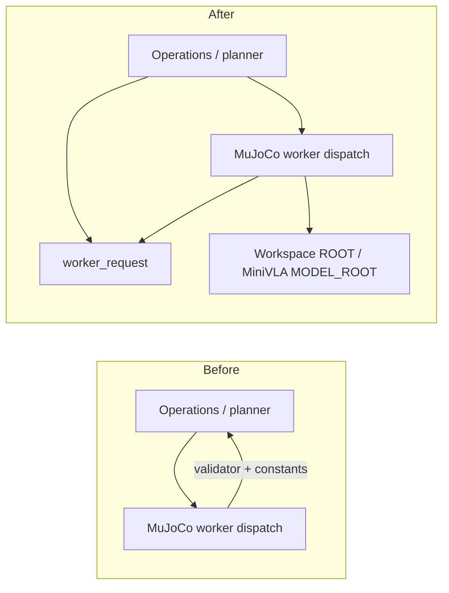
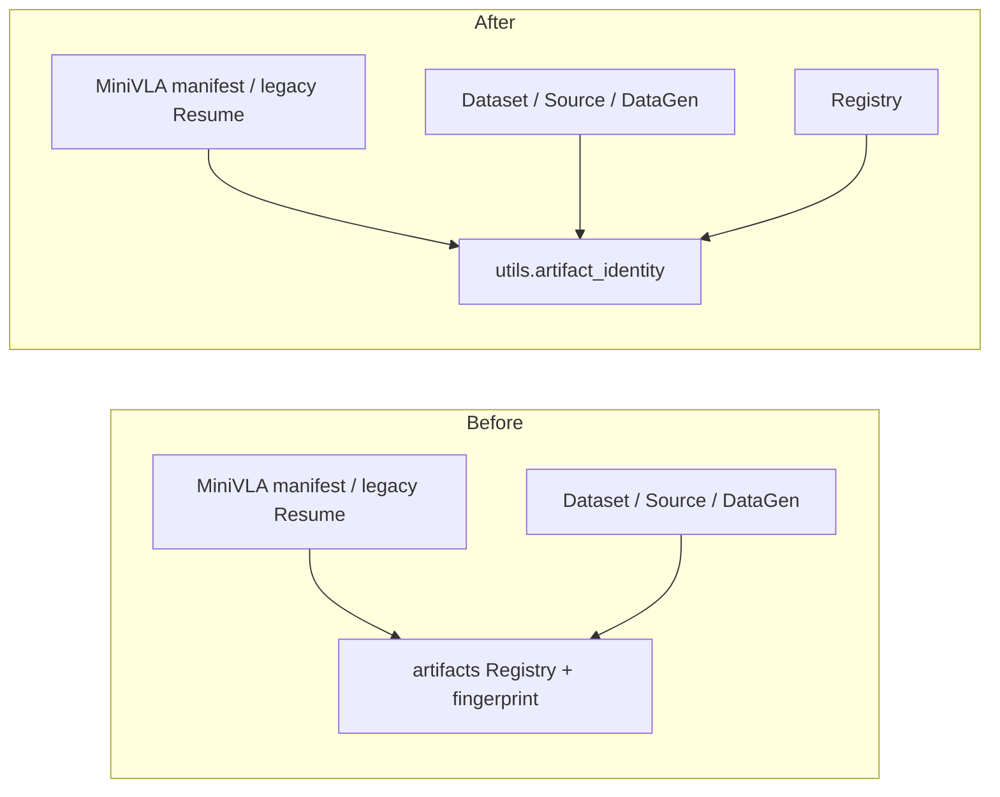

# 리팩터링 전후: 바뀐 책임과 유지한 구조

기준은 `7d02d9cf029c27aac3b2c03767e85961bfb650cb`다. 전체 감사에서 확인된 저위험 소유권 두 곳만 변경했다.
사용자 폴더/데이터를 이동하지 않았고, UI/Runtime/보정/물리/모델 구조를 다시 나누지 않았다.

## 디렉터리 전후

```text
이전                                       최종
workflow/operations.py                    workflow/operations.py
  계획/실행/취소/worker dispatch            계획/실행/취소/worker dispatch
  + MUJOCO_STAGES/mujoco_request             기존 request 이름은 동일 객체 re-export
workflow/mujoco.py                        workflow/mujoco.py
  operations의 validator/상수 import         worker_request 및 상수의 원래 소유자 사용
                                          workflow/worker_request.py   [신규]
                                            기존 stage 표/요청 검증 구현 이동
workflow/artifacts.py                     workflow/artifacts.py
  Registry/inspect/경로 + fingerprint         Registry/inspect/경로, fingerprint re-export
utils/                                    utils/artifact_identity.py   [신규]
                                            기존 fingerprint 구현 이동
learning/minivla/{data,train}.py           learning/minivla/{data,train}.py
  hash를 위해 workflow.artifacts 참조        utils.artifact_identity 참조
```

이 외에 hash-only import 위치를 바꾼 파일은 `workflow/{curation,datagen,dataset,episodes,unified,mujoco}.py`다.
파일 통째 이동/이름 변경은 없다. 함수와 protocol 표를 실제 공유 interface 소유자로 옮겼다.
기존 package 안의 신규 `.py`라 setuptools `find_packages`의 package 목록/설치 위치, CLI `scripts/`,
resource의 `Path(__file__).parents[...]` 계산을 바꾸지 않는다. 기존 dependency나 package config도 추가하지 않았다.

## 1. worker 요청 검증



문제는 engine worker가 상위 계획 파일을 읽어야 같은 요청의 유효성을 확인할 수 있다는 점이었다.
단순 함수 복사 대신 **구현 한 개를 이동**했다. `operations.py`는 기존 public import를 같은 객체로 제공한다.
GUI가 MuJoCo worker를 import해 validator를 가져오는 대안은 engine 분리를 깨므로 채택하지 않았다.
새 wrapper/manager/factory 없이 두 실제 호출자의 입력 dict 계약을 한곳에서 검증한다.

실제 코드: `workflow/worker_request.py:mujoco_request` 앞부분이다. 뒤의 Workspace/manifest/카메라/Source/Checkpoint
검사와 dict 반환은 생략했다. args와 에러 검사 순서도 이전 본문 그대로다.

```python
def mujoco_request(stage, python, workspace, input_path, config, checkpoint, renderer, options):
    if stage not in MUJOCO_STAGES:
        raise ValueError('Unsupported workflow worker stage')
    if not isinstance(options, dict):
        raise ValueError('Options must be a JSON object')
    if not Path(python).is_file():
        raise ValueError('Worker Python executable missing')
    if renderer not in ('egl', 'software-egl', 'osmesa', 'none'):
        raise ValueError('Unknown renderer')
```

입력은 CLI/planner/worker의 기존 필드이고 반환은 같은 options 객체를 포함하는 request dict다.
렌더러/입력 유효성 규칙 변경은 이제 request 모듈과 interface tests에서 시작한다.
Stage의 input/output 종류(Operations.STAGES), camera/control(Stage feeds), 옵션 help는 다른 책임이라 합치지 않았다.

기존 UI routing fixture가 `operations.load`를 mock하던 것은 새 request의 `load`에도 같은 fixture를 공급하도록 맞췄다.
READY·버튼·선택·실행 잠금 assertion은 삭제하거나 약화하지 않았다. 실제 파일 검증은 별도 request 계약 tests가 수행한다.

## 2. 파일 identity의 단일 소유자



학습 bytes 검사에 Registry가 필요하지 않았다. HDF5 외부 영상까지 포함하는 기존 알고리즘을 옮기고
모든 production의 hash-only caller가 새 소유자를 사용하게 했다. 옛 `artifacts.fingerprint`도 동일 객체다.
따라서 Registry와 학습이 서로 다른 hash를 만드는 중복 구현은 없다.

`real2sim.storage`는 원자 저장/IPC를 다루며 Dataset 영상 참조 지식을 소유하지 않는다.
Python `datasets`는 초기화할 때 LeRobotRecorder를 import한다. 단순 bytes 검사에 이 의존을 추가하는 대신
이미 공유 구현을 두는 `utils`의 명확한 이름을 사용했다. 모듈을 지우면 name/정렬/cache/HDF5 영상 규칙이
여러 호출자에 다시 필요하므로 단순 전달 계층과 다르다.

실제 코드: `utils/artifact_identity.py:fingerprint`의 마지막 부분이다. 앞의 경로 확정/정렬·`.cache` 제외,
HDF5의 외부 영상 경로 검사·중복 제거는 생략했다.

```python
    if not files:
        raise ValueError('Empty artifact')
    digest = hashlib.sha256()
    for f in files:
        digest.update(str(f.relative_to(p) if p.is_dir() else f.name if f==p else f.relative_to(p.parent)).encode())
        with f.open('rb') as stream:
            for block in iter(lambda: stream.read(1024 * 1024), b''):
                digest.update(block)
    return digest.hexdigest()
```

입력 path→기존 상대 이름/파일 bytes→동일 SHA256이며 쓰기는 없다. JSON 수치 계약의 fingerprint, Workspace
개별 file SHA, video file_sha256는 다른 payload를 hash하므로 이름이 비슷하다는 이유로 통합하지 않았다.
학습 Loader/Checkpoint schema, 데이터 정규화/모델/optimizer에는 import 위치 외의 변경이 없다.

## 실질적인 개선과 한계

| 항목 | 전후 차이 |
|---|---|
| 요청 규칙을 이해할 범위 | Operations 전체/worker 왕복에서 request interface 한 곳으로 축소. 실제 plan/취소 책임은 그대로 |
| hash 규칙 변경 | Registry의 inspection/경로 구현을 알아야 하던 상태에서 독립 identity+계약 tests로 이동 |
| 직접 양방향 import | 14쌍→11쌍. `mujoco→operations` 역방향 제거, Registry↔dataset/curation/episodes 왕복 감소 |
| 큰 정적 SCC | 52→49. 전체 codebase가 acyclic해진 것은 아님; conditional Workspace/계보/precision 의존 남음 |
| 사용자 interface | payload/오류/CLI choices·help/Widget 동작과 기존 import 경로 유지 |
| 추가된 구조 | 실제 공유 구현2개, interface/의존 방향 tests. 새 실행 계층·framework·설정/launcher0 |
| 성능 | 알고리즘/읽기 순서/chunk/physics/학습 loop 동일. 처리량 향상 주장은 하지 않음 |

의존 pair/SCC의 계산 범위는 [DEPENDENCIES](DEPENDENCIES.md)를 따른다. 신규 기능을 추가한 실험이 아니므로
가상 변경의 영향 파일 수를 실측 감소처럼 표현하지 않는다. 파일 수/LOC 자체를 개선 지표로 쓰지 않는다.

## 유지한 구조와 이유

- `real2sim/runtime.py`: 연결/제어/저장 future의 소유권은 이미 한 Runtime에 있다. 이동하면 close/finish/Stop 순서까지 영향을 받는다.
- `precision.py`: 계산 함수·Mapper·Store·Calibration seam이 있고 이미 device 없이 검사할 수 있다. 단위/수학 이동 이득 대비 위험이 크다.
- `workflow/ui.py`/CameraView: 확정된 화면과 stage 기억 상태를 그대로 보존한다. 이전 Screen 재분리를 반복하지 않는다.
- Workspace task semantics와 `episodes` Source partition: 순환은 남지만 recorded hash/역사적 데이터/두 engine 검증 없이 옮기지 않는다.
- MuJoCo thread/Isaac batch coroutine: 같은 공식 알고리즘을 사용하면서 물리 실행 방식이 다르므로 억지로 통합하지 않는다.
- `workflow.mujoco.py`의 MiniVLA 준비: 이름은 완벽하지 않지만 전체 학습/legacy/Resume 책임 이동은 별도 검증이 필요하다.
- `learning/minivla`, 기존 tasks/devices/assets/scripts: source resource 경로·package 초기화·CLI 진입점과 알고리즘을 유지한다.
- 사용자 outputs/Registry/Workspace/기존 model/data: 이동·재작성·정리를 수행하지 않는다.

전체 보류 후보의 근거/위험/검증 조건은 [감사](REFACTOR_AUDIT.md)에 있다. 고위험 변경은 추가 검증 후 별도 작업으로 다룬다.
