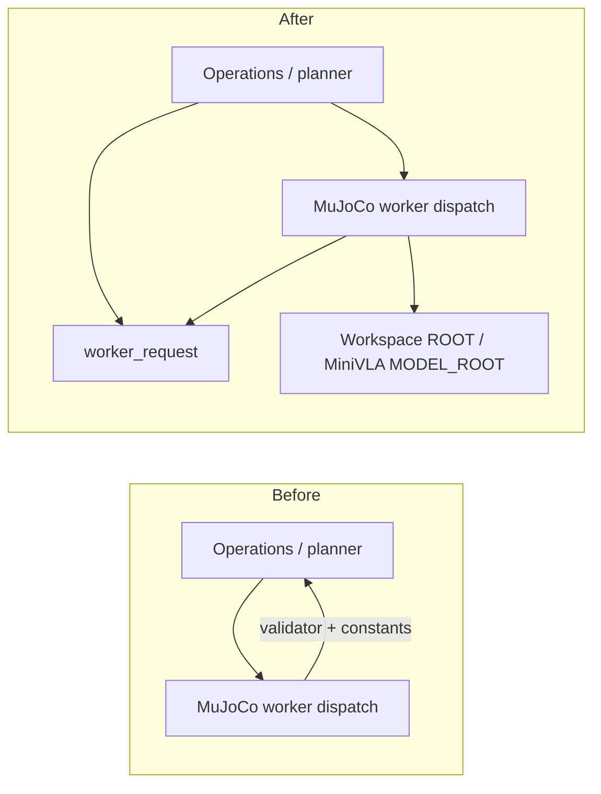
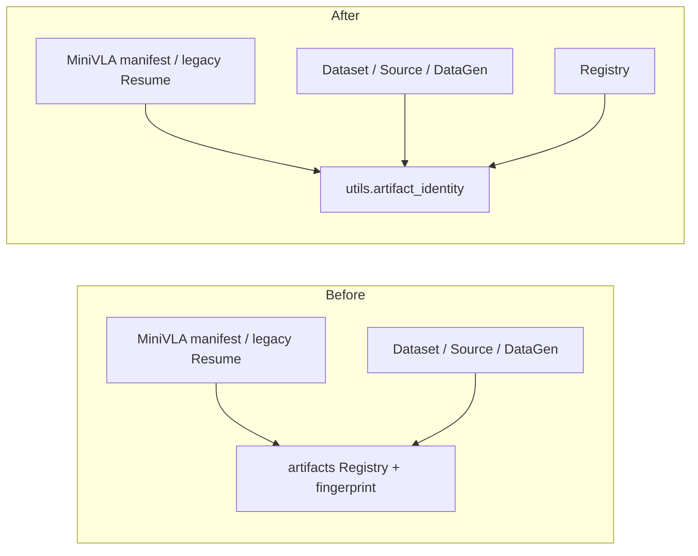

# 리팩터링 전후: 바뀐 책임과 유지한 구조

## 2026-10-19 단위6c-1 — Replay/Annotation 공통 Playback

| 이전 | 실제 교체 | 보존한 책임 |
|---|---|---|
| unified.replay가 annotation.replay_episode를 호출하고 writer 유무로 Annotation dispatch | workflow.replay.run + unified.execute의 명시 Stage dispatch | Replay 진행/결과·평가 Playback 의미, Worker 환경/Adapter 수명 |
| annotation.replay_episode에 restore/오차·manual·판정·물리 흐름·출력 혼재 | simulation.playback.restore_episode/replay_steps/step_targets + annotation.annotate_episode | Physics/DT/복원·명령/관측/None barrier, Grasp/Place/Mark/Skip/Pause/Step·주석 출력 |
| 테스트만 쓰는 replay_cache_identity/cached_replay | 본문/전용9검사 삭제 | 명시 Replay/gate·DataGen 자동 Replay 금지 유지 |

Annotation scheduler는 호출 소유자 연결 외 AST 동일하다. Reader/Writer/Adapter/엔진·UI·다른 Stage·Training은 기존 구현을 재사용하며 forwarding export를 남기지 않는다. 새 기능 교체 범위는 Playback의 복원/command/error와 Stage의 판정/표시로 구분된다. fixed-scene Native CLI의 별도 EpisodeData Replay는 이번 scope에서 보존했다.

실제 MuJoCo1·2env/Replay, Isaac Annotation2env의 같은 Episode/Scene/seed A/B trace·주석·numeric/metadata가 같다. MuJoCo 영상bytes도 같으며 Isaac RGB/MP4는 기존 반복 실행부터 달라 frame/PTS와3048frame 변동을 별도 측정했다. iterator CPU비용은5.350→5.528µs/frame(+0.178µs)으로 speedup은 없다. 전체 pipeline 순환·실제4/8env·실물/장시간까지 완료한 것으로 해석하지 않는다. [6c-1 보고서](../../outputs/workflow_validation/functional_refactor/playback/REPORT.md)를 따른다.

## 2026-10-19 단위6b-3 — Source 기록·파일 저장·환경 결합 교체

| 이전 | 현재 | 변경 이유 |
|---|---|---|
| workflow.episodes.EpisodeWriter가 env를 보유하며 관측 변환·초기 state·FK·Resume·영상/NPY/manifest 소유 | 기존 Simulation에 recording_context/sample/geometry; data.recording.SourceEpisode; 형식별 LegacyEpisodeWriter/기존 DatasetWriter; workflow.source 준비/Resume/save 연결 | 환경과 파일 기록의 수명을 분리. 수집/Discard/Cancel은 기존 mujoco.source에 유지 |
| workflow.dataset.recorded_mujoco_episode가 env/static pose/FK 조회 | Source가 save-time geometry를 Simulation에 요청하고 순수 source_episode_values에 전달 | per-frame 재조회/FK 없이 기존 수치와 시간축 유지 |
| workflow.dataset.recording_args를 Evaluation도 import | data.episodes.recording_args 직접 사용 | 순수 metadata 조립은 파일 I/O 소유, Evaluation→Dataset Stage edge 제거 |
| 원래 EpisodeWriter public callers | mujoco.source·test_minivla_integration/test_active_objects 직접 연결 | 구 클래스/함수·export 본문 삭제. Wrapper/Re-export 없음 |

Source snapshot의 numeric leaf와 initial은 Recording이 소유하고 RGB는 기존 bounded queue가 복사한다. pick pose는 이미 복사한 행렬을 사용한다. Common 초기 state/native snapshot의 종전 차이·단위/FPS/명령시점·Legacy NPY/MP4·manifest 마지막 게시 계약을 유지했다. 파일 실패 시 새 private/예약 디렉터리만 제거하며 이전 완료 episode와 원본 Resume은 보존한다.

기존6a Reader/6b-1 Common Writer/6b-2 Buffer·Source 외 물리/학습 함수는 AST 동일하다. 실제 MuJoCo/EGL Legacy34파일·Common74numeric/MP4, Resume50파일·111numeric/MP4가 같다. frame enqueue 중앙0.07668→0.07667ms로 개선 주장은 하지 않는다. 상세 수치/실패/미검증 범위는 [6b-3 보고서](../../outputs/workflow_validation/functional_refactor/source_writer/REPORT.md)다. Isaac native normalization/LegacyReader/Source Resume Catalog 의존은 남았고 Registry/Path/Curation/Training 정책은 이번에 변경하지 않았다.

## 2026-10-19 단위6b-1/2 — 공통 Writer·관측/저장 분리

| 이전 | 현재 | 이유와 범위 |
|---|---|---|
| workflow.dataset의 DatasetWriter·validate_episode·serializer/상수 | data.episodes의 실제 본문 | 모든 실제 caller를 직접 교체. old export/forwarding 없음. Reader/legacy 정책은 기존 위치 |
| EpisodeBuffer가 adapter.state/images/initial_state/check_success 호출 | SimulationAdapter.record_frame가 수집, data.recording.EpisodeBuffer는 전달값 기록 | 엔진 관측과 파일/영상 staging 소유 분리. 새 Adapter/Manager 아님 |
| datagen_info 전체 deepcopy 후 pose float32 변환 | 변경할 pose map만 새 dict/변환 | 나머지 배열은 synchronous commit 동안 빌림. 입력 변경 없이 중복 numeric 복사 제거 |
| workflow.dataset의 as_pose7/cartesian_actions | utils.transforms의 동일 본문 | 공통 recording이 Stage 수치 helper를 import하지 않음 |

기존 Atomic/Resume/Cancel·영상 staging 경로를 교체한 것이 아니라 재사용했다. Source Legacy EpisodeWriter·native normalization의 env/FK 결합은6b-3 후속으로 남아 있다. 검증과 전후 수치는 [6b 보고서](../../outputs/workflow_validation/functional_refactor/dataset_writer/REPORT.md)에 있으며 전체 Writer 분리 완료로 해석하지 않는다.

## 2026-10-19 단위6a — 공통 Reader

| 기존 | 현재 | 개선한 책임·실제 한계 |
|---|---|---|
| curation.EpisodeReader, read마다 HDF5 open/close | data.episodes.EpisodeReader, lazy 소유 handle/group·명시 close | 분석 정책과 numeric/영상 읽기 분리. 생성은 payload0, 분석/plot은 context로 해제 |
| UI의 reader=None 교체, 영상 해제는 객체 회수에 의존 | release_reader, 기존 frame Job 완료 후 해제 | 선택 중 작업 수명·stale 결과 차단 보존. 새 Thread/Manager 없음 |
| 같은 관측 timestamp 반복 읽기 | 작업 내 timestamp 배열 전달/같은 key 재사용 | 다른 key의 시각 불일치는 여전히 거부. 수치/배열·영상 의미 유지 |
| robot_preview.pose_matrix | utils.transforms.pose_matrix | 실제 호출자4개 교체, 이전 본문 삭제. 데이터/Annotation/Adapter가 UI 모듈을 순수 변환 때문에 import하지 않음 |

공통 Reader의 예외·리소스 계약/측정은 [6a 보고서](../../outputs/workflow_validation/functional_refactor/dataset_reader/REPORT.md)에 있다. `workflow.dataset.EpisodeDataset/DatasetWriter`·Curation 정책은 아직 기존 위치이며 전체 I/O 이전 완료로 해석하지 않는다. 아래는 앞서 끝난 첫5단위의 기록이다.

## 2026-10-19 첫 구현 묶음 — d60a7c2 기준

| 기존 소유 | 새 실제 소유 | 바뀐 이유/호출 경계 |
|---|---|---|
| workflow.mimic의 PhysicsControl/GenerationStopped | simulation.control | Annotation과 Adapter가 Mimic 구현을 제어 때문에 import할 필요 제거 |
| learning.minivla.policy의 ActionGuard | workflow.policy | 공통 평가가 MiniVLA에 의존하던 경로 제거 |
| minivla.train의 architecture/adapter 함수3개 | minivla.checkpoint | 모델 추론이 Trainer를 import하지 않음 |
| minivla.data의 RobotPreprocessor | minivla.policy | 모델의 저장 통계 해석을 Dataset 준비와 분리 |
| workflow.tasks의 순수 Task/Scene 구성7개 | real2sim.workspaces.tasks | compiler/Workspace가 Workflow 내부 규칙을 역참조하지 않음 |

기존 클래스/함수 본문을 삭제하고 실제 호출자를 연결했다. 새 호환 Wrapper/Re-export를 추가하지 않았다.
Task7개는 import 위치만 바뀌었고 수치 본문이 같다. 임시 MuJoCo Workspace의 hash/compiled23배열/30step trace가 같다.
UI 디자인과 공식 LeRobot Trainer는 그대로다. Registry·Curation 강제 정책·MiniVLA 학습 중단·독립 Validation은 미완료다.
[전체 현황](FUNCTIONAL_REFACTOR_PLAN.md#10-실제-구현-현황--첫-검증-경계)과
[검증 보고서](../../outputs/workflow_validation/functional_refactor/REPORT.md)를 본다.

## 이전 작업 기록

아래는 과거 감사의 변경/호환 판단이며 이번 목표 구조의 완료 상태가 아니다.

기준은 `7d02d9cf029c27aac3b2c03767e85961bfb650cb`다. 전체 감사에서 확인된 저위험 소유권 두 곳만 변경했다.
사용자 폴더/데이터를 이동하지 않았고, UI/Runtime/보정/물리/모델 구조를 다시 나누지 않았다.

## 디렉터리 전후

```text
이전                                       최종
workflow/operations.py                    workflow/operations.py
  계획/실행/취소/worker dispatch            계획/실행/취소/worker dispatch
  + MUJOCO_STAGES/mujoco_request             기존 request 이름은 동일 객체 re-export
workflow/mujoco.py                        workflow/mujoco.py
  operations의 validator/상수 import         worker_request 및 상수의 원래 소유자 사용
                                          workflow/worker_request.py   [신규]
                                            기존 stage 표/요청 검증 구현 이동
workflow/artifacts.py                     workflow/artifacts.py
  Registry/inspect/경로 + fingerprint         Registry/inspect/경로, fingerprint re-export
utils/                                    utils/artifact_identity.py   [신규]
                                            기존 fingerprint 구현 이동
learning/minivla/{data,train}.py           learning/minivla/{data,train}.py
  hash를 위해 workflow.artifacts 참조        utils.artifact_identity 참조
```

이 외에 hash-only import 위치를 바꾼 파일은 `workflow/{curation,datagen,dataset,episodes,unified,mujoco}.py`다.
파일 통째 이동/이름 변경은 없다. 함수와 protocol 표를 실제 공유 interface 소유자로 옮겼다.
기존 package 안의 신규 `.py`라 setuptools `find_packages`의 package 목록/설치 위치, CLI `scripts/`,
resource의 `Path(__file__).parents[...]` 계산을 바꾸지 않는다. 기존 dependency나 package config도 추가하지 않았다.

## 1. worker 요청 검증



문제는 engine worker가 상위 계획 파일을 읽어야 같은 요청의 유효성을 확인할 수 있다는 점이었다.
단순 함수 복사 대신 **구현 한 개를 이동**했다. `operations.py`는 기존 public import를 같은 객체로 제공한다.
GUI가 MuJoCo worker를 import해 validator를 가져오는 대안은 engine 분리를 깨므로 채택하지 않았다.
새 wrapper/manager/factory 없이 두 실제 호출자의 입력 dict 계약을 한곳에서 검증한다.

실제 코드: `workflow/worker_request.py:mujoco_request` 앞부분이다. 뒤의 Workspace/manifest/카메라/Source/Checkpoint
검사와 dict 반환은 생략했다. args와 에러 검사 순서도 이전 본문 그대로다.

```python
def mujoco_request(stage, python, workspace, input_path, config, checkpoint, renderer, options):
    if stage not in MUJOCO_STAGES:
        raise ValueError('Unsupported workflow worker stage')
    if not isinstance(options, dict):
        raise ValueError('Options must be a JSON object')
    if not Path(python).is_file():
        raise ValueError('Worker Python executable missing')
    if renderer not in ('egl', 'software-egl', 'osmesa', 'none'):
        raise ValueError('Unknown renderer')
```

입력은 CLI/planner/worker의 기존 필드이고 반환은 같은 options 객체를 포함하는 request dict다.
렌더러/입력 유효성 규칙 변경은 이제 request 모듈과 interface tests에서 시작한다.
Stage의 input/output 종류(Operations.STAGES), camera/control(Stage feeds), 옵션 help는 다른 책임이라 합치지 않았다.

기존 UI routing fixture가 `operations.load`를 mock하던 것은 새 request의 `load`에도 같은 fixture를 공급하도록 맞췄다.
READY·버튼·선택·실행 잠금 assertion은 삭제하거나 약화하지 않았다. 실제 파일 검증은 별도 request 계약 tests가 수행한다.

## 2. 파일 identity의 단일 소유자



학습 bytes 검사에 Registry가 필요하지 않았다. HDF5 외부 영상까지 포함하는 기존 알고리즘을 옮기고
모든 production의 hash-only caller가 새 소유자를 사용하게 했다. 옛 `artifacts.fingerprint`도 동일 객체다.
따라서 Registry와 학습이 서로 다른 hash를 만드는 중복 구현은 없다.

`real2sim.storage`는 원자 저장/IPC를 다루며 Dataset 영상 참조 지식을 소유하지 않는다.
Python `datasets`는 초기화할 때 LeRobotRecorder를 import한다. 단순 bytes 검사에 이 의존을 추가하는 대신
이미 공유 구현을 두는 `utils`의 명확한 이름을 사용했다. 모듈을 지우면 name/정렬/cache/HDF5 영상 규칙이
여러 호출자에 다시 필요하므로 단순 전달 계층과 다르다.

실제 코드: `utils/artifact_identity.py:fingerprint`의 마지막 부분이다. 앞의 경로 확정/정렬·`.cache` 제외,
HDF5의 외부 영상 경로 검사·중복 제거는 생략했다.

```python
    if not files:
        raise ValueError('Empty artifact')
    digest = hashlib.sha256()
    for f in files:
        digest.update(str(f.relative_to(p) if p.is_dir() else f.name if f==p else f.relative_to(p.parent)).encode())
        with f.open('rb') as stream:
            for block in iter(lambda: stream.read(1024 * 1024), b''):
                digest.update(block)
    return digest.hexdigest()
```

입력 path→기존 상대 이름/파일 bytes→동일 SHA256이며 쓰기는 없다. JSON 수치 계약의 fingerprint, Workspace
개별 file SHA, video file_sha256는 다른 payload를 hash하므로 이름이 비슷하다는 이유로 통합하지 않았다.
학습 Loader/Checkpoint schema, 데이터 정규화/모델/optimizer에는 import 위치 외의 변경이 없다.

## 실질적인 개선과 한계

| 항목 | 전후 차이 |
|---|---|
| 요청 규칙을 이해할 범위 | Operations 전체/worker 왕복에서 request interface 한 곳으로 축소. 실제 plan/취소 책임은 그대로 |
| hash 규칙 변경 | Registry의 inspection/경로 구현을 알아야 하던 상태에서 독립 identity+계약 tests로 이동 |
| 직접 양방향 import | 14쌍→11쌍. `mujoco→operations` 역방향 제거, Registry↔dataset/curation/episodes 왕복 감소 |
| 큰 정적 SCC | 52→49. 전체 codebase가 acyclic해진 것은 아님; conditional Workspace/계보/precision 의존 남음 |
| 사용자 interface | payload/오류/CLI choices·help/Widget 동작과 기존 import 경로 유지 |
| 추가된 구조 | 실제 공유 구현2개, interface/의존 방향 tests. 새 실행 계층·framework·설정/launcher0 |
| 성능 | 알고리즘/읽기 순서/chunk/physics/학습 loop 동일. 처리량 향상 주장은 하지 않음 |

의존 pair/SCC의 계산 범위는 [DEPENDENCIES](DEPENDENCIES.md)를 따른다. 신규 기능을 추가한 실험이 아니므로
가상 변경의 영향 파일 수를 실측 감소처럼 표현하지 않는다. 파일 수/LOC 자체를 개선 지표로 쓰지 않는다.

## 유지한 구조와 이유

- `real2sim/runtime.py`: 연결/제어/저장 future의 소유권은 이미 한 Runtime에 있다. 이동하면 close/finish/Stop 순서까지 영향을 받는다.
- `precision.py`: 계산 함수·Mapper·Store·Calibration seam이 있고 이미 device 없이 검사할 수 있다. 단위/수학 이동 이득 대비 위험이 크다.
- `workflow/ui.py`/CameraView: 확정된 화면과 stage 기억 상태를 그대로 보존한다. 이전 Screen 재분리를 반복하지 않는다.
- Workspace task semantics와 `episodes` Source partition: 순환은 남지만 recorded hash/역사적 데이터/두 engine 검증 없이 옮기지 않는다.
- MuJoCo thread/Isaac batch coroutine: 같은 공식 알고리즘을 사용하면서 물리 실행 방식이 다르므로 억지로 통합하지 않는다.
- `workflow.mujoco.py`의 MiniVLA 준비: 이름은 완벽하지 않지만 전체 학습/legacy/Resume 책임 이동은 별도 검증이 필요하다.
- `learning/minivla`, 기존 tasks/devices/assets/scripts: source resource 경로·package 초기화·CLI 진입점과 알고리즘을 유지한다.
- 사용자 outputs/Registry/Workspace/기존 model/data: 이동·재작성·정리를 수행하지 않는다.

전체 보류 후보의 근거/위험/검증 조건은 [감사](REFACTOR_AUDIT.md)에 있다. 고위험 변경은 추가 검증 후 별도 작업으로 다룬다.
