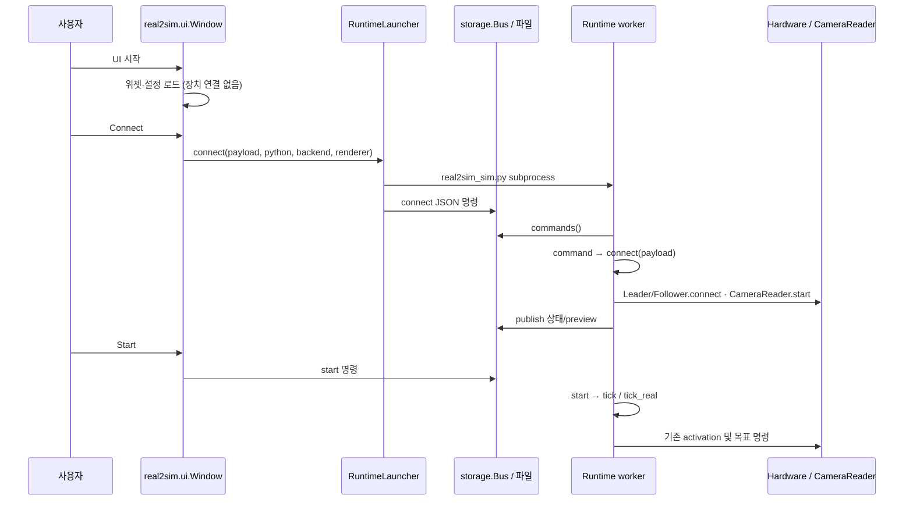

# 실제 시스템 실행 흐름

UI는 명령을 만들고 별도 process가 장치·engine·학습을 실행한다. 파일은 두 process 사이의 계약이다.
이 문서는 **현재 구현된 호출 경로**다. 이번 검증에서 실제 모터/GPU 학습/정책 성공을 수행했다는 뜻은 아니다.
장치 없는 검사·물리 검사·미실행 구간은 마지막 표와 [검증 기록](REFACTOR_VALIDATION.md)을 구분해 읽는다.

파일 경로를 짧게 쓰기 위해 아래에서 `패키지/`는 `source/soarm101_lab/soarm101_lab/`를 뜻한다.
Python dict의 JSON 저장 표현, HDF5 numeric 배열, MP4 RGB, Torch tensor는 서로 다른 데이터 단계다.

## 1. UI 시작 → Runtime → 카메라/SO-101



진입점 `scripts/real2sim/real2sim_ui.py`는 `real2sim.ui.Window`를 만든다.
`Window.connect_hw`는 hardware port/ID, profile/Workspace, precision 옵션을 dict로 만들고
`real2sim.launcher.RuntimeLauncher.connect`에 전달한다. launcher는 `worker_environment`로 GUI의
site-packages를 제외하고 `scripts/real2sim/real2sim_sim.py`를 실행한다.

Runtime CLI는 backend가 `real/calibration/mujoco`이면 선택한 경로를, Isaac이면 `AppLauncher` 뒤 `Runtime.run`을 사용한다.
`storage.Bus`의 owner lock/session/command/reply/status가 worker 생존과 명령 수명을 구분한다.
`Runtime.command('connect')`→`Runtime.connect`는 profile·포트·보정 identity를 검사하고 장치/카메라를 연다.
Connect와 모터 Start는 다르다. `Runtime.start` 이후 기존 activate/명령 전송이 가능해진다.

카메라 packet은 RGB uint8와 `read_start/read_end`의 monotonic/unix 시각·sequence다.
`CameraReader.nearest`가 packet을 복사해 전달한다. host read interval은 실제 exposure timestamp가 아니다.
실물 observation은 native degree/percent와 raw encoder 증거를 보존한다.
`Runtime.command_target`는 기존 mapping/가능한 goal 범위·SDK 정수 encoding을 거쳐 Real/Sim에 같은 q를 전달한다.
측정 q와 명령 q는 별개다. heartbeat loss와 loop stall은 기존 Stop을 수행한다.

Snapshot은 `Runtime.command`에서 state/image를 복사해 freeze→`save_snapshot_requests`→single writer의
`SnapshotDataset.save`로 간다. `prepare_snapshot`이 freshness/영상/측정 정합을 확인하고 shared robot/calibration과
개별 snapshot을 원자 저장한다. Disconnect의 finish는 진행 중 save 뒤에 예약된다. UI thread에서 디스크 저장을 기다리지 않는다.

## 2. Calibration → Workspace 선택 → 엔진 적용

보정 UI `real2sim/precision_ui.py`→`Window.connect_precision`은 exclusive calibration Runtime을 시작한다.
`Runtime.connect`→`precision.Calibration.connect/command/tick`에서 명시 선택한 device와 reference를 처리한다.
`fit_joint/review_joint`는 raw/각도 reference로 계수를 계산·검토하고, `ProfileStore.save/activate/restore`는
identity/URDF hash와 승인 기록을 검사한다. 단순히 Scene을 고르는 것으로 새 보정을 만들지 않는다.

Workspace 생성은 Builder의 책임이다. `workflow.py import-builder`→`builder.import_scene`가 export checksum,
frame graph/robot mapping/task·asset을 검사하고 versioned package를 만든다. `package.load`가 파일 증거를 재검사한다.
`WorkflowPanel.select_workspace`/`Window.select_live_scene`는 내부 Scene 선택을 공유하며 장치를 시작하지 않는다.

`precision.simulation_configuration`은 active/기록된 보정·URDF·Scene residual binding을 검사한 **실행 dict**를 만든다.
새 Source는 검증된 수집 mapping을 기록하고, Replay/DataGen/Evaluation은 기록된 model 계약을 상속한다.
현재 보정으로 과거 dataset의 숫자를 바꾸지 않는다.

- Isaac: `Runtime.build_environment` 또는 `unified._native_isaac`→`workspaces.environment.make_config`→기존 task cfg/MDP→`ManagerBasedEnv`.
- MuJoCo: `Runtime.build_environment` 또는 `workflow.mujoco._environment`→`PolicyEnvironment/MujocoBackend`→`mjcf.build_scene`의 XML 문자열/include bytes→`MjModel.from_xml_string`→model/data. 결과·임시 폴더에 생성된 Scene 파일을 저장하지 않는다.

Workspace object/task 선택은 `workflow.tasks.configured`가 만든 copy와 `scene_configuration`에 반영된다.
물성은 `physics.compile_physics`, reset은 `WorkspaceRandomizer/reset_workspace`가 담당한다.
보정용 실측 pose 표시와 학습용 randomized reset을 혼동하지 않는다. 기존 published package는 수정하지 않는다.

## 3. Source 수집 → HDF5 → Registry

`WorkflowPanel.execute`→`Operations.run`은 현재 입력/옵션을 실행 계획으로 만든다.
`Operations.plan`은 Registry/Workspace/좌표/장치 옵션을 검사하고 `artifacts.output_location`으로 경로를 결정한다.
`runs/<Run ID>`의 request/state/log/presentation과 실제 결과 경로는 별개다.

- **MuJoCo Source:** `mujoco_plan`이 `worker_request.mujoco_request`로 요청 dict를 검사→공통 Workflow CLI worker→
  `execute_request`→`mujoco.execute/source`→`_environment`→Leader 입력과 engine 관측→`episodes.EpisodeWriter(storage='common')`.
  `EpisodeWriter`는 측정 state, 적용 target, 요청 target·시각·영상·모델 증거를 보존하고 공통 Writer에 저장한다.
- **Isaac Source:** plan의 기존 `scripts/teleoperation/record_mimic_dataset.py`→Workspace task/environment→
  `mdp/so101_mimic_recorders.py`의 native EpisodeData→`dataset`의 recording 변환→공통 `DatasetWriter`.
  새 수집에 Legacy HDF5를 거쳐 재변환하는 경로를 추가하지 않는다.

공통 파일은 `so101.common-episode/2`: `data/demo_N`의 numeric/annotation/attrs와 상대 경로 MP4다.
`obs/policy/joint_pos[T,6]`는 명령 전 측정 model rad, `joint_targets[T,6]`는 그 직후 적용한 목표 rad다.
`actions[T,7]`는 Mimic EE delta+gripper 표현이다. 학습 action에는 `joint_targets`를 사용한다.

저장 검증이 끝나면 `Operations.run`→`inspect_artifact`→`Registry.register`로 ID/부모/path/SHA/provenance를 기록한다.
단순히 worker가 종료됐다는 이유로 성공 record를 만들지 않는다. 취소는 기존 SIGINT/process group 및 저장 완료 경계를 따른다.
새 Source는 `outputs/workflow/sources/<이름>/origin`에 저장하고, Source 선별·분할은 Curation에서
사용자가 지정한 이름 아래 저장한다. 분할은 그 안의 `train/val`이다. 이후 단계의 새 결과는
각 저장소의 `<저장 이름>/` 아래에 바로 저장하며 Source/split/앞 입력 이름을 경로로 중첩하지 않는다.

## 4. Annotation → DataGen → Curation → LeRobot

```text
선택 Artifact + Workspace + options
 → Operations.unified_plan → request.json
 → workflow.py worker → execute_request → unified.execute
 → EpisodeDataset (Legacy일 때만 migrate하여 새 공통 파일)
 ├ Annotation: annotation.run → 공유 replay_episode(실제 joint_targets/기존 grasp·place)
 │              → MuJoCo 독립 worker / Isaac vector tick → 빈 슬롯 즉시 재배정
 │              → 원본 Source 순서로 DatasetWriter (수동 mark는1환경)
 └ DataGen: run_mujoco 또는 run_isaac
      → worker별 Source Pool 1회 → 시도별 MimicGenerator/RNG
      → 공식 Mimic EE 목표 → Adapter → solve_selected → 선택 IK/정책 → Physics
      → 기존 grasp/drop/place 판정 → GenerationScheduler.finish
      → 성공 슬롯 예약 → Writer lock → DatasetWriter.commit → 성공 확정
```

**DataGen 실행 전에 Source 전체 자동 물리 재생을 하지 않는다.** 명시 Replay/Annotation의 재생과
개발용 cross-replay/cache 도구는 별도다. 두 engine은 공식 Mimic 생성 본문을 공유한다.
MuJoCo는 thread별 독립 MjData, Isaac은 환경별 coroutine와 하나의 batch physics step이다.
환경 수4는 카메라4분할을 의미하지 않는다. 기존 Overall+Env0 Side/Wrist 표시를 유지한다.
이 영상 구성은 DataGen에 적용한다. Annotation은 미리보기 대신 `annotation_progress` 상태 IPC를
`view.AnnotationProgress`에서 진행률/저장/실패/환경별 frame/경과 시간으로 표시한다. 결과 Side/Wrist MP4와
수동 mark/skip/pause는 유지하며, Annotation의 RGB/JPEG 전송과 Isaac Overview sensor는 생성하지 않는다.

실패 이유는 adapter의 measured contact/pose 증거와 attempt category에, 성공/시도/실패/시간은 scheduler/report/
presentation 상태에 남는다. IK 수렴 여부와 최종 grasp/place 성공은 다르다. strict/hold/best_effort, seed·성공 예약·Resume는 바꾸지 않는다.

`WorkflowPanel.open_curation`→`CurationDialog.load_data`→`curation.analyze/EpisodeReader`는 저장 파일을 읽는다.
Curation의 영상/관절/물체 telemetry는 검토용이며 model tensor에 새 feature를 추가하지 않는다.
`preview_source_split`→`episodes.source_split`, `save_source_split`→`export_source_splits`는 원본 Source group 단위로
분할한다. 이미 Train/Val인 입력은 재분할을 잠근다. `curation.export_subset`은 제외 episode를 새 저장본에 넣지 않는다.
Registry는 저장한 결과를 등록하며 다른 Stage의 입력 폴더/선택을 바꾸지 않는다.
Workflow의 **데이터 선택**은 `Registry.input_directory`의 단계별 저장소에서 폴더를 고르고
`WorkflowPanel.select_data` → `Registry.discover_collection`으로 내부 입력을 찾는다. 하나면 자동 선택한다.
Source는 READY 버전 폴더, Annotation은 origin/선별/분할 하위 목록, DataGen은 Annotation 폴더가 입력이다.
MiniVLA 별도 Val 폴더는 Train을 보존하며 실제 계약 검사를 통과한 경우 연결한다. Scene/Builder Import의 기존
실행은 Workflow 선택기에서 제거하고 Real/Sim의 `Window.browse_scene`이 소유한다.

변환은 기존 `scripts/tools/convert_isaac2lerobot.py`가 공통 HDF5/Legacy의 joint state/target·MP4를
LeRobot Parquet+MP4+meta로 mapping한다. `episodes.convert_dataset`의 Canonical 경로도 여기에 위임한다.
좌표 계약·Source lineage/partition/task·FPS·카메라를 보존하고 학습용 state/action은 model rad다.
`repo_id`는 변환 Dataset 식별 값이며 변환만으로 Hub 업로드를 실행하지 않는다.

## 5. Dataset 선택 → 학습 → Checkpoint

UI Train은 Artifact ID와 MiniVLA 별도 Validation Artifact ID, 설정 JSON/override/Resume를 options로 전달한다.
`Operations.plan`에서 호환성과 Train/Val 계보를 검사하고 기존 worker가 실제 bytes를 다시 검사한다.
같은 Source의 생성 변형을 다른 독립 Source로 꾸며 Train/Val에 나누지 않는다.

### MiniVLA

`execute_request`→`workflow.policy.train`→`mujoco.train_from_lerobot`→`validate_training_inputs`와
manifest/statistics 준비→`mujoco.train`→`python -m soarm101_lab.learning.minivla.train`.
현재 이 연결 함수가 `mujoco.py`에 있어도 LeRobot Dataset의 학습은 MuJoCo physics를 step하지 않는다.
Legacy Canonical worker도 같은 `mujoco.train`을 호출한다.

작은 manifest는 원본 LeRobot Parquet/MP4의 경로·SHA/좌표와 episode frame 범위를 참조한다.
`data.load_manifest`는 `utils.artifact_identity.fingerprint`로 bytes identity를 검사한다.
`Episodes`는 raw model rad→`RobotCoordinates.to_policy`→train-only 통계 z-score와 action chunk/mask를 만든다.
`collate` 출력은 state `[B,6]`, actions `[B,40,6]`, mask `[B,40]`, B개의 이미지/문장 목록이다.
`backbone.QwenBackbone`은 letterbox·토큰화·선택층 feature를, `head.ActionHead`는 기존 Flow-DiT를 수행한다.
`train.compute_loss/main`은 기존 수식/optimizer/validation을 사용한다.

신규 UI Batch8/accumulation1은 실제 한 Batch의 forward/backward와 한 optimizer update다.
옛 checkpoint에 batch_size가 없으면1이며 저장 accumulation8을 유지한다. OOM 시 자동 batch 축소는 없다.
`save_checkpoint`는 config/통계/모델/optimizer/step/identity를 담는 best.pt/last.pt/번호별 파일을 쓴다.
`validate_resume`는 구조·dataset/stats/frequency/기존 batch 조건을 검사한다. 새 출력에 재개하며 원본 파일을 고치지 않는다.
metrics.jsonl은 실제 측정 loss/시각을 기록하고 기존 Loss Plot이 증분 읽기한다.

### ACT / SmolVLA

`workflow.policy.train`→기존 `lerobot.scripts.lerobot_train` subprocess.
Workflow는 dataset root/repo_id·policy type·batch/steps/checkpoint 옵션을 JSON으로 넘기고 공식 trainer를 실행한다.
완료 후 `checkpoints/last/pretrained_model`의 config/safetensors와 coordinate/provenance를 검증·등록한다.
Resume은 기존 `resume_checkpoint`의 optimizer/config 경로 계약을 따른다. MiniVLA의 Batch/Resume 규칙을 여기로 복제하지 않는다.

## 6. Checkpoint 선택 → Rollout → 평가 결과

UI의 MiniVLA `selected_minivla_checkpoint`는 best/last/번호별 **선택 파일**을 확인한다.
`Operations.plan`→`execute_request`에서 아래 engine/실물 경로로 분기한다.

| 경로 | 구현된 호출과 데이터 |
|---|---|
| MuJoCo Sim | `mujoco.execute(stage='rollout')`→`evaluation.evaluate_sim`→`policy.batch_actions`→공유 model/독립 data 병렬 step→기존 task/grasp/drop metrics→성공/실패 DatasetWriter |
| Isaac Sim | `evaluation.evaluate`→AppLauncher→`evaluate_sim`의 make_config/ManagerBasedEnv→`policy.batch_actions`→vector joint action→기존 task/grasp/drop metrics→성공/실패 DatasetWriter |
| Real | UI `Real 평가 시작`의 내부 enable_motion 지정(CLI는 명시 opt-in)→`evaluation.evaluate(stage='real_eval')`→계약/보정 검증→기존 follower/camera observation→정책 action→strict hardware inverse→기존 SDK 명령 |

평가에는 실제 선택 checkpoint path/step·seed·task/scene·회별 결과가 남는다. HDF5/MP4 상세 기록과 요약 JSON의
위치는 engine별 계획 계약을 따른다. 실물 평가를 simulator 성공처럼 자동 판정하지 않는다.
`Operations.run`은 결과를 검사해 평가 Artifact와 하위 `evaluation_dataset`을 등록한다.
`evaluation_datasets.json`이 있는 실행 폴더는 Curation에서 성공/실패 분포·영상·EE 경로를 함께 열 수 있다.
개별 성공/실패 HDF5는 Replay 입력이다. 실패 기록의 재생 완료와 task 성공을 구분한다.
`mujoco.rollout/rollout_lerobot` 직접 호출은 과거 개발/fixture 호환용이며 Workspace UI는 공통 평가 실행을 사용한다.
Hub publication은 별도 `hf_dataset/hf_policy` 작업의
`hub.publish`이며 학습/변환/평가로 자동 업로드하지 않는다.

## 7. 이번에 무엇을 실행해서 확인했는가

| 구간 | 이번 작업의 확인 방식 | 이번에 하지 않은 것 |
|---|---|---|
| UI/Runtime·Calibration | Qt 동작, fake device, file IPC/subprocess, Snapshot fixture | 실제 port/camera/모터 연결 |
| Workspace/Simulation | Builder fixture hash, USD asset/cfg, MuJoCo CPU/IK tests | 실제 Isaac Kit/PhysX 새 장시간 실행 |
| DataGen/storage | 기존 parity·RNG/슬롯/rollback/Resume/영상 계약 tests | 새 실제 Source 수집·GPU 다환경 생성 |
| 학습/평가 | CPU tensor/임시 checkpoint/LeRobot fixture·명령 계획 | pretrained GPU 학습, 실물/정책 성공률·실제 Hub 업로드 |

실행 명령과 성공/실패/skip의 정확한 기록은 [REFACTOR_VALIDATION](REFACTOR_VALIDATION.md)을 본다.
과거 outputs 보고서의 실제 학습·생성 성공은 역사적 증거이며 이번 리팩터링 검증으로 재실행한 것처럼 표시하지 않는다.
