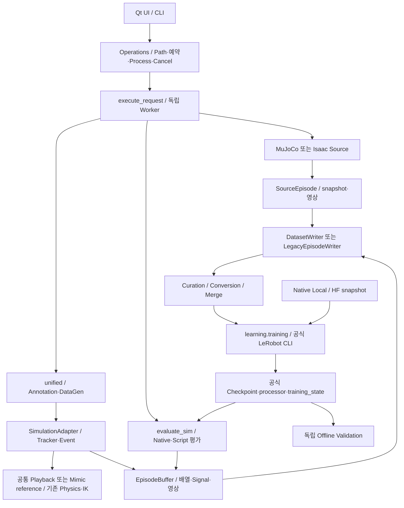

# 현재 실행 및 데이터 흐름

기준: 2026-10-23. [모듈 지도](PROJECT_STRUCTURE.md), [공개 Script 문법](../task_sdk/SCRIPT_GUIDE.md), [Native 학습/Hub](../real2sim/NATIVE_LEROBOT.md).

UI 목록은 native marker만 읽고 상세 검사·저장은 background에서 한다. Python AST 조회와 명시 Worker 실행을 구분한다. 출력 Lock·충돌 거부·완성분 게시·Cancel은 기존 Operations/Writer가 소유한다. runs는 실행 기록이며 Registry가 아니다.

## 실제 호출 경로와 합류 지점

패키지 루트는 `source/soarm101_lab/soarm101_lab/`다. 엔진·App 수명은 기존 Worker/Runtime이 소유한다.

| 입력 | 실행 경로 |
|---|---|
| MuJoCo Legacy Source | operations → mujoco.execute/source → 기존 reset/관측·명령 → SourceEpisode → 형식별 Writer |
| Isaac Native Source | operations의 기존 argv → scripts/teleoperation/record_mimic_dataset → native Episode/telemetry·stream_observation_rgb → VideoHDF5DatasetFileHandler. App/Recorder 수명이 달라 SourceEpisode로 바꾸지 않음 |
| Scene-only Source | task_scripts.script_inputs/resolve_script/load_execution_script → 같은 mujoco.source → Backend.reset + 명시 reset_objects → 같은 SourceEpisode/Writer |
| Legacy Annotation | worker_request.episode_context → unified.execute → annotate_episode → playback.restore_episode/replay_steps → Adapter.update_grasp/check_success → EpisodeBuffer/Writer |
| Annotation Terms | 같은 native 입력 경계 → load_followup → Adapter.bind_followup/after_reset → 같은 Playback/record_frame의 Event·Acceptance → 같은 Buffer/Writer |
| Legacy Mimic | unified → datagen.run_* → mimic.configuration → source_pool/execute_trial → reference DataGenerator → 기존 IK/Adapter/Writer |
| Mimic Terms | 같은 datagen → Adapter.bind_followup의 recipe 또는 subtask_configuration → 같은 reference/IK/scheduler; 기록된 Annotation Signal 재사용 |
| Native Evaluation | mujoco.execute의 rollout 또는 Isaac Worker → evaluate_sim → load_policy/batch_actions/ActionGuard → 기존 환경·Recorder/Writer |
| Script Evaluation | task_scripts.load_execution_script → 같은 evaluate_sim의 Task quota/Hook → 같은 Policy/Physics/Recorder. 사용자 성공과 물리 진단 구분 |
| Native Training | Operations → execute_request → learning.training.train/training_command → 공식 lerobot_train subprocess → native Checkpoint; Resume도 공식 optimizer/RNG 복원 |

Source Recorder의 streaming snapshot과 재생/생성 EpisodeBuffer는 입력 시점·형식이 달라 하나로 합치지 않는다. 평가의 Recorder는 Dataset 형식을 만들기 위해 같은 Adapter/Buffer를 사용한다. Policy 루프는 Annotation/Mimic 루프와 다르다.

## 독립 Dataset·모델 경로

Curation은 HDF5/Legacy를 자유 선별하고 선택적으로 분할한다. 현재 배정과 역사 Lineage/Partition은 구분한다. LeRobot 직접 Curation은 미지원이며 Converter를 사용한다. Source/Task SDK 없이 Native Local 또는 HF Dataset으로 학습할 수 있다.

Native 학습은 Train 전체와 선택 Val을 받으며 자동 Split이 없다. Fine-tune은 새 optimizer, Resume는 원래 train_config/optimizer/scheduler/RNG/step·Dataset identity·출력 위치를 유지한다. 일반 모델 로딩과 SO-101 Sim/Real 호환성 검사는 별개다. 외부 Dataset/Checkpoint에 가짜 보정·provenance를 추가하지 않는다. Hub 업로드는 명시 사용자 실행에서만 한다.

## 상태 소유권

Backend: Physics/실제 Reset RNG·native snapshot. Adapter: Episode seed stream·StableGrasp 한 개·Drop/Release·Event factory/Boundary/실패 latch. Context: 빌린 Metadata/Runtime 조회. Buffer: Episode 데이터/영상 staging. Writer: 파일 검증·Atomic 게시. Operations/Worker: Process·취소/환경 close. 자세한 Reset 순서와 호환 API는 [TASK_SDK_DESIGN](TASK_SDK_DESIGN.md)을 따른다.
