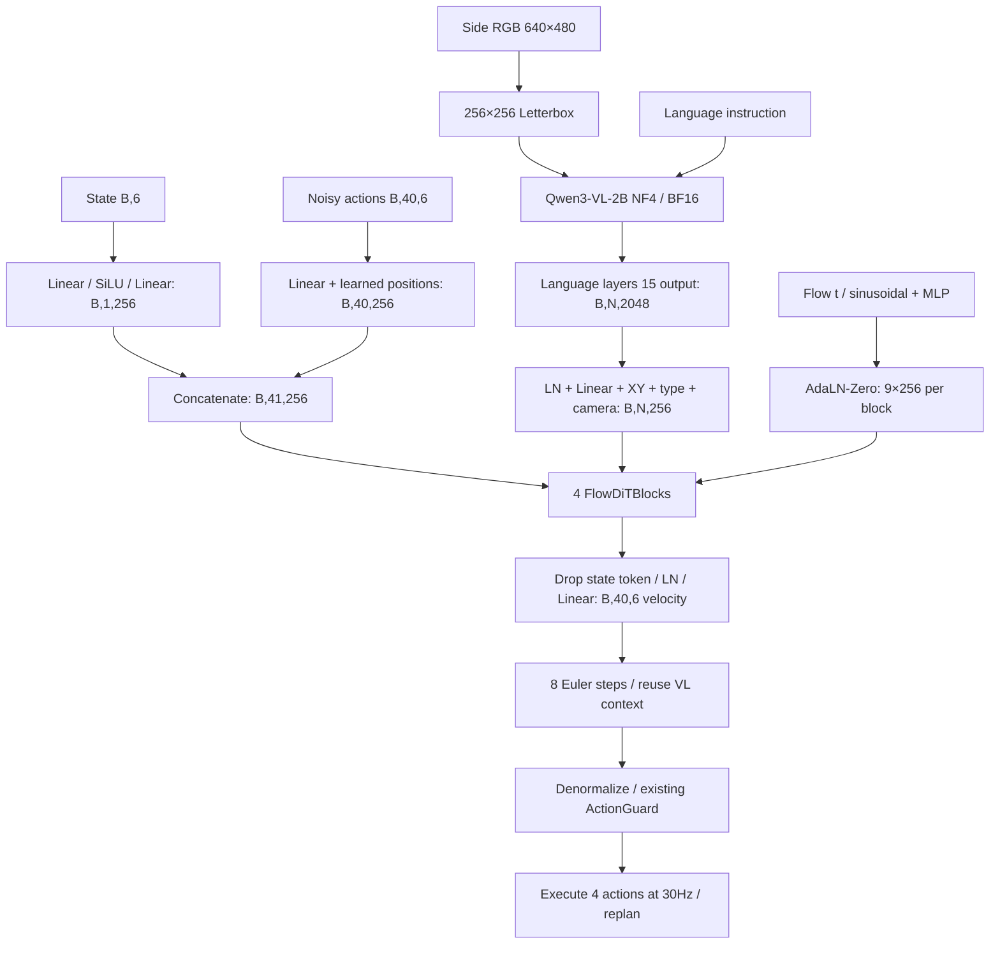

> Historical / Archived — 2026-10-22. 과거 모델 설계/실험 기록이며 삭제된 학습 명령은 실행 안내가 아닙니다. 현재 지원 범위는 [README](README.md)를 따릅니다.

# MiniVLA Flow-DiT

기존 `soarm101_lab.learning.minivla` 자체를 교체했다. 별도 버전 모델/호환 wrapper는 없다.
아키텍처 schema는 `so101.minivla.flow-dit/1`이다. 구형 checkpoint는 로드/Resume을 거절한다.



확정 기본값: Qwen/Qwen3-VL-2B-Instruct, 16번째 language block(0-based15), VL2048,
head256, blocks4, heads4(head dim64), FFN1024, dropout0.1, horizon40, action6,
flow8, replan4, side만, 모델입력256×256. 실모델 loader는 이 구조가 바뀐 config를 거절한다.
훈련 steps/LR/seed/accumulation과 frozen/qlora adaptation은 기존 config에서 설정한다.

`backbone.py`는 공식 ConditionalGeneration 클래스로 checkpoint를 로드해 prefix/missing/
mismatched key를 검사한 다음 base model을 사용한다. Frozen은 no_grad/eval이다.
전체 multimodal forward와 DeepStack을 유지하고 layers[15] hook 하나로 Tensor를 선택한다.
마지막 normalized hidden output을 쓰지 않으며 전체 hidden-state tuple/logits/KV cache도 만들지 않는다.
현재 구현은 선택층 이후 decoder도 정상 forward한다. 중간에서 모델 실행을 끊지 않는다.
실제 Transformers4.57.1의 block output은 Tensor였으며 shape/mask/gradient를 검사했다.

원본 RGB/Dataset/Camera K/UI 영상은 그대로다. 모델에만 LANCZOS letterbox를 적용한다.
640×480→256×192, 상하32px 검정. Processor min_pixels=max_pixels=65536,
patch16/merge2, 실제 grid[1,16,16], visual64 tokens. 전체 N은 텍스트 길이에 따라 달라진다.
XY는 letterbox 전체 이미지의 merged patch 중심 [0,1] 좌표이며 텍스트는0이다.
이미지 type/camera1, 텍스트 type/camera0을 더한다. 유효 토큰 압축/평균 pooling은 없다.
Padding은 cross-attention key padding mask로 제외한다. Hue/flip/crop/색 변경은 없다.

각 `FlowDiTBlock`은 bidirectional self attention → VL cross attention → FFN을 가진다.
Self Q/K/V에는 state+40actions가 함께 들어간다. State는 항상 valid, action padding은
self-attention key와 loss에서 제외한다. State를 모든 action에 add하는 경로는 제거했다.
각 branch: `LN(x)*(1+scale(t))+shift(t)` → branch → `gate(t)*branch` residual.
`AdaLNZero`의 최종 Linear(256,2304)는 weight/bias가0이다. 처음에는 identity block이다.
첫 업데이트로 gate가 열린 뒤 attention/adapter/state/LoRA까지 gradient가 전달된다.
Time embedding을 token에 직접 더하지 않는다. 마지막에는 state를 버리고 LN/Linear(256,6).

Conditional Flow Matching:

```text
z ~ N(0,I), t ~ U(0,1)
x_t = (1-t)z + t*a
v_target = a-z
loss = sum(valid_mask * joint_weight * (v_pred-v_target)^2)
       / sum(valid_mask * joint_weight)
```

gripper_weight는 마지막 축에 적용한다. Episode 끝 padding은 값을0으로 바꾸고 mask한다.
Inference는 z에서 시작해 t=k/8의 Euler `x += v/8`을8회 실행한다.
각 step에서 같은 VL Context를 재사용한다. 이 t는 30Hz 제어시간과 별개다.
물리 단위 복원과 joint/velocity guard는 기존 Runtime/Workflow 경계에서 수행한다.

ActionHead 실제 파라미터는 **7,319,558**개(Qwen 제외, adapter 포함)이다.
VLAdapter530,176, state67,584, action1,792, positions10,240, time131,584,
4blocks6,576,128, decoder2,054. 별도 Grounding UV head는 제거했다.
공용 Annotation/Curation의 grounding 데이터는 보존한다.
GR00T의 AlternateVLDiT 전체 복제가 아닌 소형 cross-attention DiT다.

QLoRA는 동일 모델의 adaptation 옵션이다. 기본0-based8~15층 q_proj/v_proj에만 r4/alpha8을
붙인다. Language non-reentrant checkpointing을 사용하고 Action Loss gradient를 검사한다.
세부 실제 GPU 결과는 VALIDATION.md를 참조한다.
